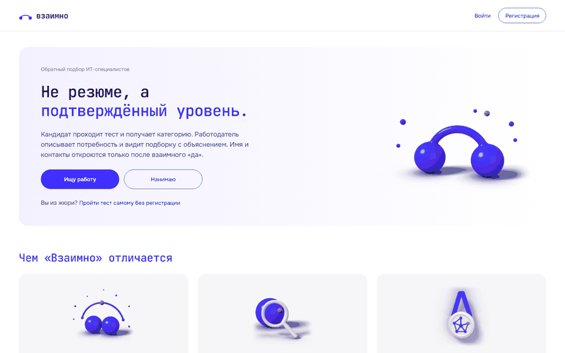
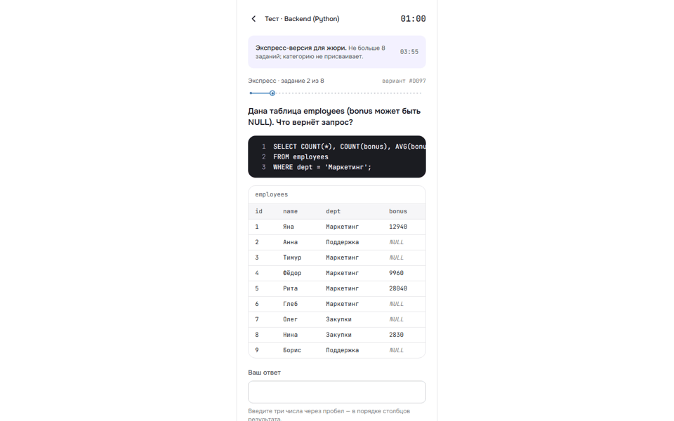
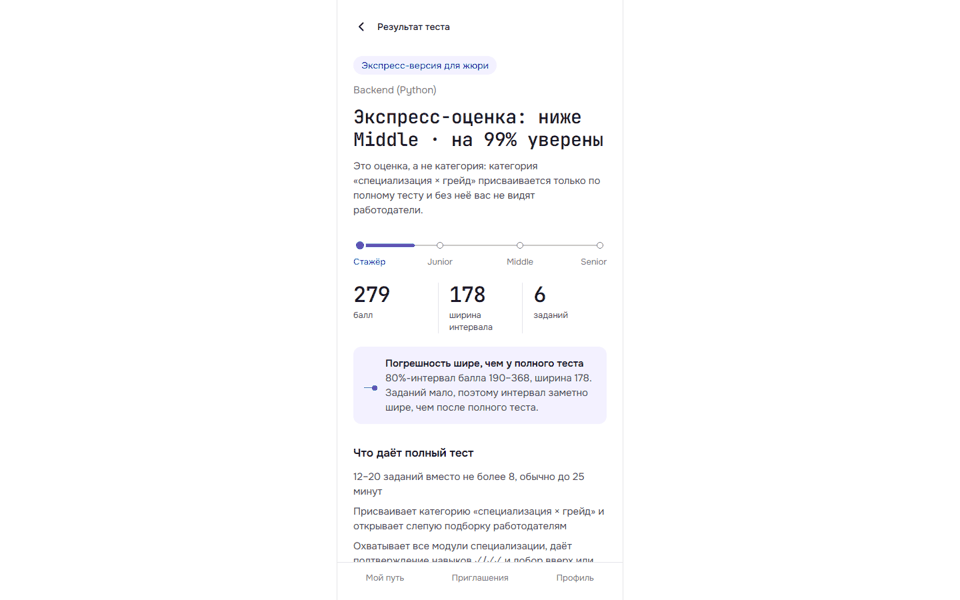
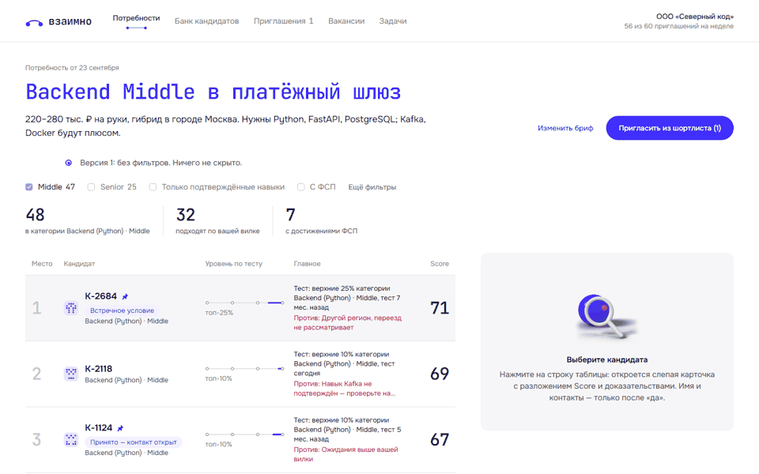
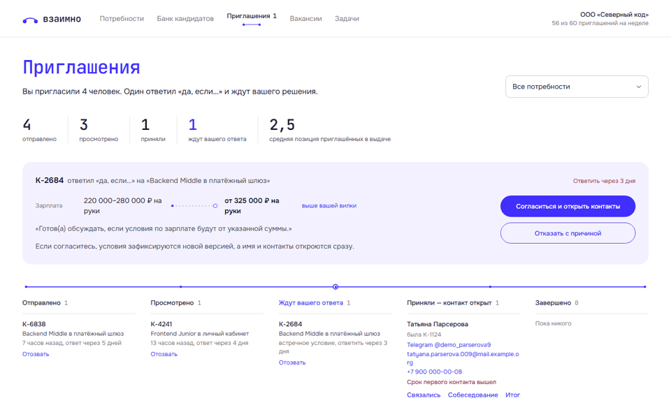
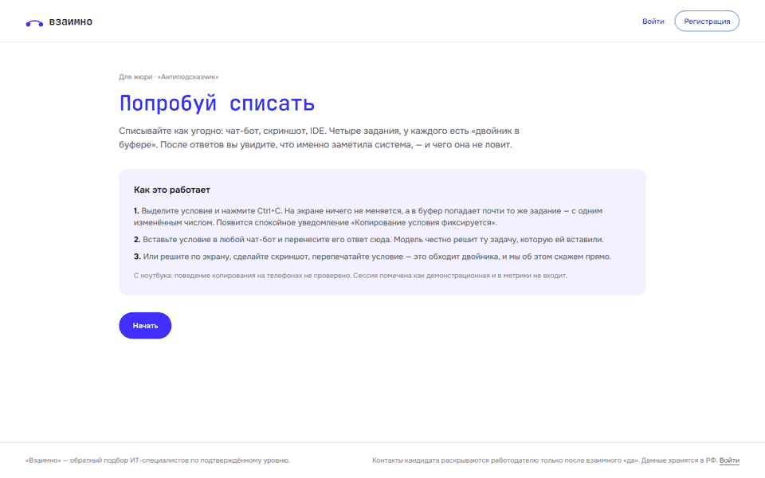

# «Взаимно» — обратный подбор ИТ-специалистов

**Работодатель описывает потребность текстом с вилкой, а не листает резюме: «Взаимно» строит слепую объяснимую подборку по подтверждённому тестом уровню, и контакты открываются только после взаимного «да».**

Хакатон ЛЦТ-2026, спецтрек ФСП. Кандидат проходит опрос и адаптивный тест на одноразовых заданиях и получает категорию «специализация × грейд» (Backend Python, Frontend JS/TS, QA, DevOps); работодатель получает подборку, где каждый довод ссылается на доказательство. Резюме и самоописание на категорию и ранг не влияют; отсутствие истории ФСП — не штраф. LLM в тесте и ранжировании не участвует.

[](https://github.com/<owner>/<repo>/actions/workflows/ci.yml)
[](LICENSE)
[](docs/README.md)
[](docs/pdf/)



## Чем отличается

| | Что сделано | Чем подтверждено |
|---|---|---|
| **Уровень подтверждён тестом, а не резюме** | Адаптивный тест (IRT/CAT): 8–20 заданий, в среднем 12,8; каждое задание — одноразовый клон семейства, ключ считается исполнением кода; «двойник в буфере» подменяет условие, скопированное в чат-бот | Симуляция утечки (коалиция из 20 кандидатов, худшая стратегия): ложный Middle у явных Junior 0,10 против 1,00 у фиксированной формы теста ([VALIDATION.md](docs/VALIDATION.md)) |
| **Объяснимый слепой подбор** | `Score = 100 · G · Cov · Cond · Σ(w·x)`; в карточке «3 за и 1 против», сумма вкладов равна Score; подборка — неизменяемые версии, фильтры скрывают, а не удаляют | P@10 0,66 против 0,52 у сортировки по уровню на 40 брифах (разница значима, 95 % ДИ [0,04; 0,24]); на 20 test-брифах 0,61 против 0,47, значимости нет — это сказано в отчёте |
| **Честность к кандидату** | Контакты и ПДн — только после взаимного «да» и отдельного согласия (152-ФЗ); без истории ФСП F = 0 и в «против» не попадает | Отсутствие ФСП никогда не «против» — 1,00; экспозиция кандидатов без ФСП в топ-10 — 0,93 от ожидаемой (допуск 0,80–1,25) |

Результаты валидации — симуляция на синтетической популяции с известной истиной: она проверяет процедуру, а не реальных людей. Выполнено 33 из 41 пороговых пунктов; невыполненные (в том числе точный грейд 0,748 при цели 0,75) показаны там же.

| Тесты | Валидация | Нагрузка |
|---|---|---|
| 2276 тестов бэкенда проходят (`make test`), CI: линт, `mypy --strict` на ядрах, e2e Playwright ([ENGINEERING.md](docs/ENGINEERING.md)) | 33 из 41 порога, P@10 0,66 против 0,52; с заданиями на навыки 0,71 (`make validate`) | 100 пользователей: 0 сбоев, p95 170 мс ([LOAD_TEST.md](docs/LOAD_TEST.md)) |

### Что ещё есть

| Возможность | Коротко | Документ |
|---|---|---|
| Цифровой паспорт навыков | Результат теста и достижение ФСП в виде подписанного файла (W3C VC, Ed25519), проверка по QR и по файлу, отзыв; издатель демонстрационный | [CREDENTIALS.md](docs/CREDENTIALS.md) |
| «Сигнал интереса» | Кандидат отмечает компанию (2 сигнала за 30 дней); работодатель видит бейдж только у карточек, которые уже открыл; в Score не входит | [MATCHING.md](docs/MATCHING.md) п. 9 |
| Симуляция рынка | Квоты приглашений и лимиты выбраны прогоном синтетического рынка, границы механизма показаны | [MATCHING.md](docs/MATCHING.md) п. 9.1 |
| Задания на навыки в проверочном наборе вакансии | PostgreSQL, FastAPI, Redis, очереди: 11 семейств с ключом-исполнением; P@10 +0,048 [+0,017; +0,082] | [MATCHING.md](docs/MATCHING.md) |
| Открытые данные рынка | Словарь навыков и рыночная вилка из открытых данных Trudvsem, без ПДн | [MATCHING.md](docs/MATCHING.md) п. 13 |
| Качество заданий | DIF по Мантелю–Хензелю, дрейф сложности, экспозиция; экран «Лаборатория → Качество» | [TESTING_MECHANISM.md](docs/TESTING_MECHANISM.md) п. 16 |
| Панель ФСП «Кадровый резерв» | Воронка от соревнований до найма; только агрегаты, k-анонимность не меньше 5 | [FSP_INTEGRATION.md](docs/FSP_INTEGRATION.md) п. 11 |
| Вход через ФСП ID | OIDC + PKCE, достижения из реестра, VSS; без истории ФСП кандидат не штрафуется | [FSP_INTEGRATION.md](docs/FSP_INTEGRATION.md) |
| Доверие и безопасность | «Проверенная компания», жалобы, кандидаты 15–17 лет с согласием представителя | [TRUST_AND_SAFETY.md](docs/TRUST_AND_SAFETY.md), [SECURITY.md](docs/SECURITY.md) |
| ATS и чат | Pull-API, вебхуки, адаптер «Хантфлоу»; чат после взаимного «да» | [ATS_INTEGRATION.md](docs/ATS_INTEGRATION.md) |
| Вакансия без брифа | «Создать вакансию» сразу, без предварительного брифа; банк кандидатов без брифа | [MATCHING.md](docs/MATCHING.md) п. 11 |
| Инженерия и доступность | CI GitHub Actions, e2e, типы, аудит зависимостей; axe: 0 serious и critical | [ENGINEERING.md](docs/ENGINEERING.md), [ACCESSIBILITY.md](docs/ACCESSIBILITY.md) |

## Как это выглядит

| | |
|---|---|
|  |  |
| Задание адаптивного теста | Результат: интервал уровня и честное «грейд не определён точно» |
|  |  |
| Подборка: Score, «за» и «против» по каждому кандидату | Воронка приглашений: «Да, если…» и раскрытие контактов |
|  | |
| Песочница жюри «Попробуй списать» | |

## Проверить за 10 минут

```bash
git clone <репозиторий> vzaimno && cd vzaimno
docker compose up -d --build                                   # 1–3 мин; пул заданий догенерируется в фоне (≈ 2,5 мин)
docker compose exec -T backend python scripts/seed_demo.py     # демо-мир, или: make demo
```

1. Откройте **http://localhost/jury** (регистрация не нужна): одна кнопка создаёт одноразового кандидата.
2. **Экспресс-тест** (до 8 заданий, ≈ 4 минуты) на том же движке и банке; при недостатке точности система честно пишет «грейд не определён точно».
3. **«Попробовать списать»**: скопируйте условие в ИИ и убедитесь, что в буфер попало условие-двойник, а на экране истинное.
4. Войдите демо-работодателем (кнопка на `/jury`), опишите потребность текстом, откройте подборку и панель доказательств.
5. **Свои данные:** `make jury-check PROFILES=backend/eval/jury_profiles_example.jsonl` прогоняет ваши профили и брифы; администратор может загрузить пары «бриф × кандидат» через `/api/admin/import`.
6. **Паспорт навыков:** в профиле кандидата — «Паспорт навыков»: выпустите, скачайте файл, измените в нём один байт и загрузите на `/v/…`: подпись не совпадёт.
7. **Сигнал интереса:** кандидат отправляет сигнал из карточки вакансии; работодатель увидит бейдж только у кандидата, чью карточку откроет.
8. **Панель ФСП:** на `/jury` кнопка «Панель ФСП» (`/fsp/reserve`), агрегаты с k-анонимностью.
9. Воспроизвести цифры: `make validate` (≈ 6 минут), `make loadtest USERS=100 RUNTIME=3m`.

Подробнее — «Быстрый старт» и «Проверьте сами за 5 минут» ниже, [DEPLOY.md](docs/DEPLOY.md) и [памятка жюри](docs/README.md#1-памятка-для-жюри).

## Требования организаторов → документы

| № | Требование | Документ | PDF |
|---|---|---|---|
| 1 | Архитектура | [ARCHITECTURE.md](docs/ARCHITECTURE.md) | [PDF](<docs/pdf/01 Архитектура.pdf>) |
| 2 | Механика тестирования | [TESTING_MECHANISM.md](docs/TESTING_MECHANISM.md) | [PDF](<docs/pdf/02 Механика тестирования.pdf>) |
| 3 | Механика подбора и категоризация | [MATCHING.md](docs/MATCHING.md) | [PDF](<docs/pdf/03 Механика подбора и категоризации.pdf>) |
| 4 | Процедура валидации и результаты | [VALIDATION_PLAN.md](docs/VALIDATION_PLAN.md), [VALIDATION.md](docs/VALIDATION.md) | [протокол](<docs/pdf/04.1 Валидация — протокол.pdf>), [результаты](<docs/pdf/04.2 Валидация — результаты.pdf>) |
| 5 | Интеграция с ФСП и ФСП ID | [FSP_INTEGRATION.md](docs/FSP_INTEGRATION.md) | [PDF](<docs/pdf/05 Интеграция с ФСП и ФСП ID.pdf>) |
| 6 | Описание API | [API.md](docs/API.md), Swagger UI `/api/docs`, ReDoc `/api/redoc` | [PDF](<docs/pdf/06 Описание API.pdf>) |
| 7 | Библиотеки с версиями | [THIRD_PARTY.md](docs/THIRD_PARTY.md) | [PDF](<docs/pdf/07 Библиотеки и версии.pdf>) |
| 8 | Сборка и запуск | [DEPLOY.md](docs/DEPLOY.md) и «Быстрый старт» ниже | [PDF](<docs/pdf/08 Сборка и запуск.pdf>) |
| + | ATS · доверие и безопасность · 152-ФЗ · LLM · нагрузка · паспорт навыков · инженерия · доступность | [ATS_INTEGRATION.md](docs/ATS_INTEGRATION.md), [TRUST_AND_SAFETY.md](docs/TRUST_AND_SAFETY.md), [SECURITY.md](docs/SECURITY.md), [LLM.md](docs/LLM.md), [LOAD_TEST.md](docs/LOAD_TEST.md), [CREDENTIALS.md](docs/CREDENTIALS.md), [ENGINEERING.md](docs/ENGINEERING.md), [ACCESSIBILITY.md](docs/ACCESSIBILITY.md) | [14](<docs/pdf/14 Цифровой паспорт навыков.pdf>), [15](<docs/pdf/15 Инженерные практики.pdf>), [16](<docs/pdf/16 Доступность и адаптивность.pdf>) |
| ← | Требование задачи → где реализовано → как проверить | [REQUIREMENTS.md](docs/REQUIREMENTS.md) | [PDF](<docs/pdf/00.1 Требования задачи и где они реализованы.pdf>) |

Всё одним файлом: [Взаимно — документация.pdf](<docs/pdf/Взаимно — документация.pdf>).

## Технологии

| Слой | Стек |
|---|---|
| Бэкенд | Python 3.12, FastAPI 0.142, SQLAlchemy 2.1, Alembic, Pydantic 2.13; движки теста и подбора на NumPy 2.5 без БД и HTTP |
| Данные | PostgreSQL 16 + pgvector 0.8 |
| Фронтенд | React 18, Vite 7, TypeScript 5.9, Tailwind 3.4, TanStack Query, типы API из OpenAPI |
| Интеграции | Keycloak 26 (ФСП ID, OIDC + PKCE), мок реестра ФСП, вебхуки и pull-API для ATS |
| Развёртывание | Docker Compose, nginx, Caddy (прод, HTTPS) |
| Тест и нагрузка | pytest, ruff, mypy, Playwright (e2e, axe), Locust, GitHub Actions |

Полный список с версиями и лицензиями — [THIRD_PARTY.md](docs/THIRD_PARTY.md).

## Лицензия

Код проекта распространяется по лицензии MIT — файл [LICENSE](LICENSE), © 2026 Команда «Два байта».

## Архитектура

```
 Браузер (React + Vite + TS)  ──────────────►  FastAPI  /api/*   (backend/app)
   кандидат · работодатель · лаборатория           │
                                                   ├─ testing   IRT/CAT-движок, банк семейств заданий, «Антиподсказчик»
   Mailpit :8025 ◄── письма с кодами ──────────────├─ matching  разбор брифа, Score, объяснения, версии подборки
                                                   ├─ contact   приглашения, «Да, если…», раскрытие, отклики, вебхуки ATS
   fsp-mock :8001 ◄── реестр достижений ───────────├─ fsp       VSS, адаптер FSPProvider, вход через ФСП ID (Keycloak)
   Keycloak :8080 (профиль fsp) ◄── OIDC ──────────├─ demo      seed, сброс, автоответчик, часы, режим жюри (DEMO_MODE)
                                                   └─ admin     импорт жюри, ранжирование, метрики пар, валидация
                                                   │
                                          PostgreSQL 16 + pgvector      config/*.yaml — все веса, пороги, квоты
```

- `backend/app` — HTTP-слой (`api/`), сервисы (`services/`), движки без БД (`testing/`, `matching/`, `contact/`, `fsp/`), ORM (`models/`).
- `backend/eval` — генератор синтетической популяции с латентной истиной и `make validate` (тот же код движков, что в проде).
- `services/fsp-mock` — мок реестра ФСП; `deploy/keycloak` — realm `fsp`; `frontend/` — интерфейс.

## Быстрый старт — всё в контейнерах (для жюри)

Нужен только Docker (Compose v2.17+): ни Python, ни Node.js на машине не требуются. Проверено на чистом состоянии (отдельный проект compose).

```bash
git clone <репозиторий> vzaimno && cd vzaimno
docker compose up -d --build                                   # или: make up
docker compose exec -T backend python scripts/seed_demo.py     # демо-мир, или: make demo
```

1. `up --build` собирает образы (backend, web, fsp-mock) и поднимает `db`, `mailpit`, `fsp-mock`, `backend` (миграции Alembic при старте),
   `web` (nginx: интерфейс и прокси `/api`) и одноразовую задачу `pool` (пул заданий теста, ≈ 2,5 минуты: `docker compose logs -f pool`).
   Сборка с тёплым кэшем образов ≈ 1 минута.
2. `seed_demo.py` наполняет демо-мир (≈ 1 минута; ждите конца `pool`: `make demo` ждёт сам).
3. Откройте **http://localhost** (порт — `VZ_WEB_PORT`, по умолчанию 80). API: http://localhost/api/docs, письма с кодами: http://localhost:8025.
4. Логины и пароли демо-аккаунтов: `docker compose exec -T backend cat var/demo_accounts.md` (или `make creds`; пароли выводятся из `VZ_APP_SECRET`).

Сервисы перезапускаются сами (`restart: unless-stopped`), у всех есть healthcheck: `docker compose ps`. Число процессов бэкенда — `VZ_WORKERS`
(по умолчанию 4; на слабом ноутбуке `VZ_WORKERS=1`). Подробности, ресурсы, боевая схема — [docs/DEPLOY.md](docs/DEPLOY.md); нагрузка — [docs/LOAD_TEST.md](docs/LOAD_TEST.md).

Разработка с бэкендом на хосте (нужны [uv](https://docs.astral.sh/uv/), Node.js; контейнер `backend` не поднимайте — порт 8000 занят uvicorn):

```bash
make up-infra        # PostgreSQL, Mailpit, мок реестра ФСП
make migrate seed    # схема БД + демо-мир (первый раз ≈ 5–8 минут)
make dev             # бэкенд в DEMO_MODE: http://localhost:8000/api/docs
cd frontend && npm install && npm run dev      # http://localhost:5173
```

Пароли демо-аккаунтов при запуске с хоста — в `backend/var/demo_accounts.md` (создаёт `make seed`, в git не попадает; в консоль не печатаются).

## Проверьте сами за 5 минут

**Жюри без регистрации: откройте `/jury`** (только DEMO_MODE; на главной появляется ссылка «Вы из жюри?»). Одна кнопка — одноразовый
кандидат с готовым опросом и начатым тестом: **экспресс** (до 8 заданий, ≈ 4 минуты, тот же движок и банк; категорию не присваивает,
при недостатке точности честно пишет «грейд не определён точно, нужен полный тест») или **полный**. Рядом — «Попробовать списать»,
вход в демо-компанию и в лабораторию без пароля, инструкция проверки на своих профилях. Сессии помечены `demo_assisted` и в калибровку
и метрики не попадают. Регистрация в DEMO_MODE не требует кода из письма (`VZ_DEMO_AUTO_VERIFY_EMAIL=false` вернёт код).

Все компании, люди и контакты вымышленные. Логины без паролей отдаёт `GET /api/demo/accounts`, пароли лежат в
`backend/var/demo_accounts.md`. Письма с кодами подтверждения — в Mailpit: http://localhost:8025.

| Роль | Логин | Что посмотреть |
|---|---|---|
| Администратор | `admin@demo.example.com` | `/api/admin/*`: импорт ваших кандидатов и брифов, ранжирование, метрики по размеченным парам |
| Жюри (методист) | `jury@demo.example.com` | Лаборатория `/api/lab/*`: трасса каждой сессии теста, банк семейств, флаги, валидация |
| Работодатель «Северный код» | `hr@severny-kod.example` | Бриф «платёжный шлюз», версии подборки, шортлист, канбан приглашений, вакансии |
| Анна (кандидат) | `anna@demo.example.com` | Backend Middle, призёр ФСП, тест на 12-м задании: два верных ответа — «Middle подтверждён» |
| Илья (кандидат) | `ilya@demo.example.com` | Backend Middle без ФСП, SQL не подтверждён: отклик на вакансию, задача на 10 минут |
| Ступенчатые кандидаты | `stage1-registered@…`, `stage2-survey@…`, `stage3-midtest@…`, `stage4-category@…` | Войти на любом шаге пути: только зарегистрирован / опрос пройден / середина теста / с категорией |
| Мария | `maria@demo.example.com` | Не создана заранее: зарегистрируйтесь сами, код придёт в Mailpit |

Сквозной путь за пять минут:

1. **Свой бриф.** Войдите как `hr@severny-kod.example`, опишите потребность: «Бэкенд в команду платёжного шлюза. Python, FastAPI,
   PostgreSQL, опыт от 2 лет. Kafka и Docker будут плюсом. Гибрид, Москва. 220–280 тыс. на руки» → чипы с цитатами, категории и охват
   вилки, подборка v1, закрепите троих (среди них Анна) и пригласите.
2. **Ответ кандидата.** Анна («Да, если: от 270 000 и удалёнка») или любой из ~300 синтетических кандидатов: на приглашения жюри
   автоответчик отвечает за 30–90 секунд — «Да», «Да, если: от min» или «Нет» с причиной.
3. **Взаимное «да».** Работодатель принимает встречное условие — у обеих сторон раскрываются контакты и запись о согласии.
4. **Время.** `POST /api/demo/clock` с `{"preset": "plus_3d"}` («+1 день / +3 дня / сброс»): сроки приглашений и откликов идут вперёд.
5. **Свои данные.** Администратор загружает ваш набор «бриф × кандидат» (формат — `backend/eval/pairs_test.jsonl`, схема
   `backend/eval/pairs_test.schema.json`):

   ```bash
   # 1. войти и получить токен: POST /api/auth/login  → access_token
   # 2. импорт; кандидаты без теста попадут в группу «категория по опросу, не подтверждена» и окажутся ниже подтверждённых
   curl -X POST http://localhost:8000/api/admin/import -H "Authorization: Bearer $TOKEN" -H "Content-Type: application/json" \
        -d "{\"name\": \"жюри\", \"pairs\": $(python -c "import json;print(json.dumps([json.loads(l) for l in open('backend/eval/pairs_test.jsonl',encoding='utf-8')][:300]))")}"
   # 3. топ-N по брифу с компонентами Score и «за/против» (JSON или ?format=csv)
   curl -X POST "http://localhost:8000/api/admin/eval/rank?format=csv" -H "Authorization: Bearer $TOKEN" \
        -H "Content-Type: application/json" -d '{"brief_id": "b01", "top": 10}'
   # 4. P@5, P@10, nDCG@10 со средним по брифам и 95% бутстреп-ДИ
   curl -X POST http://localhost:8000/api/admin/eval/pairs -H "Authorization: Bearer $TOKEN" -H "Content-Type: application/json" -d '{}'
   ```

   Тот же набор проверяется воспроизводимо: `make validate` пишет `backend/eval/out/validation.json` и `docs/VALIDATION.md`;
   `GET /api/admin/validation` отдаёт последний прогон.

Что ещё есть в DEMO_MODE (все маршруты `/api/demo/*` отвечают 404, пока он выключен):

- `POST /api/demo/reset` — быстрый сброс к состоянию seed (≈ 30 секунд): персоны, приглашения, отклики, часы; «Мария» удаляется.
  Перед показом — `make reset-demo`. Режим жюри при сбросе сохраняет своё значение.
- `POST /api/demo/jury-mode` — «режим жюри»: к текущему заданию доступна подсказка `GET /api/demo/jury/hint`; такие сессии
  помечены `demo_assisted` и исключены из метрик. Так жюри в роли кандидата не застревает на тесте.
- Общие кнопки (часы, сброс, автоответчик, переключатель режима жюри) на локальном стенде доступны любой роли; на боевом
  стенде (`VZ_ENV=prod` с `VZ_DEMO_MODE=true`) — только `admin` (`admin@demo.example.com`) или заголовку `X-Demo-Key`
  (`VZ_DEMO_CONTROL_KEY`). Подсказка кандидату в режиме жюри остаётся доступной владельцу сессии.
- `GET /api/demo/webhook-sink` — последние 20 вебхуков ATS. Укажите в профиле компании
  `https://ats.vzaimno-demo.example/api/demo/webhook-sink` — и события будут видны сразу, с проверкой подписи.

## Документация API

- Swagger UI: http://localhost:8000/api/docs
- ReDoc: http://localhost:8000/api/redoc
- OpenAPI: http://localhost:8000/api/openapi.json

## Документы

Карта и памятка жюри — [docs/README.md](docs/README.md); PDF — [docs/pdf/](docs/pdf/) (пересборка `make docs-pdf`).

| Файл | О чём |
|---|---|
| [docs/ARCHITECTURE.md](docs/ARCHITECTURE.md) | устройство системы, контейнеры, данные, сценарии |
| [docs/API.md](docs/API.md) | HTTP-API: 234 эндпоинта |
| [docs/TESTING_MECHANISM.md](docs/TESTING_MECHANISM.md) | адаптивный тест, одноразовые клоны, «Антиподсказчик» |
| [docs/MATCHING.md](docs/MATCHING.md) | разбор брифа, формула Score, объяснения |
| [docs/FSP_INTEGRATION.md](docs/FSP_INTEGRATION.md) | достижения ФСП, VSS, вход через ФСП ID |
| [docs/ATS_INTEGRATION.md](docs/ATS_INTEGRATION.md) | интеграция с ATS работодателя |
| [docs/TRUST_AND_SAFETY.md](docs/TRUST_AND_SAFETY.md) | «Проверенная компания», жалобы, модерация |
| [docs/SECURITY.md](docs/SECURITY.md) | модель угроз, приватность, 152-ФЗ |
| [docs/LLM.md](docs/LLM.md) | где и как используется LLM |
| [docs/VALIDATION_PLAN.md](docs/VALIDATION_PLAN.md), [docs/VALIDATION.md](docs/VALIDATION.md) | протокол валидации и её результаты |
| [docs/LOAD_TEST.md](docs/LOAD_TEST.md) | нагрузочное тестирование |
| [docs/CREDENTIALS.md](docs/CREDENTIALS.md) | цифровой паспорт навыков |
| [docs/ENGINEERING.md](docs/ENGINEERING.md), [docs/ACCESSIBILITY.md](docs/ACCESSIBILITY.md) | CI, тесты, типы, безопасность; доступность |
| [docs/REQUIREMENTS.md](docs/REQUIREMENTS.md) | требования задачи и где они реализованы |
| [docs/THIRD_PARTY.md](docs/THIRD_PARTY.md), [docs/DEPLOY.md](docs/DEPLOY.md) | библиотеки и версии; сборка и запуск |
| [services/fsp-mock/README.md](services/fsp-mock/README.md) | мок реестра ФСП |
| [deploy/keycloak/README.md](deploy/keycloak/README.md) | realm `fsp` (ФСП ID) |
| `config/*.yaml` | все веса, пороги, квоты и справочники; демо-мир — `config/demo.yaml` |

## Команды

| Команда | Что делает |
|---|---|
| `make up` / `make down` | поднять / остановить PostgreSQL, Mailpit, fsp-mock |
| `make migrate` | миграции Alembic |
| `make gen-pool` | пул одноразовых экземпляров заданий (`seed` доливает его сам) |
| `make seed` | демо-мир; идемпотентно, повторный запуск пропускает созданное (`--force` пересобирает сценарий) |
| `make reset-demo` | быстрый сброс демо к состоянию seed |
| `make demo-accounts` | пересоздать файл с логинами и паролями |
| `make test` / `make lint` | `pytest -q` и `ruff check .` |
| `make validate` | симуляция и подбор → `docs/VALIDATION.md` |
| `make dev` | бэкенд с автоперезагрузкой в DEMO_MODE |

### Команды без make (Windows, PowerShell)

```powershell
docker compose up -d db mailpit fsp-mock                       # make up-infra
cd backend
uv run alembic upgrade head                                    # make migrate
uv run python scripts/generate_pool.py                         # make gen-pool
$env:PYTHONUTF8 = "1"; uv run python scripts/seed_demo.py      # make seed
uv run python scripts/seed_demo.py --reset                     # make reset-demo
uv run python scripts/seed_demo.py --credentials-only          # make demo-accounts
uv run pytest -q                                               # make test
uv run ruff check .                                            # make lint
uv run python -m eval.validate                                 # make validate
$env:VZ_DEMO_MODE = "true"; uv run uvicorn app.main:app --reload --port 8000   # make dev
```

Целиком в контейнерах: `docker compose up -d --build`, затем `docker compose exec -T backend python scripts/seed_demo.py` (раздел «Быстрый старт»). Переменные окружения `VZ_*` описаны в `.env.example`.
