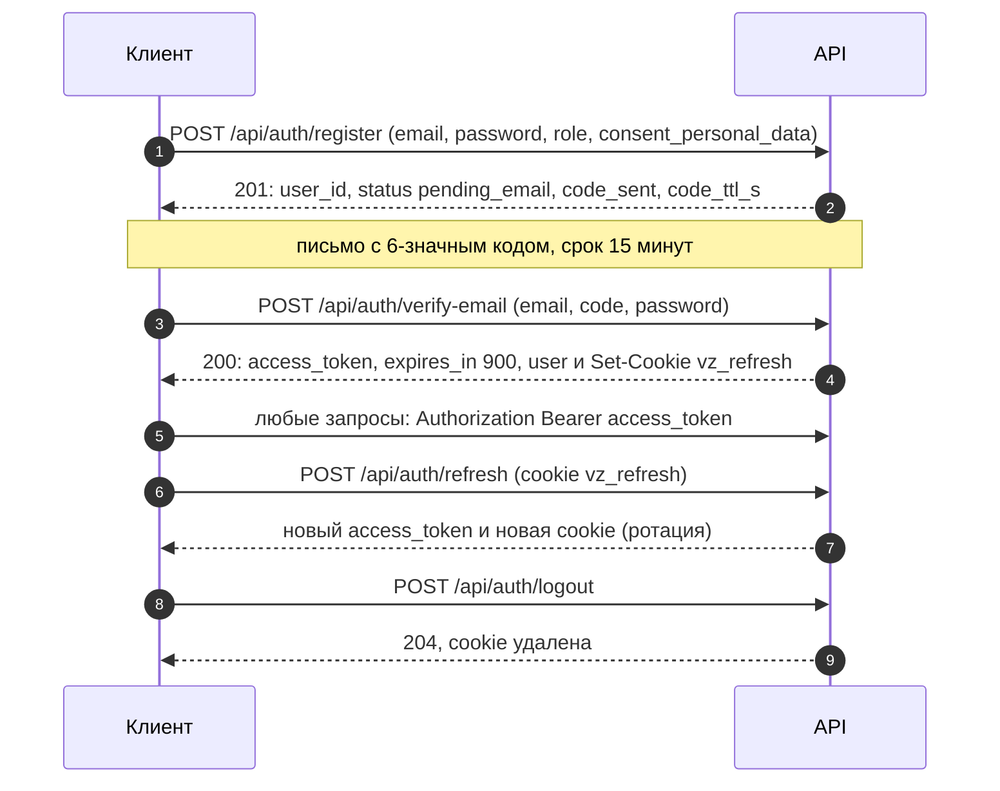

# API «Взаимно»: обзор

REST/JSON-API бэкенда. Исчерпывающее описание (поля, схемы, примеры ошибок) — в интерактивной документации и в `openapi.json`; этот документ объясняет, как с API работать: аутентификация, формат ошибок, разделы и сквозные соглашения. Названия эндпоинтов и полей сверены с OpenAPI, сформированным из кода (`app.main:app`, версия API `0.1.0`).

Содержание: [1. Документация и схема](#1-документация-и-схема) · [2. Аутентификация](#2-аутентификация) · [3. Формат ошибок](#3-формат-ошибок-и-коды) · [4. Ограничение частоты](#4-ограничение-частоты-запросов) · [5. Разделы](#5-разделы-и-эндпоинты) · [6. Соглашения](#6-сквозные-соглашения) · [7. Примеры](#7-примеры-сценарии-curl) · [8. Статус](#8-в-разработке)

## 1. Документация и схема

| Что | Адрес |
|---|---|
| Swagger UI (интерактивно, «Authorize» принимает access-токен) | `/api/docs` |
| ReDoc | `/api/redoc` |
| Схема OpenAPI 3.1 (JSON) | `/api/openapi.json` |
| Готовность и жизнь процесса | `/api/health`, `/api/health/live` |

Все пути — под префиксом `/api`. Локально бэкенд слушает `http://localhost:8000` (`docker compose up -d`), фронтенд в разработке проксирует `/api` на него (Vite, порт 5173).

**Как получить `openapi.json`:**

```bash
# 1. С запущенного сервера
curl -s http://localhost:8000/api/openapi.json -o openapi.json

# 2. Без сервера и базы данных (схема строится из кода)
cd backend
uv run python -c "import json; from app.main import app; print(json.dumps(app.openapi(), ensure_ascii=False, indent=1))" > openapi.json

# 3. Типы TypeScript для фронтенда (из запущенного бэкенда или из файла)
cd frontend
npm run gen:api
OPENAPI_FILE=../backend/openapi.json npm run gen:api
```

Примечание: страницы `/api/docs` и `/api/redoc` работают без интернета: скрипты и стили Swagger UI (Apache-2.0) и ReDoc (MIT) лежат в `backend/app/static/docs` и отдаются самим бэкендом по `/api/docs-assets/*`; внешних CDN и шрифтов Google нет.

Документация реестра ФСП (предлагаемый контракт) — отдельный OpenAPI сервиса `fsp-mock` (`http://localhost:8001/docs`), см. [FSP_INTEGRATION.md](FSP_INTEGRATION.md).

## 2. Аутентификация

Своя аутентификация в FastAPI: email и пароль с подтверждением кодом из письма, JWT-доступ и refresh-токен в httpOnly-cookie. Роли: `candidate` («Ищу работу»), `employer` («Нанимаю»), `methodist`, `admin`. Самостоятельно регистрируются только первые две; методист и администратор создаются из БД или сидом.



| Элемент | Правила |
|---|---|
| Регистрация | `POST /api/auth/register`: `email`, `password`, `role` (`candidate` или `employer`), `consent_personal_data` (обязательно `true`), необязательно `consent_text_version`. Аккаунт создаётся в статусе `pending_email`; согласие на обработку ПДн пишется в журнал отдельной записью с версией текста. Повтор для неподтверждённого email обновляет пароль и роль и отправляет новый код |
| Требования к паролю | 8–128 символов, хотя бы одна буква и одна цифра. Хранится как argon2id |
| Код из письма | 6 цифр, действует 15 минут; повторная отправка не раньше чем через 60 с и не больше 5 писем в час; на один код — 5 неверных попыток |
| Подтверждение | `POST /api/auth/verify-email` принимает код **и пароль** из регистрации (код доказывает владение ящиком, пароль — что активирует тот, кто задал аккаунт). После успеха создаются профиль кандидата или компания работодателя (по домену почты; личные домены — своя компания с пометкой «личный email»), выдаются токены |
| Access-токен | JWT HS256, срок 15 минут (`expires_in: 900`); claims `sub` (id пользователя), `role`, `type: access`, `iss: vzaimno`, `iat`, `exp`, `jti`. Передаётся `Authorization: Bearer <токен>`; клиент держит его в памяти. Роль и статус аккаунта сервер проверяет **по БД**, а не по токену: блокировка и смена роли действуют сразу |
| Refresh-токен | Случайные 256 бит в cookie `vz_refresh` (httpOnly, `Path=/api/auth`, `SameSite=Lax`, `Secure` в проде), срок 30 дней. В БД хранится только sha256. Каждый `POST /api/auth/refresh` выдаёт новый токен той же цепочки, старый помечается использованным; повторное предъявление использованного токена = подозрение на кражу: цепочка завершается (`401 refresh_reused`). Повтор в пределах 10 секунд — гонка вкладок (`409 refresh_superseded`, цепочка жива) |
| Вход | `POST /api/auth/login`; ответ одинаков для неизвестного email и неверного пароля (`401 invalid_credentials`); `403 email_not_verified` — нужно ввести код; `403 account_blocked` |
| Восстановление пароля | `POST /api/auth/password-reset/request` (ответ не выдаёт, есть ли аккаунт) и `…/confirm` (код + новый пароль; все прежние сессии завершаются) |
| Вход через ФСП ID | `GET /api/fsp/login`, `GET /api/fsp/callback` (адрес возврата из ФСП ID — страница фронтенда `/candidate/fsp/callback`; переход браузера на `GET /api/fsp/callback` отвечает 303 на неё), демо-вход — раздел «ФСП» |
| Ответы `/api/auth/*` | Заголовок `Cache-Control: no-store` |

## 3. Формат ошибок и коды

Любая ошибка возвращается в одном формате с русским текстом для пользователя:

```json
{
  "code": "invalid_credentials",
  "message": "Неверный email или пароль",
  "details": null
}
```

`code` — стабильный машинный код (`snake_case`), по нему клиент выбирает экран; `message` — готовая фраза; `details` — подробности (объект или список), например:

- `422 validation_error`: `details` — список `{"field": "password", "message": "Минимум 8 символов", "type": "string_too_short"}`;
- `429`: `details.retry_after_s`, заголовок `Retry-After`;
- `409` от машины состояний контакта: `contact_rejected`, `details.reason` и списки `errors`, `warnings`, `notes` с кодами правил;
- ошибки правил теста: `details.available_at` — когда действие станет доступно.

Необработанное исключение — `500 internal_error` в том же формате (тело читается браузером благодаря CORS-заголовкам).

| HTTP | Смысл | Типичные коды |
|---|---|---|
| 400 | Некорректный запрос, нарушено правило формы | `code_invalid`, `code_expired`, `code_attempts_exceeded`, `consent_required`, `salary_invalid`, `salary_required`, `grade_required`, `unknown_specialization`, `derived_specialization`, `contact_invalid`, `fsp_state_invalid`, `fsp_state_mismatch`, `fsp_email_missing`, `role_not_allowed` |
| 401 | Нет входа или токен недействителен | `not_authenticated`, `token_invalid`, `token_expired`, `invalid_credentials`, `refresh_missing`, `refresh_invalid`, `refresh_expired`, `refresh_reused`. Заголовок `WWW-Authenticate: Bearer` |
| 403 | Недостаточно прав | `role_forbidden` (в `details` — требуемые роли), `account_blocked`, `email_not_verified`, `fsp_demo_disabled`, `fsp_state_foreign` |
| 404 | Не найдено **или чужое** (запись другого пользователя неотличима от несуществующей, чтобы нельзя было перебирать идентификаторы) | `not_found`, `need_not_found`, `invitation_not_found`, `session_not_found`, `candidate_not_found`, `profile_not_disclosed` |
| 409 | Конфликт состояния и бизнес-правил | `email_taken`, `already_verified`, `consent_outdated`, `active_session_exists`, `survey_required`, `specialization_not_testable`, `extension_pending`, `contact_rejected`, `company_profile_incomplete`, `pair_active`, `shortlist_full`, `rollback_too_old`, `vacancy_exists`, `application_exists`, `refresh_superseded`, `fsp_id_taken`, `fsp_already_linked` |
| 413 | Слишком большой файл | `resume_too_large` (PDF до 5 МБ) |
| 422 | Ошибка валидации полей | `validation_error`, `brief_invalid`, `category_invalid`, `resume_empty` |
| 429 | Слишком часто | `rate_limited`, `resend_too_soon`, `resend_hourly_limit`; `Retry-After` в секундах |
| 501 | Раздел в разработке | `not_implemented` |
| 503 | Внешняя зависимость недоступна | `mail_unavailable`, `fsp_registry_unavailable`, `fsp_id_unavailable`, `task_unavailable` |

Полный список кодов раздела указан в описании соответствующего эндпоинта в Swagger UI.

## 4. Ограничение частоты запросов

Токен-корзина в памяти процесса (`N/секунд`): корзина вмещает `N` токенов и равномерно пополняется за период. Превышение — `429` с `Retry-After`. Лимиты безопасности настраиваются переменными `VZ_RL_*` (`.env.example`), лимиты разделов — в коде и конфигах.

| Область | Лимит | Ключ |
|---|---|---|
| Вход | 5 за 300 с по email; 30 за 300 с по IP | email, IP |
| Регистрация | 10 в час | IP |
| Ввод кода (подтверждение email, новый пароль) | 10 за 900 с | email |
| Повторная отправка кода, запрос восстановления | 20 в час | IP |
| Обновление сессии | 60 в минуту | IP |
| Начало и завершение входа через ФСП ID, демо-вход | 30/300 с, 30/300 с, 20/300 с | IP |
| «Обновить достижения ФСП» | 6 за 600 с | аккаунт |
| Шаги опроса | 60 в минуту | аккаунт |
| Создание сессии теста | 10 в час | аккаунт |
| `next`, ответы, события теста | 120, 60, 120 в минуту | аккаунт |
| Оспорить флаг | 10 в час | аккаунт |
| Загрузка резюме | 10 в час | аккаунт |
| PDF-профиль, превью «так вас видят», поиск компаний для блок-листа | 30 за 600 с, 120 и 60 в минуту | аккаунт |
| Страница сверки PDF `/api/v/{code}` | 120 в минуту | IP |
| Ответы кандидата и действия работодателя с приглашениями и откликами; отклики; ответы на задачи; тест вебхука | 30, 10, 20 и 5 в минуту (`config/contact.yaml → http_limits`) | аккаунт или компания |
| Подбор (бриф, версии, банк) и отправка приглашений | 30 в минуту (`config/contact.yaml → quotas.rate_limit_per_minute`) | аккаунт |
| Калибровка (лаборатория) | 5 за 300 с | аккаунт |

Корзины живут в памяти процесса: при нескольких воркерах лимит действует на воркер (для продакшена их выносят в Redis или PostgreSQL).

## 5. Разделы и эндпоинты

Всего 169 эндпоинтов в 17 разделах. Колонка «Кто» — требуемая роль (`require_roles`); «любой вошедший» — любой авторизованный пользователь, «без входа» — публичный маршрут (`refresh` и `logout` опираются на cookie).

### Служебное

| Метод | Путь | Кто | Назначение |
|---|---|---|---|
| `GET` | `/api/health` | без входа | Готовность сервиса |
| `GET` | `/api/health/live` | без входа | Процесс жив |

### Аутентификация

| Метод | Путь | Кто | Назначение |
|---|---|---|---|
| `POST` | `/api/auth/register` | без входа | Регистрация по email |
| `POST` | `/api/auth/verify-email` | без входа | Подтверждение email кодом |
| `POST` | `/api/auth/resend-code` | без входа | Отправить код ещё раз |
| `POST` | `/api/auth/login` | без входа | Вход по email и паролю |
| `POST` | `/api/auth/password-reset/request` | без входа | Восстановление пароля: отправить код |
| `POST` | `/api/auth/password-reset/confirm` | без входа | Восстановление пароля: новый пароль по коду |
| `POST` | `/api/auth/refresh` | без входа | Обновить сессию |
| `POST` | `/api/auth/logout` | без входа | Выйти |
| `GET` | `/api/auth/me` | любой вошедший | Текущий пользователь |

### Согласия

| Метод | Путь | Кто | Назначение |
|---|---|---|---|
| `GET` | `/api/consents/documents` | без входа | Тексты согласий |
| `GET` | `/api/consents` | любой вошедший | Мой журнал согласий |
| `POST` | `/api/consents` | любой вошедший | Дать согласие |
| `POST` | `/api/consents/{consent_id}/revoke` | любой вошедший | Отозвать согласие |

### Опрос

| Метод | Путь | Кто | Назначение |
|---|---|---|---|
| `GET` | `/api/survey/form` | кандидат | Анкета опроса |
| `GET` | `/api/survey/current` | кандидат | Текущая анкета |
| `PUT` | `/api/survey/steps/industries` | кандидат | Шаг 1: отрасли |
| `PUT` | `/api/survey/steps/actions` | кандидат | Шаг 2: что делали руками |
| `PUT` | `/api/survey/steps/stack` | кандидат | Шаг 3: технологии и стаж |
| `POST` | `/api/survey/hint` | кандидат | Подсказка по специализации |
| `PUT` | `/api/survey/steps/specialization` | кандидат | Шаг 4: специализация |
| `GET` | `/api/survey/history` | кандидат | История опросов |

### Тестирование

| Метод | Путь | Кто | Назначение |
|---|---|---|---|
| `GET` | `/api/tests/briefing` | кандидат | Выбор грейда и брифинг |
| `POST` | `/api/tests/sessions` | кандидат | Начать тест |
| `GET` | `/api/tests/sessions/{session_id}` | кандидат | Состояние сессии |
| `GET` | `/api/tests/sessions/{session_id}/next` | кандидат | Текущее задание |
| `POST` | `/api/tests/sessions/{session_id}/answer` | кандидат | Ответить на задание |
| `POST` | `/api/tests/sessions/{session_id}/events` | кандидат | События страницы теста |
| `POST` | `/api/tests/sessions/{session_id}/extension` | кандидат | Добор вверх или вниз |
| `GET` | `/api/tests/sessions/{session_id}/result` | кандидат | Результат теста |
| `GET` | `/api/tests/sessions/{session_id}/review` | кандидат | Разбор ошибок |
| `GET` | `/api/tests/qualification` | кандидат | Мой грейд |
| `GET` | `/api/tests/qualification/{specialization}` | кандидат | Мой грейд по специализации |
| `POST` | `/api/tests/qualification/{specialization}/downgrade` | кандидат | Перейти на грейд ниже |
| `POST` | `/api/tests/flags/{flag_id}/dispute` | кандидат | Оспорить флаг |

### Кандидат

| Метод | Путь | Кто | Назначение |
|---|---|---|---|
| `GET` | `/api/candidates/me` | кандидат | Мой профиль |
| `PUT` | `/api/candidates/me` | кандидат | Сохранить профиль |
| `GET` | `/api/candidates/me/resume` | кандидат | Черновик распознанного резюме |
| `POST` | `/api/candidates/me/resume` | кандидат | Загрузить резюме (PDF) |
| `DELETE` | `/api/candidates/me/resume` | кандидат | Удалить резюме |
| `POST` | `/api/candidates/me/resume/confirm` | кандидат | Подтвердить поля из резюме |
| `GET` | `/api/candidates/me/profile.pdf` | кандидат | Скачать PDF-профиль |
| `GET` | `/api/candidates/me/profile-pdf` | кандидат | Ссылка сверки PDF-профиля |
| `GET` | `/api/candidates/disclosed/{ref}/profile.pdf` | работодатель | Полный PDF-профиль кандидата для работодателя |
| `GET` | `/api/candidates/me/privacy` | кандидат | Приватность и режим поиска |
| `PUT` | `/api/candidates/me/privacy` | кандидат | Сохранить настройки приватности и поиска |
| `GET` | `/api/candidates/me/preview` | кандидат | Так вас видят |
| `POST` | `/api/candidates/me/preview` | кандидат | Так вас видят — с черновиком настроек |
| `GET` | `/api/candidates/me/blocklist/search` | кандидат | Найти компанию для блок-листа |
| `GET` | `/api/candidates/me/consents` | кандидат | Журнал согласий |
| `DELETE` | `/api/candidates/me` | кандидат | Удалить аккаунт (право на удаление, 152-ФЗ): тело `{"password"}` или `{"confirm": "УДАЛИТЬ"}` для аккаунта без пароля; необратимо, все сессии завершаются; `403 password_invalid`, `429` — 5 попыток в час |
| `GET` | `/api/candidates/me/visibility-stats` | кандидат | Как меня видят |

### Компании

| Метод | Путь | Кто | Назначение |
|---|---|---|---|
| `GET` | `/api/companies/me` | работодатель | Профиль моей компании |
| `PUT` | `/api/companies/me` | работодатель | Изменить профиль компании |
| `DELETE` | `/api/companies/me` | работодатель | Удалить аккаунт работодателя (тело как у кандидата); если он последний в компании — ждущие приглашения отзываются, брифы и вакансии закрываются, контакты связи и вебхук ATS стираются |
| `GET` | `/api/companies/me/preview` | работодатель | Так видит кандидат |
| `GET` | `/api/companies/me/webhooks` | работодатель | Журнал доставок вебхуков |
| `POST` | `/api/companies/me/webhooks/test` | работодатель | Проверить вебхук |
| `POST` | `/api/companies/me/webhooks/rotate-secret` | работодатель | Новый секрет подписи |
| `GET` / `PUT` | `/api/companies/me/ats` | работодатель | Настройки ATS: тип (Нет / Вебхук / Хантфлоу), адрес, токен (шифруется, не возвращается) |
| `POST` | `/api/companies/me/ats/check` | работодатель | Проверить подключение (эмулятор записывает запрос в журнал) |
| `GET` | `/api/companies/me/ats/log` | работодатель | «Журнал ATS» |
| `GET` / `POST` | `/api/companies/me/ats/keys` | работодатель | API-ключи компании: список, создание (ключ виден один раз) |
| `POST` / `DELETE` | `/api/companies/me/ats/keys/{id}/rotate`, `/api/companies/me/ats/keys/{id}` | работодатель | Перевыпуск и отзыв ключа |
| `GET` | `/api/ats/v1/me`, `/vacancies`, `/invitations[/{id}]`, `/applications[/{id}]` | ключ компании | Pull-API для ATS: курсор, `updated_since`, контакты только при раскрытии и `contacts:read` |
| `POST` | `/api/ats/v1/invitations/{id}/status`, `/api/ats/v1/applications/{id}/status` | ключ компании (`status:write`) | Статус из ATS через машину состояний, `Idempotency-Key`, 409 при недопустимом переходе — [ATS_INTEGRATION.md](ATS_INTEGRATION.md) |
| `GET` | `/api/chat/threads`, `/api/chat/unread` | кандидат, работодатель | Переписки и непрочитанные (чат после «Взаимно») |
| `GET` / `POST` | `/api/chat/{kind}/{id}`, `/api/chat/{kind}/{id}/messages` | кандидат, работодатель | Переписка по приглашению (`invitation`) или отклику (`application`); только после взаимного «да» |
| `GET` | `/api/companies/{company_id}/reliability` | любой вошедший | Надёжность компании |

### Потребности и подборка

| Метод | Путь | Кто | Назначение |
|---|---|---|---|
| `POST` | `/api/needs/parse` | работодатель | Разобрать бриф (живая карточка) |
| `POST` | `/api/needs` | работодатель | Создать бриф |
| `GET` | `/api/needs` | работодатель | Мои брифы |
| `GET` | `/api/needs/{need_id}` | работодатель | Бриф |
| `PATCH` | `/api/needs/{need_id}` | работодатель | Изменить бриф |
| `GET` | `/api/needs/{need_id}/categories` | работодатель | Категории и охват вилки |
| `GET` | `/api/needs/{need_id}/check` | работодатель | Как мы проверим |
| `POST` | `/api/needs/{need_id}/versions` | работодатель | Собрать новую версию подборки |
| `GET` | `/api/needs/{need_id}/versions` | работодатель | Версии подборки |
| `GET` | `/api/needs/{need_id}/selection` | работодатель | Текущая подборка |
| `GET` | `/api/needs/{need_id}/versions/{n}` | работодатель | Версия подборки |
| `POST` | `/api/needs/{need_id}/rollback` | работодатель | Откатиться к версии |
| `GET` | `/api/needs/{need_id}/versions/{n}/neighbors/{rank}` | работодатель | Почему выше соседа |
| `GET` | `/api/needs/{need_id}/shortlist` | работодатель | Шортлист брифа |
| `PUT` | `/api/needs/{need_id}/shortlist/{ref}` | работодатель | Закрепить кандидата |
| `DELETE` | `/api/needs/{need_id}/shortlist/{ref}` | работодатель | Открепить кандидата |
| `GET` | `/api/needs/{need_id}/candidates/{ref}` | работодатель | Карточка кандидата (Р6) |
| `GET` | `/api/bank` | работодатель | Банк кандидатов |
| `GET` | `/api/bank/summary` | работодатель | Сводка «специализация × грейд» одним запросом для карты талантов: число подтверждённых кандидатов, доля с ФСП, ожидания P25/P50/P75 «на руки» (появляются при N ≥ `privacy_min_n` = 10, округлены до ступени), «ждут теста» по направлениям; свой лимит запросов |
| `GET` | `/api/bank/candidates/{ref}` | работодатель | Карточка кандидата из банка |
| `GET` | `/api/skills` | любой вошедший | Справочник навыков для фильтров (`testable`, модули теста, специализации); `?testable=true`, `?spec=` |

### Приглашения

| Метод | Путь | Кто | Назначение |
|---|---|---|---|
| `POST` | `/api/invitations` | работодатель | Пригласить кандидата |
| `GET` | `/api/invitations` | работодатель | Воронка приглашений |
| `POST` | `/api/invitations/batch` | работодатель | Пригласить пачку из шортлиста |
| `POST` | `/api/invitations/preview` | работодатель | Превью «так увидит кандидат» |
| `GET` | `/api/invitations/inbox` | кандидат | Мои приглашения |
| `GET` | `/api/invitations/inbox/{invitation_id}` | кандидат | Приглашение (кандидат) |
| `GET` | `/api/invitations/{invitation_id}` | работодатель | Приглашение (работодатель) |
| `POST` | `/api/invitations/{invitation_id}/view` | кандидат | Отметить просмотренным |
| `POST` | `/api/invitations/{invitation_id}/accept` | кандидат | Ответить «Да» |
| `POST` | `/api/invitations/{invitation_id}/decline` | кандидат | Ответить «Нет» |
| `POST` | `/api/invitations/{invitation_id}/counter` | кандидат | Ответить «Да, если…» |
| `POST` | `/api/invitations/{invitation_id}/dispute` | кандидат | «Со мной не связались» |
| `POST` | `/api/invitations/{invitation_id}/check` | кандидат | «Условия совпали?» |
| `POST` | `/api/invitations/{invitation_id}/revoke-consent` | кандидат | Отозвать согласие на передачу контактов |
| `POST` | `/api/invitations/{invitation_id}/grant-consent` | кандидат | Подтвердить согласие после встречного |
| `POST` | `/api/invitations/{invitation_id}/report` | кандидат | Пожаловаться на приглашение |
| `POST` | `/api/invitations/{invitation_id}/withdraw` | работодатель | Отозвать приглашение |
| `POST` | `/api/invitations/{invitation_id}/counter/accept` | работодатель | Согласиться на встречное условие |
| `POST` | `/api/invitations/{invitation_id}/counter/decline` | работодатель | Отказать во встречном условии |
| `POST` | `/api/invitations/{invitation_id}/contacted` | работодатель | «Связались» |
| `POST` | `/api/invitations/{invitation_id}/interview` | работодатель | «Собеседование» |
| `POST` | `/api/invitations/{invitation_id}/outcome` | работодатель | Итог: найм или «не сложилось» |

### Отклики

| Метод | Путь | Кто | Назначение |
|---|---|---|---|
| `POST` | `/api/applications` | кандидат | Откликнуться на вакансию |
| `GET` | `/api/applications` | работодатель | Отклики на мои вакансии |
| `GET` | `/api/applications/mine` | кандидат | Мои отклики |
| `GET` | `/api/applications/mine/{application_id}` | кандидат | Мой отклик |
| `POST` | `/api/applications/{application_id}/withdraw` | кандидат | Отозвать отклик |
| `POST` | `/api/applications/{application_id}/revoke-consent` | кандидат | Отозвать согласие после отказа |
| `GET` | `/api/applications/{application_id}` | работодатель | Отклик (работодатель) |
| `POST` | `/api/applications/{application_id}/interest` | работодатель | «Есть интерес» |
| `POST` | `/api/applications/{application_id}/reject` | работодатель | Отказать с причиной |

### Вакансии

| Метод | Путь | Кто | Назначение |
|---|---|---|---|
| `POST` | `/api/vacancies` | работодатель | Опубликовать бриф как вакансию |
| `GET` | `/api/vacancies` | кандидат | Вакансии для меня |
| `GET` | `/api/vacancies/mine` | работодатель | Мои вакансии |
| `PATCH` | `/api/vacancies/{vacancy_id}` | работодатель | Изменить вакансию |
| `GET` | `/api/vacancies/{vacancy_id}` | кандидат | Вакансия (кандидат) |
| `POST` | `/api/vacancies/{vacancy_id}/close` | работодатель | Снять вакансию с публикации |

### Регулярные задачи

| Метод | Путь | Кто | Назначение |
|---|---|---|---|
| `GET` | `/api/tasks/catalog` | работодатель | Каталог семейств (тип A) |
| `GET` | `/api/tasks` | работодатель | Мои задачи |
| `POST` | `/api/tasks` | работодатель | Создать задачу |
| `POST` | `/api/tasks/{task_id}/pause` | работодатель | Поставить задачу на паузу |
| `POST` | `/api/tasks/{task_id}/activate` | работодатель | Возобновить задачу |
| `POST` | `/api/tasks/{task_id}/close` | работодатель | Закрыть задачу |
| `GET` | `/api/tasks/{task_id}/submissions` | работодатель | Решения по задаче |
| `POST` | `/api/tasks/assignments/{assignment_id}/review` | работодатель | Оценить решение (тип B) |
| `POST` | `/api/tasks/check-sets` | работодатель | Проверочный набор по вакансии |
| `GET` | `/api/tasks/check-sets/{need_id}` | работодатель | Результаты проверочного набора |
| `GET` | `/api/tasks/me` | кандидат | Мои задачи (кандидат) |
| `POST` | `/api/tasks/assignments/{assignment_id}/start` | кандидат | Открыть задачу |
| `POST` | `/api/tasks/assignments/{assignment_id}/submit` | кандидат | Отправить решение |
| `POST` | `/api/tasks/assignments/{assignment_id}/skip` | кандидат | Пропустить задачу |

### ФСП

| Метод | Путь | Кто | Назначение |
|---|---|---|---|
| `GET` | `/api/fsp/availability` | без входа | Доступен ли ФСП ID |
| `GET` | `/api/fsp/login` | без входа или кандидат | Начать вход через ФСП ID |
| `GET` | `/api/fsp/callback` | без входа или кандидат | Завершить вход через ФСП ID |
| `GET` | `/api/fsp/demo/athletes` | без входа | Демо-спортсмены для «демо-входа ФСП» |
| `POST` | `/api/fsp/demo-login` | без входа или кандидат | Демо-вход ФСП |
| `GET` | `/api/fsp/me` | кандидат | Мои данные ФСП |
| `DELETE` | `/api/fsp/me` | кандидат | Отвязать ФСП ID |
| `GET` | `/api/fsp/me/achievements` | кандидат | Предпросмотр достижений ФСП |
| `PATCH` | `/api/fsp/me/results/{result_id}` | кандидат | Показывать или скрыть результат |
| `POST` | `/api/fsp/me/enrichment` | кандидат | Согласие на обогащение профиля данными ФСП |
| `POST` | `/api/fsp/me/refresh` | кандидат | Обновить данные из реестра ФСП |

### Проверка профиля

| Метод | Путь | Кто | Назначение |
|---|---|---|---|
| `GET` | `/api/v/{code}` | без входа | Сверить PDF-профиль |

### Уведомления

| Метод | Путь | Кто | Назначение |
|---|---|---|---|
| `GET` | `/api/notifications` | любой вошедший | Мои уведомления |
| `GET` | `/api/notifications/unread` | любой вошедший | Счётчики непрочитанных |
| `POST` | `/api/notifications/read-all` | любой вошедший | Отметить все прочитанными |
| `POST` | `/api/notifications/{notification_id}/read` | любой вошедший | Отметить прочитанным |

### Лаборатория

| Метод | Путь | Кто | Назначение |
|---|---|---|---|
| `GET` | `/api/lab/sessions` | методист, админ | Сессии теста |
| `GET` | `/api/lab/sessions/{session_id}/trace` | методист, админ | Трасса сессии |
| `GET` | `/api/lab/bank` | методист, админ | Банк заданий |
| `GET` | `/api/lab/bank/{family_id}/clones` | методист, админ | Клоны рядом |
| `GET` | `/api/lab/flags` | методист, админ | Очередь флагов |
| `POST` | `/api/lab/flags/{flag_id}/resolve` | методист, админ | Решение по флагу |
| `GET` | `/api/lab/validation` | методист, админ | Валидация |
| `POST` | `/api/lab/calibrate` | методист, админ | Калибровка заданий |

### Администрирование

Маршруты `/api/admin/*` — роль «администратор»; маршруты `/api/demo/*` существуют только при `VZ_DEMO_MODE=true` (иначе `404`) и на боевом стенде должны быть выключены. Если стенд всё же в `VZ_ENV=prod` с демо (стенд жюри), общие кнопки (часы, сброс, автоответчик, режим жюри) доступны только роли `admin` или заголовку `X-Demo-Key` (`VZ_DEMO_CONTROL_KEY`): `403 demo_controls_restricted` остальным; вне prod — любой вошедший.

| Метод | Путь | Кто | Назначение |
|---|---|---|---|
| `GET` | `/api/demo/state` | без входа | Состояние демо-режима |
| `GET` | `/api/demo/accounts` | без входа | Демо-аккаунты |
| `POST` | `/api/demo/clock` | любой вошедший; в prod — админ или `X-Demo-Key` | Сдвинуть часы демо |
| `POST` | `/api/demo/reset` | то же | Сбросить демо-мир (режим жюри сохраняет значение) |
| `POST` | `/api/demo/autoresponder` | то же | Автоответчик синтетических кандидатов |
| `POST` | `/api/demo/jury-mode` | то же | Режим жюри |
| `GET` | `/api/demo/jury/hint` | кандидат | Подсказка жюри к заданию |
| `GET` | `/api/demo/synthetic` | работодатель | Какие кандидаты синтетические |
| `GET` | `/api/demo/webhook-sink` | без входа | Последние события вебхуков ATS |
| `POST` | `/api/demo/webhook-sink` | без входа | Принять вебхук ATS |
| `GET` | `/api/admin/import` | администратор | Список импортов жюри |
| `POST` | `/api/admin/import` | администратор | Импорт кандидатов и брифов жюри |
| `DELETE` | `/api/admin/import/{batch_id}` | администратор | Удалить импорт жюри |
| `POST` | `/api/admin/eval/rank` | администратор | Ранжирование по брифу (топ-N с компонентами Score) |
| `POST` | `/api/admin/eval/pairs` | администратор | Метрики по размеченным парам (P@5, P@10, nDCG@10) |
| `GET` | `/api/admin/validation` | администратор | Последний прогон валидации |

#### Администрирование и демо-режим: подробнее

- **`/api/admin/*`** (роль `admin`): `POST /api/admin/import` принимает набор размеченных пар «бриф × кандидат» (формат `backend/eval/pairs_test.jsonl`, схема `backend/eval/pairs_test.schema.json`; отдельно можно передать `briefs` и `candidates`); кандидат с `features: null` — без теста: он попадает в группу «категория по опросу, не подтверждена» и ранжируется ниже подтверждённых. Импортированные данные **не попадают в банк платформы**. `POST /api/admin/eval/rank` строит топ-N по брифу (`brief_id` из импорта или `text` с вилкой) тем же движком, что подборка работодателя, с компонентами Score, вкладами и «за»/«против»; `?format=csv` отдаёт тот же топ в CSV. `POST /api/admin/eval/pairs` считает P@5, P@10, nDCG@10 со средним по брифам и 95 % бутстреп-доверительным интервалом (тот же код, что `make validate`); `GET /api/admin/validation` отдаёт последний прогон валидации.
- **`/api/demo/*`** существует только при `VZ_DEMO_MODE=true`, иначе `404`: `POST /api/demo/clock` (`{"preset": "plus_1d"}`, «+1 день», «+3 дня», сброс; сдвигает сроки приглашений и откликов и свежесть тестов), `POST /api/demo/reset` (быстрый сброс к состоянию seed), `POST /api/demo/autoresponder` (автоответчик синтетических кандидатов отвечает на приглашения за 30–90 с), `POST /api/demo/jury-mode` и `GET /api/demo/jury/hint` («режим жюри»: подсказка к текущему заданию, сессия помечается `demo_assisted` и исключается из метрик и калибровки), `GET /api/demo/webhook-sink` и `POST /api/demo/webhook-sink` (встроенный приёмник вебхуков ATS, последние 20 событий), `GET /api/demo/state`, `GET /api/demo/accounts` (логины без паролей, открытые маршруты). На боевом стенде демо-режим выключают.

## 6. Сквозные соглашения

| Тема | Правило |
|---|---|
| Идентификаторы | UUID в строковом виде. **Кандидаты в API работодателя** — только непрозрачная ссылка `ref` (и псевдоним «К-4821»): внутренний id кандидата, id попыток теста, задач и записей ФСП наружу не уходят |
| Время | Даты в ответах — ISO 8601 в UTC; тексты для людей — относительные («через 3 дня»), считаются по общим часам платформы |
| Проверка владельца | Любая запись проверяется на принадлежность текущему пользователю или его компании; чужая даёт `404` |
| Согласия | Действия, требующие согласия (`test_logging` при старте теста, `contact_disclosure` при «Да» и отклике, `blind_card`, `fsp_enrichment`), принимают отдельное булево поле; устаревший текст согласия — `409 consent_outdated` |
| Пагинация и версии | Подборка и банк: `page` (по 10 строк, до 100) и `hidden_page` («Скрыто фильтрами»); вкладка `tab=overall` («Общий топ») или `tab=category` с `category=backend_python:middle`; версии подборки — номер `n`; сравнение версий — `compare_to`. Списки уведомлений и лаборатории — `limit` |
| Идемпотентность | `POST /api/tests/sessions/{id}/answer`: повтор того же `seq` ничего не меняет (`duplicate: true`). Получение текущего задания (`next`) возвращает уже выданный экземпляр |
| Приватность | В ответах работодателю до раскрытия контактов нет полей ПДн ни на какой глубине; ключи заданий и теги дистракторов в ответы теста не попадают |
| CORS | Разрешённые источники — `VZ_CORS_ORIGINS`; `allow_credentials` включён (cookie); заголовок `Retry-After` доступен клиенту |
| Заголовки ответа | `X-Content-Type-Options: nosniff`, `X-Frame-Options: DENY`, `Referrer-Policy: strict-origin-when-cross-origin` |
| Язык | Все сообщения для пользователя — русские; идентификаторы и коды — английские |

## 7. Примеры (сценарии curl)

```bash
API=http://localhost:8000/api

# Регистрация кандидата и подтверждение (письмо с кодом — в Mailpit, http://localhost:8025)
curl -s -X POST $API/auth/register -H 'Content-Type: application/json' \
  -d '{"email":"anna@example.ru","password":"Secret123","role":"candidate","consent_personal_data":true}'
curl -s -c cookies.txt -X POST $API/auth/verify-email -H 'Content-Type: application/json' \
  -d '{"email":"anna@example.ru","code":"123456","password":"Secret123"}'
# → {"access_token":"…","token_type":"bearer","expires_in":900,"user":{…}}
TOKEN=...   # подставьте access_token

# Опрос и тест
curl -s $API/survey/form -H "Authorization: Bearer $TOKEN"
curl -s -X POST $API/tests/sessions -H "Authorization: Bearer $TOKEN" -H 'Content-Type: application/json' \
  -d '{"specialization":"backend_python","grade":"middle","consent_test_logging":true}'
curl -s $API/tests/sessions/$SESSION/next -H "Authorization: Bearer $TOKEN"
curl -s -X POST $API/tests/sessions/$SESSION/answer -H "Authorization: Bearer $TOKEN" \
  -H 'Content-Type: application/json' -d '{"seq":1,"answer":"42"}'
curl -s $API/tests/sessions/$SESSION/result -H "Authorization: Bearer $TOKEN"

# Обновление сессии (cookie vz_refresh)
curl -s -b cookies.txt -c cookies.txt -X POST $API/auth/refresh

# Работодатель: бриф и подборка (вилка обязательна)
curl -s -X POST $API/needs -H "Authorization: Bearer $EMP" -H 'Content-Type: application/json' \
  -d '{"text":"Ищем backend-разработчика на Python, Middle, FastAPI и PostgreSQL обязательны, Kafka будет плюсом","salary_from":220000,"salary_to":300000,"salary_net":true}'
curl -s -X POST $API/needs/$NEED/versions -H "Authorization: Bearer $EMP" -H 'Content-Type: application/json' -d '{}'
curl -s "$API/needs/$NEED/selection?tab=overall&page=1" -H "Authorization: Bearer $EMP"
```

```bash
# Жюри: свои данные и ранжирование (токен администратора; пароли демо-аккаунтов: backend/var/demo_accounts.md)
PAIRS=$(python -c "import json; print(json.dumps([json.loads(l) for l in open('backend/eval/pairs_test.jsonl', encoding='utf-8')][:300]))")
curl -s -X POST $API/admin/import -H "Authorization: Bearer $ADMIN" -H 'Content-Type: application/json' \
  -d "{\"name\": \"жюри\", \"pairs\": $PAIRS}"
curl -s -X POST "$API/admin/eval/rank?format=csv" -H "Authorization: Bearer $ADMIN" -H 'Content-Type: application/json' \
  -d '{"brief_id": "b01", "top": 10}'
```

Полный сквозной сценарий (приглашение → «Да, если…» → контакты) — в диаграмме [ARCHITECTURE.md](ARCHITECTURE.md) п. 6.3.

## 8. В разработке

| Что | Состояние |
|---|---|
| ATS: забор изменений и обратная синхронизация этапов | Готово: `/api/ats/v1/*`, адаптер «Хантфлоу» (эмулятор; боевой режим не проверялся на живом сервисе) — [ATS_INTEGRATION.md](ATS_INTEGRATION.md); исходящие вебхуки работают (`/api/companies/me/webhooks*`) |
| «Сигнал интереса» | В разработке |
| События «Антиподсказчика» | `POST /api/tests/sessions/{id}/events` принимает `copy`, `cut`, `dragstart`, `self_paste`, `copy_bypass` и пишет их в журнал; серверная обработка (хуки `anticheat_hooks.py`) и клиентский обработчик — в разработке |
| Направления QA и DevOps в тесте | В коде есть первые семейства, но `POST /api/tests/sessions` для них отвечает `409 specialization_not_testable`, пока направления не включены в `config/taxonomy.yaml` |
| Удаление аккаунта | Отдельного эндпоинта нет; отвязка ФСП ID и удаление резюме есть |
