# Архитектура «Взаимно»

Документ описывает, из чего состоит платформа, где проходят границы модулей и как данные движутся между ними. Все утверждения сверены с кодом `backend/app`, `services/fsp-mock`, `deploy/keycloak`, `docker-compose.yml` и `config/*.yaml`. То, что ещё не построено, помечено «в разработке». Инженерные практики — [ENGINEERING.md](ENGINEERING.md), доступность — [ACCESSIBILITY.md](ACCESSIBILITY.md), требования задачи и где они реализованы — [REQUIREMENTS.md](REQUIREMENTS.md).

Содержание: [1. Принципы](#1-принципы) · [2. Функциональная архитектура](#2-функциональная-архитектура) · [3. Контекст и контейнеры (C4)](#3-контекст-и-контейнеры-c4) · [4. Модули монолита](#4-модули-монолита-и-их-границы) · [5. Данные (ERD)](#5-данные-erd) · [6. Сквозные сценарии](#6-сквозные-сценарии-sequence) · [7. Состояния](#7-машины-состояний) · [8. Сквозные механизмы](#8-сквозные-механизмы) · [9. Статус реализации](#9-статус-реализации)

## 1. Принципы

| Принцип | Как выполнен |
|---|---|
| Модульный монолит | Один процесс FastAPI (`app.main:app`), один PostgreSQL. Модули — пакеты Python с однонаправленными зависимостями (п. 4). Дробить на сервисы нет смысла: нагрузка небольшая, а транзакционность между тестом, подбором и контактом нужна |
| Чистые ядра, тонкие сервисы | Алгоритмы (`app/testing`, `app/matching`, `app/contact`, `app/fsp`) не знают ни о БД, ни о HTTP; зависят только от `app.core` (конфиги, часы). Хранение и права — в `app/services/*`, HTTP — в `app/api/*` |
| Все числа в YAML | Веса, пороги, квоты, справочники — `config/*.yaml` (8 файлов). В коде магических чисел нет. Версия конфига подбора (`scoring_config_version` = версия + sha256 содержимого) записывается в каждую версию подборки |
| Детерминизм | Всё случайное — через явный `random.Random(seed)` или `numpy.random.default_rng(seed)`. Время бизнес-логики — только через `app.core.clock.clock` (подменяется в тестах и в демо-режиме) |
| LLM вне оцениваемого контура | Выдача и ключи заданий, сложность `b`, грейд, Score, ранжирование и объяснения работают без LLM. LLM допустима только через шлюз `app/llm` с маскированием ПДн и детерминированным fallback (разбор брифа и резюме, только «добавляет» поля с цитатой) |
| Приватность по построению | Работодатель до взаимного «да» получает только слепую проекцию кандидата (`CandidateBlind`); контакты (`CandidateDisclosed`) — при действующей записи `ContactDisclosure` с отдельным согласием |
| Свой вход, внешний ФСП ID | Регистрация, пароли и сессии — в FastAPI. Keycloak (realm `fsp`) — только внешний провайдер «Войти через ФСП ID» |

## 2. Функциональная архитектура

Три роли пользователей (`candidate`, `employer`, `methodist`; плюс `admin`) и сквозная цепочка «опрос → тест → категория → подборка → приглашение → взаимное «да» → контакты».

```mermaid
%%{init: {'theme':'base','themeVariables':{'primaryColor':'#EEF0FF','primaryBorderColor':'#402FFF','primaryTextColor':'#1B1B2F','lineColor':'#6F6F8C','secondaryColor':'#F4F4F8','tertiaryColor':'#FFFFFF','textColor':'#6F6F8C','edgeLabelBackground':'#F4F4F8','clusterBkg':'#F8F8FC','clusterBorder':'#B8B8D0','noteBkgColor':'#F4F4F8','noteTextColor':'#1B1B2F','noteBorderColor':'#9A9AB0','actorBkg':'#EEF0FF','actorBorder':'#402FFF','actorTextColor':'#1B1B2F','actorLineColor':'#9A9AB0','signalColor':'#6F6F8C','signalTextColor':'#6F6F8C','labelBoxBkgColor':'#EEF0FF','labelBoxBorderColor':'#402FFF','labelTextColor':'#1B1B2F','loopTextColor':'#6F6F8C','activationBkgColor':'#DCDFFF','activationBorderColor':'#402FFF','fontSize':'14px'}}}%%
flowchart LR
  subgraph CAND["Кандидат"]
    direction TB
    k1["Регистрация и код из письма"] --> k2["Опрос: 4 шага"]
    k2 --> k3["Выбор грейда"]
    k3 --> k4["Адаптивный тест CAT"]
    k4 --> k5["Категория: специализация × грейд"]
    k5 --> k6["Профиль, согласия, PDF, ФСП ID"]
    k6 --> k7["Приглашения и задачи"]
  end
  subgraph EMP["Работодатель"]
    direction TB
    e1["Профиль компании"] --> e2["Бриф с вилкой"]
    e2 --> e3["Категории и охват вилки"]
    e3 --> e4["Подборка: версии, фильтры, шортлист"]
    e4 --> e5["Приглашение с зарплатой"]
    e5 --> e6["Контакты после взаимного да"]
    e6 --> e7["Итог и обратная связь"]
  end
  subgraph LAB["Методист"]
    direction TB
    m1["Банк заданий и клоны"] --> m2["Трасса сессий"]
    m2 --> m3["Флаги целостности"]
    m3 --> m4["Калибровка и валидация"]
  end
  k5 -. "категория и признаки" .-> e4
  e5 -- "приглашение" --> k7
  k7 -- "Да, Да если, Нет" --> e6
  k4 -. "ответы и события" .-> m2
```

Функции по модулям (раздел «Как устроено» каждой механики — в отдельных документах):

| Функция | Кандидат | Работодатель | Методист | Модуль и документ |
|---|---|---|---|---|
| Опрос и классификатор специализации | `/api/survey/*` | — | — | `app.testing.survey`, [TESTING_MECHANISM.md](TESTING_MECHANISM.md) |
| Адаптивный тест, результат, разбор, смена грейда | `/api/tests/*` | — | трасса, флаги, калибровка (`/api/lab/*`) | `app.testing`, `app.services.testing` |
| Защита от подсказок («Антиподсказчик») | флаг видит и оспаривает | не видит | акт сверки | `app.testing.anticheat`, `app.services.anticheat` ([TESTING_MECHANISM.md](TESTING_MECHANISM.md) п. 9) |
| Сигнал интереса | отправляет и отзывает (`/api/interest`) | видит бейдж «Взаимный интерес» только у открытых карточек | — | `app.services.contact`, [MATCHING.md](MATCHING.md) п. 9 |
| Цифровой паспорт навыков | выпускает, скачивает, отзывает (`/api/credentials/me`) | проверяет по QR `/v/код`, видит «Паспорт проверен» | — | `app.credentials`, [CREDENTIALS.md](CREDENTIALS.md) |
| Качество заданий (DIF, дрейф, экспозиция) | — | — | `/api/lab/quality` | `app.testing.monitoring`, [TESTING_MECHANISM.md](TESTING_MECHANISM.md) п. 16 |
| Панель ФСП «Кадровый резерв» | — | — | `/api/fsp/dashboard` (методист, админ) | `app.services.fsp_dashboard`, [FSP_INTEGRATION.md](FSP_INTEGRATION.md) п. 11 |
| Разбор брифа, категории, охват | — | `/api/needs/*` | — | `app.matching`, [MATCHING.md](MATCHING.md) |
| Score, объяснения, версии подборки, банк | «как меня видят» | `/api/needs/*/versions`, `/api/bank` | — | `app.matching`, `app.services.matching` |
| Приглашение, «Да / Да, если… / Нет», раскрытие контактов, надёжность компании | `/api/invitations/inbox/*` | `/api/invitations/*` | — | `app.contact`, `app.services.contact` |
| Вакансии и отклики | `/api/vacancies`, `/api/applications` | `/api/vacancies`, `/api/applications` | — | `app.services.contact` |
| Регулярные задачи и «проверочный набор по вакансии» | `/api/tasks/me`, `/api/tasks/assignments/*` | `/api/tasks/*` | — | `app.services.tasks` |
| ФСП ID, достижения, VSS | `/api/fsp/*` | видит обобщённую строку | — | `app.fsp`, `app.services.fsp_link`, [FSP_INTEGRATION.md](FSP_INTEGRATION.md) |
| Резюме (PDF), PDF-профиль, сверка по QR | `/api/candidates/me/*`, `/api/v/{code}` | PDF раскрытого кандидата | — | `app.services.resume`, `app.services.pdf`, `app.services.profile` |
| Согласия, журнал, аудит | `/api/consents`, журнал | — | — | `app.core.consents`, `app.core.audit`, [SECURITY.md](SECURITY.md) |
| Уведомления, вебхуки ATS | `/api/notifications` | `/api/companies/me/webhooks` | — | `app.services.notify`, `app.services.contact.webhooks` |
| Интеграция с ATS (pull-API, статусы, адаптер «Хантфлоу», журнал), чат после «Взаимно» | `/api/ats/v1`, `/api/chat` | `/api/companies/me/ats*` | `company_api_keys`, `ats_settings`, `ats_log`, `chat_messages` | `app.services.ats`, `app.services.chat` — [ATS_INTEGRATION.md](ATS_INTEGRATION.md) |
| Валидация | — | — | `/api/lab/validation` | `backend/eval`, [VALIDATION.md](VALIDATION.md) |

## 3. Контекст и контейнеры (C4)

### 3.1. Уровень 1 — контекст

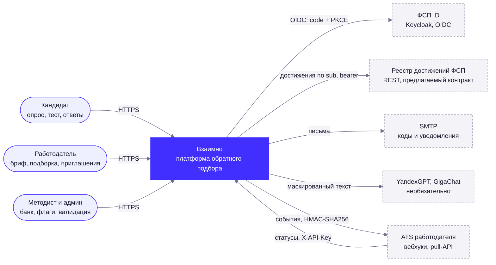

### 3.2. Уровень 2 — контейнеры

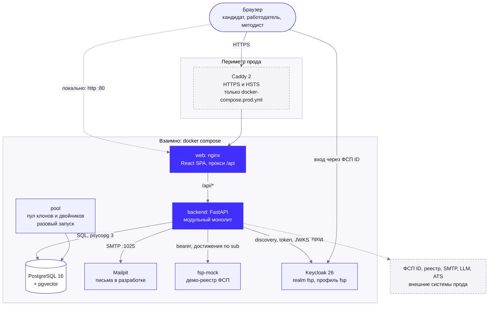

Сервисы `docker-compose.yml` (проект `vzaimno`):

| Сервис | Образ / сборка | Порт | Лимит памяти | Назначение |
|---|---|---|---|---|
| `db` | `pgvector/pgvector:0.8.7-pg16` | 5432 | 512 МБ | PostgreSQL 16; расширение `vector` создаёт миграция `0001` |
| `backend` | сборка `backend/Dockerfile` (python:3.12-slim, uv, непривилегированный пользователь) | 8000 | 768 МБ | Миграции `alembic upgrade head`, затем `uvicorn app.main:app --no-proxy-headers` (клиентский IP определяет приложение) |
| `fsp-mock` | сборка `services/fsp-mock` (python:3.12-slim) | 8001 | 256 МБ | Демо-реестр ФСП, 60 синтетических спортсменов |
| `mailpit` | `axllent/mailpit:v1.31.4` | 8025 (веб), 1025 (SMTP) | 128 МБ | Письма с кодом видны на http://localhost:8025 |
| `keycloak` | `quay.io/keycloak/keycloak:26.0`, профиль `fsp` | 8080 | 768 МБ | ФСП ID: realm `fsp` с 30 демо-пользователями |
| `web` | сборка `frontend/Dockerfile` (nginx со статикой Vite, SPA-fallback, прокси `/api` → `backend`) | 80 | 128 МБ | Интерфейс на http://localhost. Для разработки — Vite dev-сервер :5173 (`npm run dev`). Caddy с HTTPS есть только в `docker-compose.prod.yml`: [DEPLOY.md](DEPLOY.md) |
| `pool` | образ бэкенда, разовый запуск `scripts/generate_pool.py` | — | 1 ГБ | Прегенерация пула клонов заданий и двойников; затем завершается |

Демо не зависит от Keycloak и от `fsp-mock`: при `VZ_FSP_PROVIDER=auto` бэкенд берёт данные реестра из встроенного снимка (`app/fsp/data/demo_registry.json`), а вместо входа через Keycloak есть «демо-вход ФСП» с подписанным мок-токеном.

## 4. Модули монолита и их границы

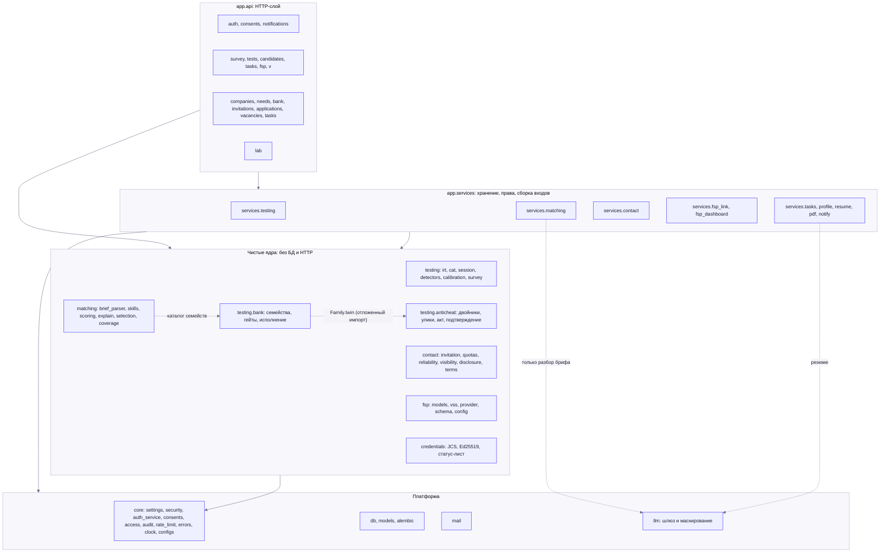

### 4.1. Границы по пакетам

Граф зависимостей получен статическим разбором импортов `backend/app`. Ядра (`testing`, `matching`, `contact`, `fsp`) импортируют только `app.core` (и `testing.bank` у подбора для каталога семейств).

| Модуль | Пакеты | Что внутри | Чего там нет | Конфиг |
|---|---|---|---|---|
| **testing** | `app/testing` (`irt.py`, `cat.py`, `session.py`, `detectors.py`, `calibration.py`, `survey.py`, `simulate.py`) и `app/testing/bank` | Модель ответа и EAP, выбор задания, стоп и решение, машины состояний сессии и квалификации, детекторы и CUSUM, калибровка, классификатор опроса. Банк: контракт `Family`, семейства `families/*`, CI-гейты, офлайн-исполнение ключей | БД, HTTP, LLM. Клон выбирает вызывающий сервис, движок решает «какое семейство и почему» | `testing.yaml`, `taxonomy.yaml` |
| **anticheat** | `app/testing/anticheat` | «Двойник в буфере», классификация ответов, агрегирование улик, акт сверки, «Подтверждение за 5 минут», песочница жюри | БД, HTTP, LLM, автоматический бан. Подключается к сервису теста через три хука (`app/services/testing/anticheat_hooks.py`) | `anticheat.yaml` |
| **matching** | `app/matching` | Разбор брифа, словарь навыков и граф «навык → модули», Score и его компоненты, объяснения, версии подборки и фильтры, охват и рекомендации категорий, планировщик «проверочного набора» | БД, HTTP; LLM в контур Score не импортируется (проверяет тест `test_ranking_path_never_imports_llm`) | `scoring.yaml`, `skills.yaml`, `fsp.yaml`, `taxonomy.yaml` |
| **contact** | `app/contact` | Машина состояний приглашения (таблица `(from, action, actor) → to`), квоты и паузы, надёжность компании R, матрица видимости (`CandidateBlind` / `CandidateDisclosed`), псевдонимы, раскрытие, антифейк-правила, рабочие дни | БД, HTTP | `contact.yaml` |
| **fsp** | `app/fsp` | Контракт реестра (`models.py`), расчёт VSS, провайдеры (`HttpFSPProvider`, `InProcessFSPProvider`, `FallbackFSPProvider`), нормализация в схему платформы | Сеть кроме `HttpFSPProvider`; ничего не знает о подборе и Score | `fsp.yaml` |
| **platform** | `app/core`, `app/db`, `app/models`, `app/mail`, `app/llm`, `app/api/deps.py` | Настройки `VZ_*`, argon2id и JWT, регистрация и сессии, журнал согласий, контроль владельца записи (IDOR), аудит, rate limit, единый формат ошибок, `Clock`, SMTP, шлюз LLM | Продуктовые правила (они в YAML и в ядрах) | `.env` (`.env.example`) |
| **services** | `app/services/*` | Адаптеры «ядро ↔ БД ↔ права»: `testing` (сессии, пул клонов, шифрование ключей, детекторы на данных БД, лаборатория), `matching` (кэш признаков, версии, приватность), `contact`, `fsp_link` (OIDC и синхронизация), `tasks`, `profile`, `resume`, `pdf`, `notify`, `demo` (демо-мир, автоответчик, импорт жюри) | Алгоритмы | — |
| **api** | `app/api/*` | 19 роутеров под префиксом `/api`, зависимости (текущий пользователь, роли, лимиты), DTO | Бизнес-правил: роутер проверяет роль и владельца, ограничивает частоту и отдаёт DTO | — |

### 4.2. Инварианты, которые проверяют тесты

| Инвариант | Где проверяется |
|---|---|
| LLM не импортируется модулями Score, ранжирования и объяснений | `tests/test_api_needs_review.py::test_ranking_path_never_imports_llm`; в `app/testing` и `app/services/testing` импортов `app.llm` нет |
| До взаимного «да» в ответах работодателю нет ни одного ПДн-ключа на любой глубине | `tests/test_contact_privacy.py`, `tests/test_api_contact_privacy.py`, `tests/test_api_needs_privacy.py` |
| Сумма вкладов компонентов равна Score (± 0,1), 3 контрольных примера Score | `tests/test_matching_scoring.py`, `tests/test_matching_explain.py` |
| Запись другого пользователя неотличима от несуществующей (404, не 403) | `tests/test_platform_access.py` |
| Контракт реестра в бэкенде и в `fsp-mock` совпадает байт-в-байт | `tests/test_fsp_mock.py` |
| Клоны: 200 экземпляров без исключений, детерминизм по seed, ≥ 95 % различных ключей, дистракторы ≠ ключу | `tests/test_bank_gates.py`, `tests/test_bank_*.py` |

Всего в `backend/tests` собирается 2297 тестов (`uv run pytest --collect-only -q`). Для тестов API нужен PostgreSQL (`VZ_TEST_DATABASE_URL`).

## 5. Данные (ERD)

Хранилище — PostgreSQL 16. Статусы хранятся строками (`VARCHAR`), не `ENUM`-типами PostgreSQL: новое значение не требует миграции типа. Жёсткие `CHECK` — только там, где ошибка опасна: роль и статус пользователя, цель согласия, статус тестовой сессии, `salary_to >= salary_from`, `email = lower(email)`. Уникальные частичные индексы обеспечивают правила на уровне БД: «одна активная тестовая сессия на аккаунт» (`uq_test_sessions_one_active`), «одно активное приглашение на пару компания–кандидат» (`uq_invitations_active_pair`), «одна корпоративная компания на домен» (`uq_companies_corporate_domain`). Миграции Alembic: `0001`–`0006` (схема, статусы, тестирование, подбор, контакт, профиль и ФСП) и `0007_demo` (таблицы демо-режима и импорта жюри: `demo_personas`, `demo_state`, `jury_batches`, `jury_candidates`, `jury_briefs`, `jury_pairs`).

Расширение `pgvector` включено в `0001`, но колонок типа `vector` пока нет: эмбеддинги в рантайме не используются (член `cos(emb, proto)` в разборе брифа по умолчанию равен 0). Это «в разработке».

### 5.0. Обзор: ключевые сущности

Ниже только основные таблицы и связи; полные ERD по областям — в п. 5.1–5.4.

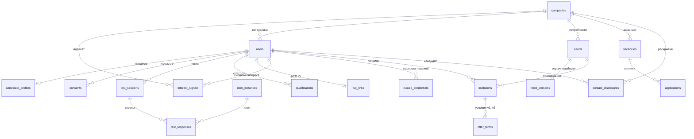

### 5.1. Пользователи, согласия, компании

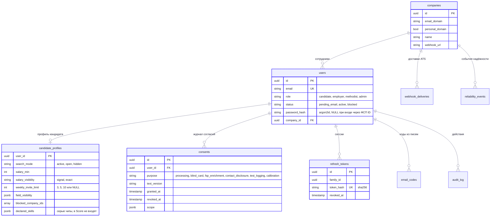

### 5.2. Тестирование

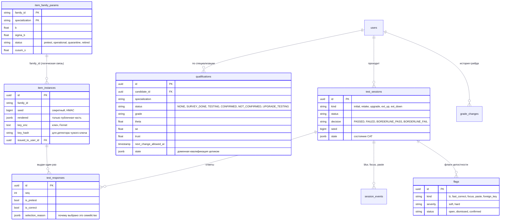

Дополнительно: `drift_events` (срабатывания CUSUM), `calibration_runs` (прогоны MAP-уточнения `b`), `validation_runs` (результаты `eval.validate` для экрана «Лаборатория»), `survey_responses` (ответы опроса с версией). Таблица `candidate_features` — ранняя схема материализованных признаков; подбор читает и пересобирает `matching_features` (п. 5.3).

### 5.3. Подбор и контакт

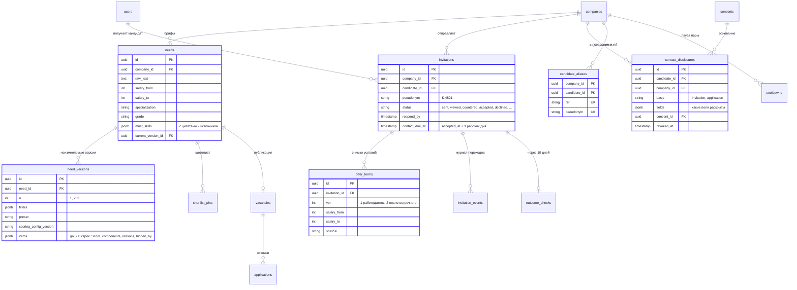

Служебные таблицы подбора: `matching_features` (кэш признаков кандидата по категории, `visible` — виден ли в банке), `profile_views` (кто и когда открыл карточку), `impression_log` (показы в подборках для «как меня видят»). Контакт: `application_events`, `feedback`, `notifications`, `reliability_snapshots`.

### 5.4. ФСП и регулярные задачи

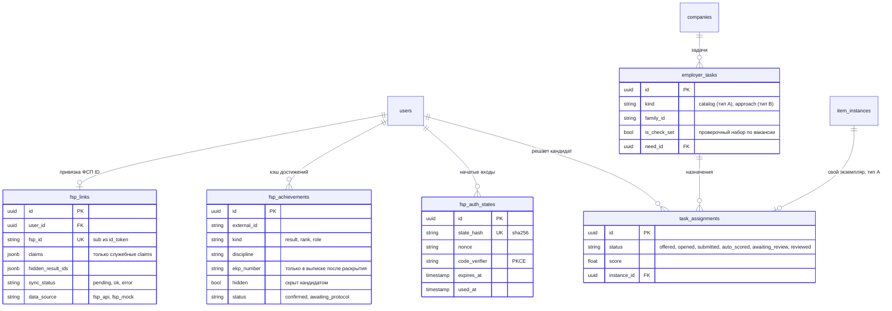

## 6. Сквозные сценарии (sequence)

Эндпоинты и поля соответствуют OpenAPI (`/api/openapi.json`). Условные обозначения: БД — PostgreSQL; ядро — чистые функции `app.testing`, `app.matching`, `app.contact`, `app.fsp`.

### 6.1. Путь кандидата: опрос → грейд → CAT → категория

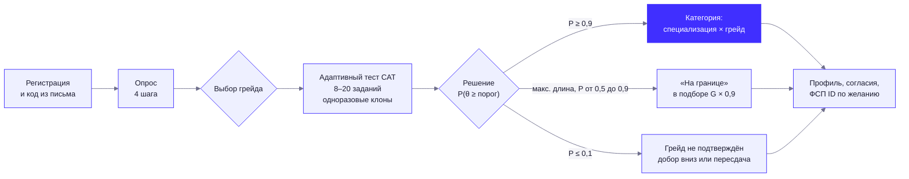

Последовательность вызовов:

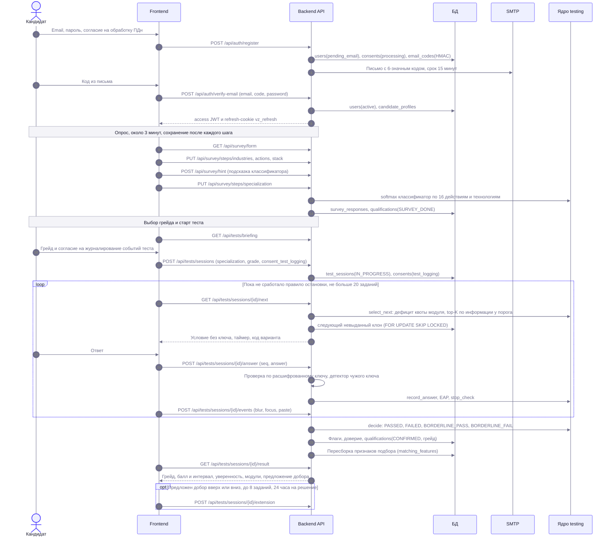

После `CONFIRMED` кандидат виден работодателям (`matching_features.visible`) только при выполнении всех условий: аккаунт активен, есть согласие `blind_card`, режим поиска не «не ищу», сессия не на проверке у методиста, возраст не меньше 16 лет.

### 6.2. Подбор: бриф → категории → версия подборки

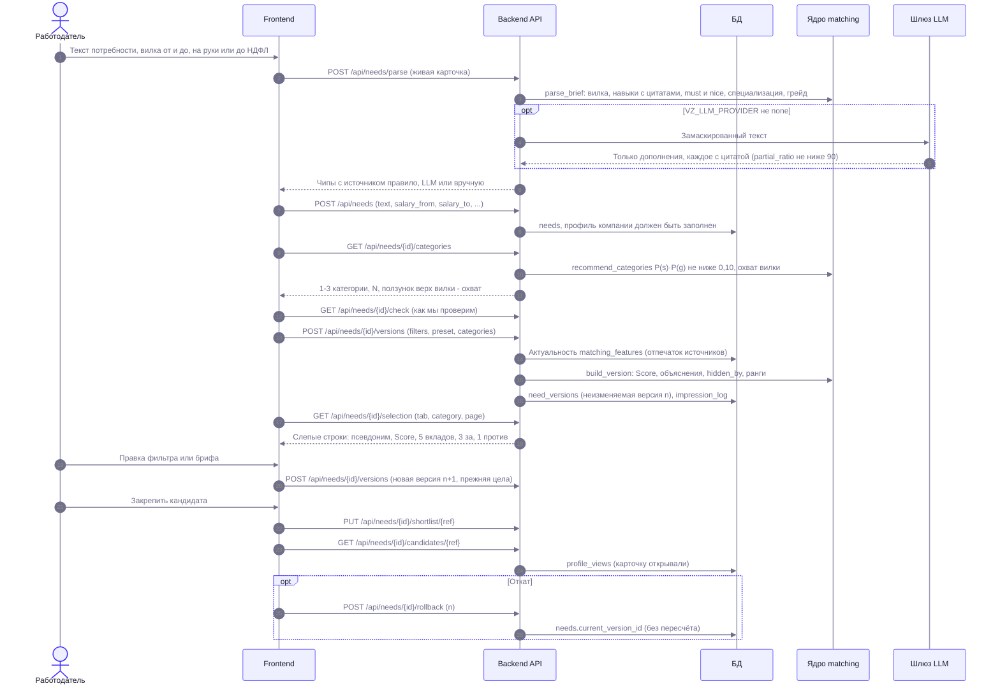

### 6.3. Приглашение: «Да / Да, если… / Нет» и раскрытие контактов

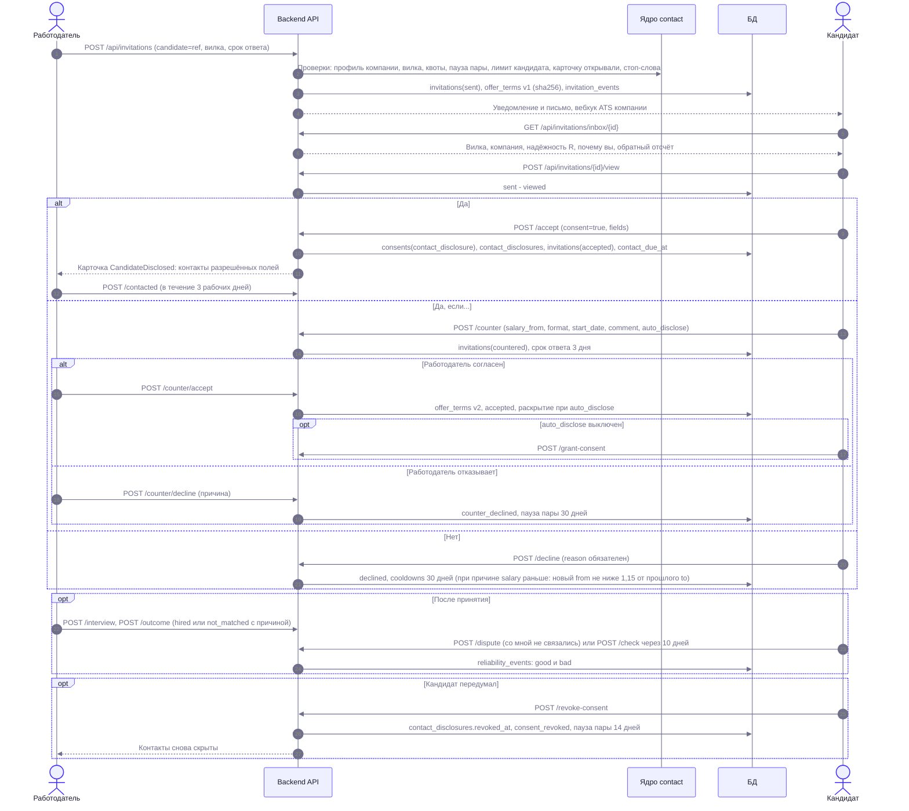

Пути в блоках — `/api/invitations/{id}/…`. Сроки применяются лениво при чтении (источник истины); `sweep()` лишь делает то же для всех сразу и повторяет неудачные вебхуки.

**Обещание процесса.** В приглашении работодатель может отметить обязательства по найму (`config/contact.yaml → invitation.promises`: «без технического скрининга», «сразу финальное интервью», «без тестового задания»). Они хранятся флагами приглашения `promise:<код>` — условия и их sha256 не меняются, в Score кандидата обещания не входят. Кандидат видит их чипами до ответа; если в сверке «условия совпали?» он выбирает «Обещание по процессу не выполнено» (`promise_broken`), в журнал надёжности компании пишется `terms_promise_broken` — минус в доле «условия совпали», как и «зарплата ниже» или «вакансии нет».

### 6.4. Привязка ФСП ID: OIDC + PKCE → реестр

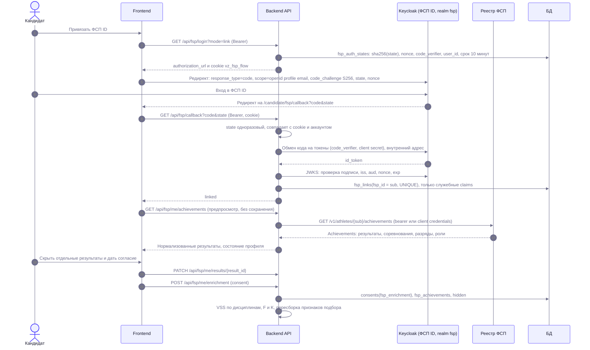

Подробности контракта реестра, расчёта VSS и перехода на настоящий ФСП ID — в [FSP_INTEGRATION.md](FSP_INTEGRATION.md).

## 7. Машины состояний

### 7.1. Приглашение

Таблица переходов `(from, action, actor) → (to, guards, side_effects)` лежит в `app/contact/invitation.py` (`TRANSITIONS`); каждый переход пишется в `invitation_events`. Подписи статусов одинаковы у обеих сторон (`config/contact.yaml → status_labels`).

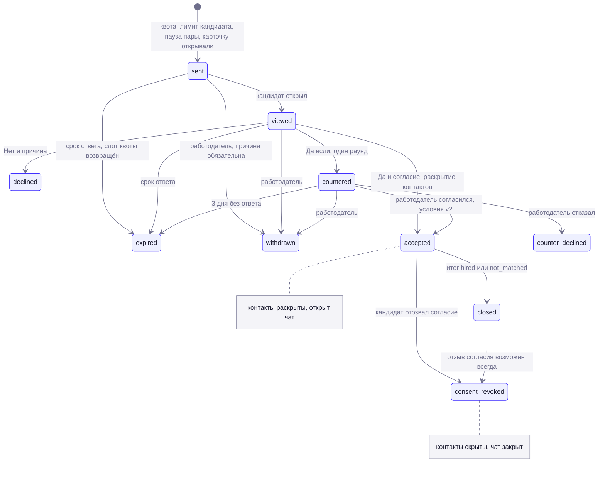

В `accepted` и `closed` есть «петли» без смены статуса: «связались», «со мной не связались», «условия совпали?», «собеседование», «согласие после встречного».

### 7.2. Тестовая сессия и квалификация

```mermaid
%%{init: {'theme':'base','themeVariables':{'primaryColor':'#EEF0FF','primaryBorderColor':'#402FFF','primaryTextColor':'#1B1B2F','lineColor':'#6F6F8C','secondaryColor':'#F4F4F8','tertiaryColor':'#FFFFFF','textColor':'#6F6F8C','edgeLabelBackground':'#F4F4F8','clusterBkg':'#F8F8FC','clusterBorder':'#B8B8D0','noteBkgColor':'#F4F4F8','noteTextColor':'#1B1B2F','noteBorderColor':'#9A9AB0','actorBkg':'#EEF0FF','actorBorder':'#402FFF','actorTextColor':'#1B1B2F','actorLineColor':'#9A9AB0','signalColor':'#6F6F8C','signalTextColor':'#6F6F8C','labelBoxBkgColor':'#EEF0FF','labelBoxBorderColor':'#402FFF','labelTextColor':'#1B1B2F','loopTextColor':'#6F6F8C','activationBkgColor':'#DCDFFF','activationBorderColor':'#402FFF','fontSize':'14px'}}}%%
stateDiagram-v2
  direction LR
  [*] --> CREATED
  CREATED --> IN_PROGRESS: старт
  IN_PROGRESS --> PAUSED: обрыв связи
  PAUSED --> IN_PROGRESS: возврат, не позже 30 минут
  PAUSED --> ABANDONED: больше 30 минут
  IN_PROGRESS --> DECIDED: правило остановки
  DECIDED --> EXTENSION_OFFERED: доступен добор
  EXTENSION_OFFERED --> FINAL: отказ или 24 часа
  DECIDED --> FINAL: добора нет
  FINAL --> UNDER_REVIEW: 3 и больше мягких флагов или чужой ключ
  UNDER_REVIEW --> FINAL: методист оставил, доверие 0,75
  UNDER_REVIEW --> INVALIDATED: методист аннулировал
```

Квалификация (кандидат × специализация): `NONE → SURVEY_DONE → TESTING → CONFIRMED(g) | NOT_CONFIRMED`, далее `CONFIRMED(g) → UPGRADE_TESTING → CONFIRMED(g+1) | CONFIRMED(g)`. Принудительного понижения нет. Правила попыток и смены грейда — в [TESTING_MECHANISM.md](TESTING_MECHANISM.md).

## 8. Сквозные механизмы

| Механизм | Реализация |
|---|---|
| Конфигурация | `app/core/configs.py` читает `config/*.yaml` (каталог переопределяется `VZ_CONFIG_DIR`); инфраструктура и секреты — `VZ_*` из окружения (`app/core/settings.py`, `.env.example`). В `VZ_ENV=prod` бэкенд не стартует с dev-секретами, секретами короче 32 символов и без Secure-cookie |
| Время | `app.core.clock.clock`: заморозка в тестах, смещение «+1 день» в демо-режиме (смещение хранится в `demo_clock` и переживает перезапуск). Подпись access-JWT — по настенным часам |
| Сроки и планировщик | Сроки приглашений, откликов и пауз применяются лениво при чтении — это источник истины. **Планировщик** (`app/services/scheduler`, `config/scheduler.yaml`): asyncio-цикл в lifespan приложения (в тестах не запускается, `VZ_SCHEDULER_ENABLED=false` выключает) раз в минуту вызывает `services.contact.sweep()` (напоминания, «истекло», «нет ответа», повтор вебхуков ATS), ночью (00:00 UTC) — калибровку заданий с CUSUM дрейфа (то же, что `POST /api/lab/calibrate`), в 00:30 UTC — чистку по срокам хранения (`config/privacy.yaml`). Между процессами задачу берёт держатель рекомендательной блокировки PostgreSQL; итог суточных задач пишется в `audit_log` (`scheduler.*`) — после перезапуска в ту же ночь повторного прогона нет |
| Фоновые задачи | `BackgroundTasks` FastAPI: долив пула клонов после выдачи задания (`pool.top_up_background`); периодические задачи — планировщик (строка выше). Отдельной очереди задач нет |
| Ошибки | Единый формат `{code, message, details}`; сообщения на русском; 500 перехватывается внутри CORS, чтобы фронтенд мог прочитать тело (см. [API.md](API.md)) |
| Аудит и согласия | `audit_log` (вход, токены, согласия, раскрытия; без ПДн в payload), журнал `consents` с версией текста и отзывом без удаления |
| Rate limit | Токен-корзина в памяти процесса (`app/core/rate_limit.py`); для нескольких воркеров корзины нужно вынести в Redis или PostgreSQL. Клиентский IP за Caddy — `X-Forwarded-For` только от доверенных прокси (`VZ_FORWARDED_ALLOW_IPS`, `app/core/netutil.py`) |
| Удаление аккаунта и сроки хранения | `DELETE /api/candidates/me`, `DELETE /api/companies/me` (`app/services/account/erasure.py`): строка `users` удаляется, каскады БД убирают всё персональное; ночная чистка по срокам (`retention.py`, `config/privacy.yaml`) — подробности в [SECURITY.md](SECURITY.md) п. 1.3 |
| Почта | `app/mail`: SMTP (STARTTLS или SSL) или консоль; сбой SMTP не ломает действие пользователя (`send_mail_safe`) |
| Вебхуки ATS | HMAC-SHA256 в `X-Vzaimno-Signature`, идемпотентный `X-Vzaimno-Event-Id`, повторы с экспоненциальной паузой, защита от SSRF (внутренние адреса запрещены), журнал последних 20 доставок |
| Метаданные безопасности HTTP | `X-Content-Type-Options: nosniff`, `X-Frame-Options: DENY`, `Referrer-Policy`, `Cache-Control: no-store` на `/api/auth/*`; HSTS и TLS — на уровне Caddy |

Производительность (замер на синтетической популяции, [VALIDATION.md](VALIDATION.md) §4.7): сборка версии подборки на пуле 1 864 кандидатов — медиана 83 мс, p95 156 мс при цели ≤ 300 мс. Время подбора растёт линейно с размером пула; кэш признаков (`matching_features`) пересобирается по хукам и по отпечатку источников.

## 9. Статус реализации

| Область | Статус |
|---|---|
| Бэкенд: аутентификация, согласия, опрос, тестирование, банк (111 семейства в 14 модулях: Backend, Frontend, QA, DevOps и 11 семейств навыков для проверочных наборов), подбор, контакт, ФСП ID и реестр, профиль и резюме, PDF-профиль со сверкой, регулярные задачи, уведомления, вебхуки, лаборатория, валидация | Готово, покрыто тестами |
| Контракт реестра ФСП, `fsp-mock`, realm Keycloak `fsp` | Готово |
| Фронтенд | Готово: кандидат (опрос, брифинг, тест, результат, «Мой грейд», приглашения, ФСП, приватность, профиль и PDF), работодатель (потребности, подборка, приглашения, банк, вакансии, задачи, профиль компании), лаборатория, страница жюри и песочница; образ `web` (nginx) |
| «Антиподсказчик»: двойники, улики, акт сверки, «Подтверждение за 5 минут», песочница | Готово: библиотека `app/testing/anticheat`, сервис `app/services/anticheat`, хуки `anticheat_hooks.py` подключены к выдаче заданий и ответам, клиентский обработчик буфера (`frontend/src/features/anticheat`), лента сверок и акты в лаборатории, песочница жюри |
| Банки DevOps и QA | Готово: обе специализации `active` (модули `devops_core` 11 и `qa_testing` 11 семейств плюс общие `git_linux`, `http_api`, `sql`); банк меньше, чем у Backend и Frontend |
| `/api/admin/*` (импорт данных жюри, ранжирование с компонентами Score, метрики по размеченным парам, валидация) и `/api/demo/*` (часы «+1 день», сброс, автоответчик, режим жюри, приёмник вебхуков; только при `VZ_DEMO_MODE=true`) | Готово; наполнение демо-мира — `make seed` (`backend/scripts/seed_demo.py`) |
| «Сигнал интереса» и симуляция рынка | Готово: `/api/interest`, бейдж «Взаимный интерес», квоты и недельные лимиты из `config/contact.yaml`; симуляция `eval/market_sim.py` ([MATCHING.md](MATCHING.md) п. 9) |
| Цифровой паспорт навыков | Готово: подписанный Verifiable Credential (Ed25519, `did:web`), QR `/v/код`, отзыв по Bitstring Status List; издатель демонстрационный ([CREDENTIALS.md](CREDENTIALS.md)) |
| Качество заданий: DIF, дрейф, экспозиция | Готово: `app/testing/monitoring.py`, экран «Лаборатория → Качество» (`/api/lab/quality`), `eval.fairness` ([TESTING_MECHANISM.md](TESTING_MECHANISM.md) п. 16) |
| Панель ФСП «Кадровый резерв» | Готово: `/fsp/reserve`, `/api/fsp/dashboard`, k-анонимность и вторичное подавление ([FSP_INTEGRATION.md](FSP_INTEGRATION.md) п. 11) |
| Задания на конкретные навыки в проверочном наборе вакансии; открытые данные рынка | Готово ([MATCHING.md](MATCHING.md), «Навыки, наблюдаемые через проверочный набор» и п. 13) |
| Вакансия без брифа, банк кандидатов без брифа | Готово: «Создать вакансию» и `GET /api/bank` |
| Инженерия: CI, e2e, типы, безопасность; доступность | Готово: `.github/workflows/ci.yml`, Playwright, `mypy --strict` на ядрах ([ENGINEERING.md](ENGINEERING.md)); axe: 0 serious и critical ([ACCESSIBILITY.md](ACCESSIBILITY.md)) |
| Фабрика семейств (LLM пишет черновик генератора офлайн) | В разработке |
| Эмбеддинги и колонки `vector` | В разработке |
| ATS: исходящие вебхуки, pull-API, обратная синхронизация статусов, адаптер «Хантфлоу» (эмулятор), чат после «Взаимно» | Готово ([ATS_INTEGRATION.md](ATS_INTEGRATION.md)); боевой режим Хантфлоу на живом сервисе не проверялся |
| Ночная калибровка с CUSUM и периодический `sweep()` | Готово: встроенный планировщик (`app/services/scheduler`, `config/scheduler.yaml`); ручной запуск остался |
| Удаление аккаунта, сроки хранения ПДн, минимизация ответа реестра ФСП | Готово (`app/services/account`, `config/privacy.yaml`); согласие законного представителя 15–17 лет — письмо с одноразовой ссылкой и подтверждение ([SECURITY.md](SECURITY.md) п. 1.4) |
| Caddy и HTTPS | Готово в `docker-compose.prod.yml` и `deploy/Caddyfile` (в локальный `docker-compose.yml` не входят) — [DEPLOY.md](DEPLOY.md) |
