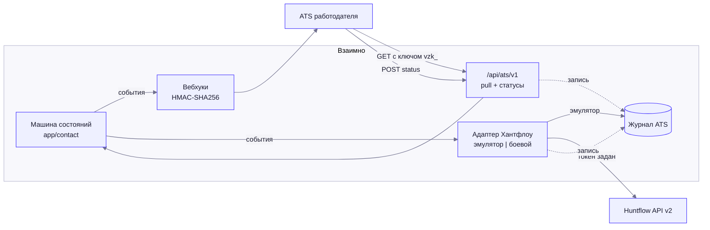
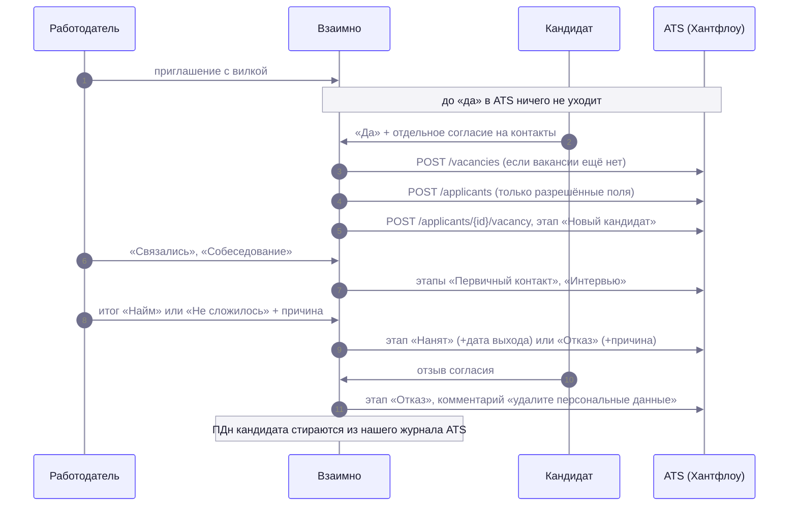
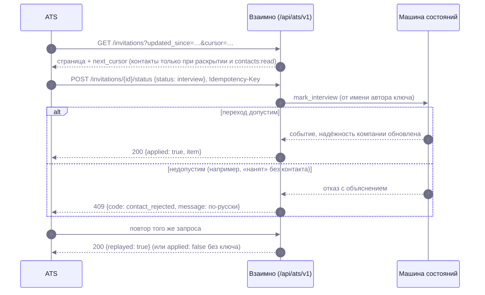

# Интеграция с ATS работодателя и чат после «Взаимно»

Документ описывает, как платформа встраивается в существующий процесс найма (по ответу организаторов: «синхронизация вакансий, откликов и статусов с внутренней системой найма через API»), и как это можно проверить без живой коммерческой ATS. Чат после «Взаимно» — в конце.

Решение (DECISIONS 29): боевых подключений к реальным ATS нет; вместо них — проверяемая интеграция из четырёх частей, все они покрыты тестами (`backend/tests/test_api_ats.py`, `test_api_chat.py`).

| Часть | Что делает | Где |
|---|---|---|
| Исходящие вебхуки | Подписанные события (HMAC-SHA256) при смене статуса приглашения и отклика | `app/services/contact/webhooks.py`, `/api/companies/me/webhooks*` (без изменений) |
| Pull-API | ATS забирает вакансии, приглашения и отклики с курсором и фильтром `updated_since` | `/api/ats/v1/*`, `app/api/ats.py`, `app/services/ats/pull.py` |
| Обратная синхронизация | ATS передаёт статусы («связались», «интервью», «оффер», «нанят», «отказ») — они идут через нашу машину состояний | `POST /api/ats/v1/{invitations,applications}/{id}/status`, `app/services/ats/status.py` |
| Адаптер «Хантфлоу» | Наши события → кандидат, вакансия, смена этапа в формате Huntflow API v2; эмулятор и боевой режим | `app/services/ats/huntflow.py`, `sync.py` |

## 1. Что реально, что эмулировано

| Что | Статус |
|---|---|
| Ключи компании, области доступа, pull-API, приём статусов, идемпотентность | Реально работает, проверено тестами и вручную через HTTP |
| Вебхуки | Реально работают (доставка, повторы, подпись, журнал) |
| Адаптер «Хантфлоу», эмулятор | Реально работает: запросы строятся полностью, записываются в «Журнал ATS» ровно в том виде, в каком ушли бы в Хантфлоу; ответы — синтетические и детерминированные |
| Адаптер «Хантфлоу», боевой режим | Код отправки есть и проверен на подменённом транспорте (заголовок, пути, id этапов из справочника ATS, сбой не ломает действие). **Против живого Хантфлоу не запускался**: поля сверены с публичной документацией Huntflow API v2, но реальный ответ и токен не проверены. Для включения нужны только адрес API и токен |
| Повторы неудачных боевых запросов | Нет: сбой пишется в журнал, повторной отправки очереди нет (у вебхуков она есть) |
| Другие ATS (Potok, E-Staff и т. п.) | Не реализованы: подключаются через pull-API и вебхуки |

## 2. Концепция

Работодатель в профиле компании выбирает тип интеграции: **Нет / Вебхук / Хантфлоу** — и выпускает API-ключи для pull-API. Принцип один: наружу уходит только то, что кандидат уже разрешил. До взаимного «да» в ATS нет ни имени, ни контактов кандидата, есть только псевдоним «К-4821» в pull-API.

### Последовательность: приглашение → контакты → этапы в ATS

### Последовательность: статус из ATS

## 3. Безопасность

- **Ключи компании** (выбрано вместо OAuth2 client credentials: интеграция «сервер—сервер», ключ с областями проще выдать и отозвать из профиля, чем держать OAuth-сервер). Формат `vzk_<key_id>_<секрет>`; в БД — только sha256 секрета; показывается один раз при создании и перевыпуске; перевыпуск и отзыв действуют сразу; не больше 5 действующих ключей (`config/contact.yaml → ats`). Любая ошибка ключа — одинаковый 401. Лимит запросов — на ключ.
- **Области доступа:** `vacancies:read`, `invitations:read`, `applications:read`, `contacts:read`, `status:write`. Без нужной области — 403 `ats_scope_missing`.
- **ПДн только после раскрытия.** Блок `candidate.contacts` приходит, только если у ключа есть `contacts:read` **и** у пары действует согласие на раскрытие (`ContactDisclosure.revoked_at IS NULL`), и содержит только поля, которые разрешил кандидат. В остальных случаях — `null`. Внутренних id кандидата в ответах нет никогда (проверяется тестами: `assert_no_pii`). После отзыва согласия запись «обновляется» (`updated_at`), и ATS видит пропажу контактов при следующем забирании.
- **Токен Хантфлоу** хранится зашифрованным (Fernet, ключ из `VZ_APP_SECRET`, как ключи экземпляров теста), наружу не возвращается (только последние 4 знака), в журнал не попадает. Адрес API проходит ту же SSRF-проверку, что и URL вебхука.
- **Вебхуки:** подпись `X-Vzaimno-Signature: sha256=<HMAC-SHA256(секрет, тело)>`, идемпотентность `X-Vzaimno-Event-Id`; контакты в событии — только при согласии.
- **152-ФЗ:** при отзыве согласия адаптер отправляет этап «Отказ» с просьбой удалить данные, а имя, телефон, email и Telegram стираются из «Журнала ATS» (в самой ATS удаление остаётся за работодателем).
- **Аудит:** создание, перевыпуск и отзыв ключей, смена настроек, принятые статусы — в `audit_log` (без ПДн).

## 4. Pull-API `/api/ats/v1`

Заголовок: `Authorization: Bearer vzk_…`. Схема — в `/api/docs` (тег «Интеграция ATS»).

| Метод и путь | Область | Описание |
|---|---|---|
| `GET /me` | любая из `vacancies:read` | Проверка ключа: компания, области |
| `GET /vacancies` | `vacancies:read` | Опубликованные и закрытые вакансии |
| `GET /invitations`, `GET /invitations/{id}` | `invitations:read` (+ `contacts:read`) | Приглашения со статусом, этапом, итогом, условиями (хеш sha256) |
| `GET /applications`, `GET /applications/{id}` | `applications:read` (+ `contacts:read`) | Отклики кандидатов |
| `POST /invitations/{id}/status` | `status:write` | Статус из ATS |
| `POST /applications/{id}/status` | `status:write` | Статус отклика из ATS |

**Пагинация и синхронизация.** Параметры `updated_since` (ISO 8601, включительно), `cursor`, `limit` (по умолчанию 50, максимум 100), у приглашений и откликов ещё `status`. Порядок — по `(updated_at, id)`; ответ: `items`, `next_cursor` (`null` — конец), `server_time`. Курсор непрозрачный; повтор с тем же курсором возвращает те же записи. Рекомендуемый цикл: хранить `server_time` предыдущего прохода, передавать как `updated_since`, идти по `next_cursor`; запись, изменённая в ту же секунду, не потеряется (фильтр включительный), дубли отбрасывать по `id`.

**Идемпотентность записи.** Заголовок `Idempotency-Key` (до 80 знаков): повтор того же запроса возвращает прежний ответ с `replayed: true`; тот же ключ для другого статуса — 409 `ats_idempotency_conflict`. Без ключа повтор уже достигнутого состояния — 200 с `applied: false`.

### Соответствие статусов ATS и нашей машины состояний

| Статус из ATS | Приглашение | Условие | Ошибка 409, если условие нарушено |
|---|---|---|---|
| `contacted` | `mark_contacted` («Связались», в срок — плюс к надёжности) | приглашение принято, контакты открыты | «Контакты кандидата ещё не открыты» |
| `interview` | `mark_interview` (этап «собеседование»; контакт отмечается вместе с ним) | принято | сообщение машины состояний |
| `offer` | этап `offer` (в машине состояний этапа нет, хранится как `stage`) | принято и был контакт | `offer_requires_contact` |
| `hired` | `close` / `hired` | был контакт | «Сначала отметьте «Связались» или «Собеседование»…» |
| `rejected` + `reason` | `close` / `not_matched` | причина: `skills_missing` (+`skill_ids`), `position_closed`, `chose_other` | 400 `ats_reason_required` без причины |

Для откликов: `viewed` → просмотр, `interested` → «есть интерес» (при необходимости с просмотром), `rejected` + `reason` (`skills_missing`, `salary`, `position_closed`, `chose_other`, `other`) → отказ. Переходы после финального статуса (например, `rejected` по уже закрытому найму) отклоняются кодом 409 с русским объяснением. Надёжность компании пересчитывается теми же побочными эффектами, что при ручной отметке в кабинете. Событие записывается от имени автора ключа.

## 5. Адаптер «Хантфлоу» и соответствие полей

Формы запросов — по публичной документации Huntflow API v2 (`https://api.huntflow.ru/v2`, заголовок `Authorization: Bearer <токен>`). Адрес и номер организации задаются в профиле; в эмуляторе номер по умолчанию — 1.

| Наша сущность | Запрос Хантфлоу | Поля |
|---|---|---|
| Вакансия (опубликованная, бриф или приглашение) | `POST /accounts/{id}/vacancies` | `position` ← название, `company` ← название компании, `body` ← описание, `money` ← «220000-280000 руб. на руки» |
| Кандидат после «да» | `POST /accounts/{id}/applicants` | `first_name`, `last_name`, `middle_name` ← ФИО (3 слова — «Фамилия Имя Отчество», 2 слова — «Имя Фамилия»); `phone`, `email`; `social: [{social_type: TELEGRAM, value}]`; `position`, `money`; `externals[0].data.body` — «Источник: платформа «Взаимно»…». Только поля, разрешённые кандидатом |
| Первичное добавление и смена этапа | `POST /accounts/{id}/applicants/{applicant_id}/vacancy` | `vacancy`, `status` (id этапа), `comment`, `rejection_reason` (id причины), `employment_date` |
| Подключение | `GET /accounts` | «Проверить подключение» |
| Этапы воронки (боевой режим) | `GET /accounts/{id}/vacancies/statuses` | сопоставление по названию из `config/contact.yaml → ats.huntflow.stage_names` |

Этапы: приглашение принято → «Новый кандидат»; «Связались» → «Первичный контакт»; «Собеседование» → «Интервью»; «Найм» → «Нанят» (+дата выхода); «Не сложилось» → «Отказ» с причиной; отзыв согласия → «Отказ». Отклики: «есть интерес» → «Первичный контакт», отказ → «Отказ». Если в организации нет этапа с нужным названием — запись «Журнала ATS» со статусом `failed` и понятной причиной.

Идемпотентность исходящих запросов — по ключам в журнале (`hf:applicant:…`, `hf:move:<id события>`): повтор события не создаёт дублей.

**Эмулятор** включён, пока токен не задан: журнал содержит запрос целиком (метод, URL, заголовки без секрета, тело) и синтетический ответ с детерминированным `id` — следующие запросы ссылаются на него так же, как на настоящий. В профиле компании: «Журнал ATS» (раскрывается до тела запроса), «Проверить подключение», выбор типа, токен.

Откат кандидата к «слепому» состоянию в ATS невозможен технически; поэтому в ATS кандидат создаётся только после раскрытия.

## 6. Настройки

`config/contact.yaml → ats`: размер страницы, префикс и длина ключей, лимит ключей и запросов, размер журнала, области, типы, названия этапов Хантфлоу и id этапов эмулятора, допустимые статусы. Таблицы: `company_api_keys`, `ats_settings`, `ats_log`, `chat_messages` (миграция `0010_chat_ats`).

---

# Чат после «Взаимно»

Переписка по приглашению или отклику (ответ организаторов: «списаться на платформе удобнее»; решение DECISIONS 29).

| Состояние контакта | Кандидат | Работодатель |
|---|---|---|
| Нет «взаимного да» (приглашение не принято, согласия нет) | 403 `chat_unavailable` | 403 `chat_unavailable` |
| Принято (отклик: «есть интерес») и согласие действует | читает и пишет | читает и пишет |
| Контакт завершён («Завершено»), согласие действует | только чтение | только чтение |
| Согласие отозвано | история только для чтения | 403 `chat_closed`, переписки нет в списке |
| Не участник | 404 | 404 |

- Только текст, длина до `chat.max_len` (1000), не чаще `chat.rate_per_minute` (10) в минуту, не больше `chat.thread_max_messages` (500) в переписке (`config/contact.yaml → chat`).
- Уведомление в кабинете и письмо собеседнику (письмо — не чаще раза в 30 минут на переписку); **текста сообщения в уведомлении и письме нет**.
- Непрочитанные: `GET /api/chat/unread`, `GET /api/chat/threads`; открытие переписки отмечает сообщения собеседника прочитанными.
- Аудит: `chat.message_sent` (длина, без текста).
- DEMO_MODE: синтетический кандидат отвечает заготовкой из `chat.demo_replies` (детерминированно).
- Эндпоинты: `GET /api/chat/{kind}/{id}` (`after` — курсор по `seq`), `POST /api/chat/{kind}/{id}/messages`, `kind` = `invitation` | `application`. Интерфейс: панель на экране «Взаимно» кандидата и в карточке приглашения работодателя (после раскрытия), опрос раз в 8 секунд.
