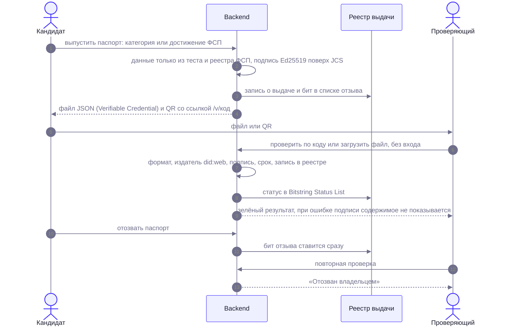

# Цифровой паспорт навыков

Результат теста и достижения ФСП кандидат может получить в виде **подписанного файла**: его можно показать любому работодателю или положить в портфолио, а подлинность проверяется без входа на платформу. Решение 31.1 в журнале решений.

> **Издатель — демонстрационный.** Паспорт выдаёт платформа «Взаимно», а не ФСП. Это не официальный сертификат ФСП. Надпись «Демонстрационный издатель» есть в самом файле, в API и на странице проверки. Как ФСП может стать настоящим издателем — раздел 6.

## 1. Что используется (стандарты)

| Слой | Стандарт | Как у нас |
|---|---|---|
| Модель данных | W3C Verifiable Credentials Data Model 2.0 | контекст `https://www.w3.org/ns/credentials/v2`, `validFrom`/`validUntil` |
| Форма «значка» | 1EdTech Open Badges 3.0 | тип `OpenBadgeCredential`, `credentialSubject` типа `AchievementSubject`, `Achievement`, `Result`/`ResultDescription`, `Evidence` |
| Подпись | W3C Data Integrity, криптосьют `eddsa-jcs-2022` | Ed25519 (RFC 8032) поверх канонизации JCS (RFC 8785); `proofValue` — multibase base58btc |
| Канонизация | JSON Canonicalization Scheme, RFC 8785 | собственная реализация `app/credentials/jcs.py`, проверена по контрольным примерам RFC (числа по ECMAScript, порядок ключей по UTF-16) |
| Идентификатор издателя | `did:web` | `did:web:<домен платформы>`, ключ — в `/.well-known/did.json` (`Multikey`, `publicKeyMultibase` вида `z6Mk…`) |
| Отзыв | W3C Bitstring Status List | список `/api/credentials/status/1`, `statusPurpose: revocation`, сжатие GZIP + base64url, 131 072 бита |

Новых зависимостей нет: `cryptography` уже в проекте, JCS и base58 написаны и покрыты тестами (около 150 строк).

## 2. Какие паспорта бывают

1. **Категория** («Backend (Python) · Middle»): специализация и грейд, балл на шкале платформы, стандартная погрешность измерения (SEM, баллы), дата подтверждения тестом, ссылка на методику (`evidence`). Выпускается только для категории, подтверждённой тестом и видимой в подборке (не на проверке у методиста).
2. **Достижение ФСП**: обобщённая запись из реестра (демонстрационные данные мока). Только поля из `config/credentials.yaml → fsp.allowed_fields`: дисциплина, уровень, год, итог, полоса места («топ-3»), роль по протоколу (личный зачёт, капитан, в команде; функция в команде из заявки участника в паспорт не попадает — в протоколах ФСП её нет). Вид спорта указан по Всероссийскому реестру видов спорта: «спортивное программирование», код **1010001311Я** (`fieldOfStudy` и `tag: ["ВРВС:1010001311Я"]` достижения Open Badges 3.0; значение — из `config/fsp.yaml → sport`). Номер ЕКП, команда, точное место, ссылка на протокол, ФИО и ФСП ID **не попадают** в файл. Выпускается только при привязанном ФСП ID и согласии на обогащение; скрытые кандидатом результаты недоступны.

Резюме и самоописание в паспорт не попадают и на категорию не влияют.

## 3. Персональные данные

- Субъект по умолчанию — **псевдонимный идентификатор** `urn:vzaimno:subject:<24 hex>` = HMAC(секрет платформы, id пользователя). Без секрета он не связывается с человеком, при смене секрета связь рвётся.
- Имя добавляется **только если кандидат отметил это при выпуске** (и только если ФИО заполнено в профиле).
- Страница проверки по коду из QR имя не показывает никогда. При проверке загруженного файла имя показывается, если оно в файле: файл уже у проверяющего.
- В реестре выдачи (таблица `issued_credentials`) хранится подписанный документ; при удалении аккаунта записи удаляются каскадом, и такой файл перестаёт проходить проверку («в реестре выдачи записи нет»).
- Работодатель после раскрытия контактов видит на карточке только «Паспорт проверен ✓», названия действующих паспортов и издателя. Баллы и имя из паспорта он не получает: они в файле, которым кандидат делится сам.

## 4. Что делает кандидат

Профиль → «Паспорт навыков»:

1. Выпустить паспорт по категории или по достижению ФСП (с именем или без).
2. Скачать JSON; рядом — QR со ссылкой `/v/<код>`.
3. Отозвать: бит в списке отзыва ставится сразу, любая проверка покажет «отозван».

Срок действия — 365 дней (`config/credentials.yaml → validity_days`): категория актуальна ограниченно, как и в PDF-профиле.

## 5. Проверка

Выпуск, проверка и отзыв целиком:

Страница `/v/<код>` (QR) и блок «Проверить файл» на той же странице; публично, без входа, с ограничением частоты запросов. Проверяются по отдельности:

| Проверка | Красный результат |
|---|---|
| Формат (Verifiable Credential) | «Это не файл паспорта навыков» |
| Издатель (`did:web` платформы и её ключ) | «Издатель неизвестен платформе» |
| Подпись Ed25519 | «Подпись не совпадает: содержимое файла изменено после выдачи» |
| Срок действия | «Срок действия истёк» |
| Запись в реестре выдачи | «В реестре выдачи записи нет» |
| Отзыв | «Отозван владельцем: паспорт больше не действует» |

Если подпись не прошла, содержимое файла на странице не показывается. Демонстрация: скачать паспорт, изменить в файле один байт (например, `542` на `543`), загрузить — красный крест. Тесты: `backend/tests/test_credentials_core.py` (JCS, base58, подпись, подделка, список отзыва, `did.json`, минимизация ПДн) и `test_credentials_api.py` (выпуск, скачивание, проверка, подделка по байту, срок, отзыв, удалённая запись, имя по выбору, доступ, карточка работодателя).

## 6. Что настоящее, а что демонстрация

| | Сейчас | Для настоящего издателя |
|---|---|---|
| Формат и подпись | настоящие: любой валидатор VC/Data Integrity проверит подпись | то же |
| Издатель | `did:web` платформы, ключ создан у нас; в файле явно «демонстрационный издатель» | издатель `did:web:<домен ФСП>`, ключ в HSM/KMS ФСП |
| Данные ФСП | демо-мок реестра | настоящий реестр по контракту из [FSP_INTEGRATION.md](FSP_INTEGRATION.md) |
| Что заверено | платформа заверяет, что результат теста получен на ней, и факт выписки из реестра | ФСП заверяет само достижение |
| Реестр выдачи и отзыв | у платформы | у ФСП: тот же Bitstring Status List по адресу ФСП |

**Как ФСП станет настоящим издателем (дорожная карта ФСП ID).**

1. ФСП публикует `did.json` на своём домене и выдаёт платформе делегированный ключ (или подписывает паспорта у себя по запросу платформы).
2. В `issuer` паспорта ставится идентификатор ФСП; поле `issuer.name` — реальное название. Отметка «демо» убирается конфигом, формат файла не меняется.
3. Достижения ФСП подписывает сам ФСП при внесении результата в реестр; платформа подписывает только категорию теста. Работодатель проверяет оба паспорта одним и тем же инструментом.
4. Привязка к человеку через `sub` ФСП ID вместо псевдонима платформы (по согласию). Остальное — как для всех паспортов.

## 7. Настройка и ключ

- `VZ_CREDENTIALS_KEY_PEM` — PEM (PKCS#8) приватного ключа Ed25519 (переводы строк как `\n` допустимы) **или** `VZ_CREDENTIALS_KEY_FILE` — путь к файлу. Ключ в git не хранится.
- dev: если ничего не задано, ключ создаётся при первом запуске в `backend/var/credentials-ed25519.pem` (каталог вне git). Тесты используют эфемерный ключ.
- prod без ключа: выдача и проверка отвечают 503 «не настроен ключ подписи», запасной ключ не подставляется.
- `VZ_CREDENTIALS_DID_DOMAIN` — домен для `did:web` (по умолчанию хост из `VZ_PUBLIC_BASE_URL`; порт кодируется как `%3A`). Адрес `/.well-known/did.json` должен отдаваться на этом домене: в `deploy/Caddyfile` и прокси Vite он направлен на бэкенд.
- Смена ключа делает ранее выпущенные паспорта непроверяемыми: перед ротацией — перевыпуск или публикация старого ключа в `did.json` вторым `verificationMethod`.

## 8. Ограничения

- Проверка в реестре выдачи обязательна: файл, выпущенный другим стендом, будет красным, даже если подпись верна для того же ключа.
- Отзыв проверяется только онлайн (список отзыва у платформы); офлайн-проверка подписи без обращения к платформе возможна по `did.json`, но статус отзыва без сети неизвестен.
- Данные ФСП демонстрационные.
