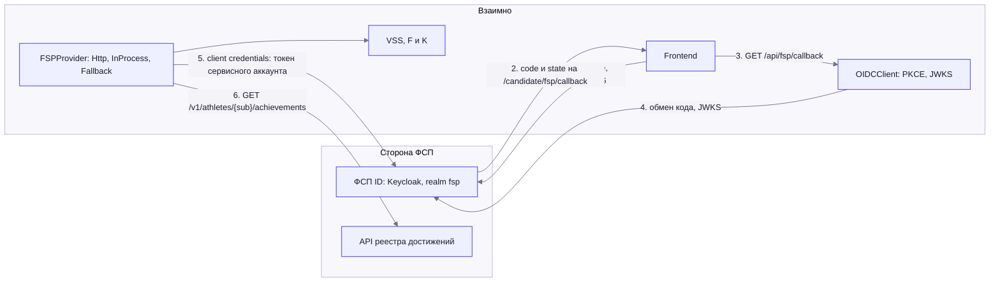
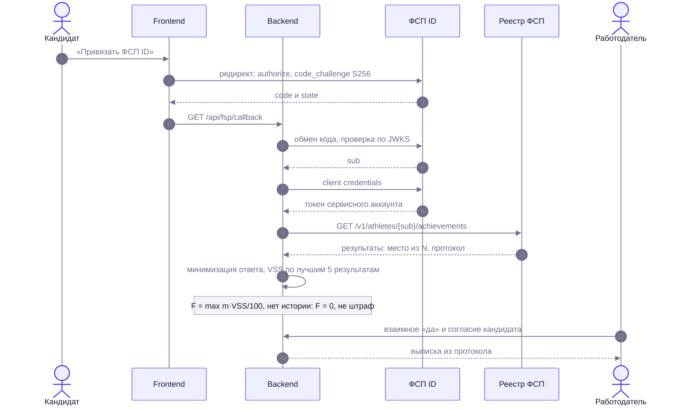
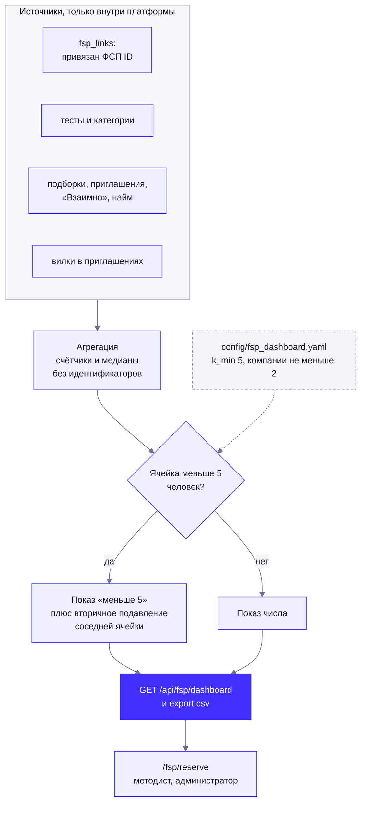

# Предложение ФСП: интеграция с реестром и ФСП ID

Документ описывает, как «Взаимно» получает данные Федерации спортивного программирования, как их использует и как перейти от демо-стенда к реальным системам ФСП. Он рассчитан на то, чтобы Федерация могла взять его как есть: **контракт API реестра** (разделы 3–4) — предложение, по которому мы уже написали рабочий мок и клиент; **расчёт VSS** (раздел 5) — прозрачная формула, все веса которой лежат в `config/fsp.yaml` и пересматриваются вместе с экспертами ФСП.

Источники истины: контракт — `backend/app/fsp/models.py` (копия в `services/fsp-mock/fsp_mock/contract.py` синхронизируется командой `python -m fsp_mock sync-contract`, расхождение ловит тест `test_fsp_mock.py`); realm — `deploy/keycloak/realm-fsp.json`; веса — `config/fsp.yaml`; клиент — `backend/app/fsp`, `backend/app/services/fsp_link`.

Содержание: [1. Принципы](#1-принципы) · [2. Схема](#2-схема-интеграции) · [3. ФСП ID](#3-фсп-id-oidc) · [4. API реестра](#4-предлагаемый-контракт-api-реестра) · [5. VSS](#5-расчёт-vss) · [6. Соревнования и мероприятия](#6-учёт-соревнований-и-мероприятий) · [7. Согласия](#7-согласия-скрытие-результатов-приватность) · [8. Несовершеннолетние](#8-несовершеннолетние) · [9. Путь к реальной интеграции](#9-пошаговый-путь-к-реальной-интеграции) · [10. Вопросы к ФСП](#10-что-нужно-согласовать-с-фсп)

## 1. Принципы

| Принцип | Что это значит |
|---|---|
| ФСП усиливает профиль, но не открывает дверь | Достижения влияют на **порядок внутри категории** (компонент F, не больше 15 баллов из 100) и на подтверждение навыков. Грейд и категорию даёт только тест |
| Отсутствие истории — не штраф | Нет привязки, нет результатов, результат ждёт протокола: F = 0, в «против» не попадает никогда |
| Согласие и контроль у спортсмена | Данные реестра сохраняются только при отдельном согласии; результаты можно скрыть; привязку можно снять с удалением данных |
| Минимум данных работодателю | До взаимного «да» — обобщённая строка («Призёр всероссийских · продуктовое программирование (хакатон) · 2025 · топ-3 · в команде»), без ФИО, номера ЕКП, команды и ссылки на протокол: пара «ЕКП + место» по публичным протоколам однозначно выдаёт человека |
| Проверяемость | После раскрытия — выписка с номером ЕКП, местом из N, командой и ссылкой на протокол |
| Замена без переписывания кода | Переход на реальные системы ФСП — смена переменных окружения и реализация одного HTTP-контракта |

## 2. Схема интеграции



Две независимые части:

1. **ФСП ID** отвечает на вопрос «кто это»: даёт стабильный `sub` и (для нового аккаунта) email. Своя регистрация и сессии «Взаимно» от него не зависят.
2. **Реестр достижений** отвечает на вопрос «что у него в протоколах»: по `sub` отдаёт результаты, соревнования, разряды и роли.

Пока у ФСП нет публичного API реестра (протоколы публикуются сканами PDF), на стенде работают: Keycloak с тем же realm `fsp` и сервис `fsp-mock` (60 вымышленных спортсменов, 25 соревнований, фамилии из ИТ-терминов, в номере ЕКП после года стоит «99» — признак синтетики). Если мок или Keycloak не подняты, демо не ломается: данные берутся из встроенного снимка (`VZ_FSP_PROVIDER=auto`), а вместо входа есть «демо-вход ФСП» с подписанным мок-токеном (в интерфейсе везде пометка «Демо-реестр ФСП»).

Последовательность: привязка, достижения, VSS и выписка:



## 3. ФСП ID (OIDC)

### 3.1. Клиент в realm `fsp`

| Параметр | Значение |
|---|---|
| Realm | `fsp` (на стенде — свой Keycloak 26 из `deploy/keycloak/realm-fsp.json`; в проде — `https://sso.fsp-russia.ru/realms/fsp`) |
| Client ID | `vzaimno` (`VZ_FSP_OIDC_CLIENT_ID`) |
| Тип клиента | Конфиденциальный (client secret), `publicClient: false` |
| Поток | Authorization code (`standardFlowEnabled`) + **PKCE S256** (`pkce.code.challenge.method = S256`); прямой доступ по паролю выключен (`directAccessGrantsEnabled: false`) |
| Redirect URI | `https://<домен>/candidate/fsp/callback` — страница фронтенда (`VZ_FSP_OIDC_REDIRECT_URI`, маршрут есть в `routes.tsx`), она вызывает `GET /api/fsp/callback` с `code` и `state` и привязывает ФСП ID. Локально — `http://localhost:5173/candidate/fsp/callback`. В демо-realm дополнительно разрешён реальный адрес бэкенда `…/api/fsp/callback`: переход браузера на него (заголовок `Sec-Fetch-Mode: navigate`) бэкенд перенаправляет (303) на страницу фронтенда с теми же `code`/`state` (и `error`, если ФСП ID отказал) — так работает и client, у которого зарегистрирован именно этот адрес. Старых путей `/auth/fsp/callback` и `/api/auth/fsp/callback` нет |
| Scopes | `openid profile email` (`VZ_FSP_SCOPES`) |
| Сервисный аккаунт | Включён (`serviceAccountsEnabled`): grant `client_credentials` для чтения API реестра |
| Защита от перебора | В демо-realm включена `bruteForceProtected`; срок жизни access-токена 300 с |

### 3.2. Какие claims нужны и что мы с ними делаем

| Claim | Нужен | Использование |
|---|---|---|
| `sub` | Да | Ключ связи: `fsp_links.fsp_id` (UNIQUE: один ФСП ID — один аккаунт) и ключ запроса к реестру `GET /v1/athletes/{sub}…`. **Должен быть стабилен** |
| `email` | Только при первом входе с лендинга | Адрес нового аккаунта; на него отправляется код подтверждения (аккаунт создаётся в `pending_email`). Без `email` — ошибка `fsp_email_missing`. Email из ФСП ID **не даёт права** на чужой аккаунт: если такой адрес уже зарегистрирован, вход отклоняется (409), привязать ФСП ID можно в профиле |
| `iss`, `aud`, `nonce`, `exp`, `iat` | Да | Проверка id_token: подпись по JWKS (допустимы RS/PS/ES-алгоритмы, `none` и HS* запрещены), `iss` равен realm, `aud` содержит наш client, `nonce` совпадает с начатым входом, срок действия с запасом 30 с. При неизвестном `kid` JWKS перечитывается один раз (ротация ключей) |
| `name`, `given_name`, `family_name`, `preferred_username`, `email_verified` | Нет | В привязке хранятся только служебные claims (`iss`, `sub`, `aud`, `azp`, `auth_time`, `preferred_username`, `email_verified`): имя и email из ФСП ID платформе для подбора не нужны |

### 3.3. Как защищён вход

- `state` и `nonce` — случайные 256/192 бит; в БД хранится только `sha256(state)`, запись одноразовая (`used_at`), живёт 10 минут (`VZ_FSP_STATE_TTL_S`).
- Вход привязан к браузеру: ответ `GET /api/fsp/login` ставит httpOnly-cookie `vz_fsp_flow` (путь `/api/fsp`) со `state`; завершить вход можно только из того же браузера. Привязка (`mode=link`) завершается только аккаунтом, который её начал.
- Бэкенд ходит за токеном по внутреннему адресу realm (`VZ_FSP_OIDC_INTERNAL_URL`), браузер — по публичному (`VZ_FSP_OIDC_ISSUER`); `iss` в id_token принимается и публичный, и внутренний. С настоящим SSO ФСП оба адреса совпадают.
- Лимиты: начать вход, завершить вход, демо-вход — 30/300 с, 30/300 с, 20/300 с с одного IP; «обновить достижения» — 6 раз за 10 минут на аккаунт.

## 4. Предлагаемый контракт API реестра

Контракт — OpenAPI 3.1, версия `1.0` (`CONTRACT_VERSION`). Лишние поля в ответах клиент игнорирует (`extra="ignore"`), поэтому реестр может расширять схему, не ломая клиентов. Получить схему из мока:

```bash
cd services/fsp-mock
pip install -r requirements.txt
uvicorn fsp_mock.main:app --port 8001        # документация: http://localhost:8001/docs
# схема файлом:
python -c "import json; from fsp_mock.main import app; print(json.dumps(app.openapi(), ensure_ascii=False, indent=1))" > fsp-registry-openapi.json
```

### 4.1. Эндпоинты

Все `/v1/*` требуют заголовок `Authorization: Bearer <токен>`; ответы — JSON в кодировке UTF-8; ошибки — `{"detail": "текст на русском"}`.

| Метод и путь | Ответ | Назначение | Коды |
|---|---|---|---|
| `GET /v1/athletes/{sub}` | `Athlete` | Профиль спортсмена: ФИО, дата рождения, регион. `sub` — из ФСП ID | 200, 401, 404, 422 |
| `GET /v1/athletes/{sub}/achievements` | `Achievements` | Результаты (вместе с соревнованиями, на которые они ссылаются), разряды, роли судьи и тренера. Пустые списки — спортсмен есть, результатов нет | 200, 401, 404, 422 |
| `GET /v1/competitions/{ekp}` | `CompetitionProtocol` | Карточка соревнования и выписка результатов по возрастанию места. Нужен для сверки протокола; платформа пока вызывает его только через провайдер, в потоках подбора не использует | 200, 401, 404, 422 |
| `GET /protocols/{ekp}` | HTML | Публичная страница протокола — значение `Competition.protocol_url`; токен не нужен (в демо) | 200, 404 |
| `GET /health` | `{"status", "contract_version"}` | Проверка работоспособности | 200 |

Семантика ошибок для клиента: `404` — спортсмена нет в реестре (для платформы это «результатов нет», F = 0); `401/403` — отказ в доступе (`FSPAuthError`); сетевая ошибка, таймаут и `5xx` — «реестр недоступен» (`FSPUnavailable`): прежние данные кандидата **не обнуляются**, синхронизация получает статус `error`, а в режиме `auto` используется резервный снимок. Различие важно: сбой сети не должен выглядеть как «у спортсмена нет результатов».

Требования к данным: `athlete_sub` во всех записях ответа равен `sub` из пути (чужие записи платформа отбрасывает и пишет предупреждение); каждый `Result.ekp` присутствует в `Achievements.competitions`; `ekp` — ровно 16 цифр; записи про одного спортсмена стабильно идентифицируются полем `id` (на нём держатся «скрыть результат» и дедупликация).

### 4.2. Аутентификация клиента

| Режим | Как | Где |
|---|---|---|
| Демо | Статический bearer-токен (`FSP_MOCK_TOKENS` в моке, `VZ_FSP_REGISTRY_TOKEN` в бэкенде), сравнение за постоянное время | `fsp-mock` |
| Прод | **OAuth 2.0 client credentials** сервисного аккаунта того же client в realm `fsp`: `POST VZ_FSP_TOKEN_URL` (`grant_type=client_credentials`, `client_id`, `client_secret`, необязательный `scope` из `VZ_FSP_REGISTRY_SCOPE`). Токен кэшируется до истечения с запасом 30 с; при `401` обновляется один раз. Если задан `VZ_FSP_TOKEN_URL`, статический токен не используется | `ClientCredentialsAuth` |

Доступ к реестру идёт от имени платформы, а не пользователя: платформа обязана запрашивать только `sub`, который получила от ФСП ID при входе этого пользователя, и только при действующем согласии.

### 4.3. Модели

Типы полей — по `backend/app/fsp/models.py`. Колонка «Как используем» показывает, где поле влияет на результат.

**`Athlete`** — спортсмен

| Поле | Тип | Описание | Как используем |
|---|---|---|---|
| `sub` | строка | Идентификатор = claim `sub` ФСП ID | Ключ связи |
| `last_name`, `first_name`, `middle_name` | строки | ФИО | Только кандидату в его собственном предпросмотре (фамилия и инициалы). Работодателю не передаются. Не участвуют в ранжировании |
| `birth_date` | дата | Дата рождения | Только год рождения, для политики по несовершеннолетним (раздел 8); наружу не отдаётся |
| `region_code`, `region_name` | строки | Субъект РФ | Не используется в ранжировании |
| `organization` | строка | Региональное отделение или клуб | Не используется |

**`Competition`** — соревнование из ЕКП

| Поле | Тип | Описание | Как используем |
|---|---|---|---|
| `ekp` | 16 цифр | Номер в Едином календарном плане | Ключ; в выписке после раскрытия |
| `title` | строка | Название | Строка результата |
| `discipline_code` | `^\d{10}[А-ЯA-Z]$` | Код дисциплины ВРВС | Дисциплина → короткий код (`algo`, `product`, `bas`, `robotics`, `infosec`); подпись в интерфейсе — из `config/fsp.yaml`, для `1010021811Я` — «Продуктовое программирование (хакатон)», как дисциплину называет ФСП |
| `level` | enum | `international`, `all_russian`, `interregional`, `regional`, `municipal` | Вес уровня L |
| `status_type` | enum | `championship`, `cup`, `first` (первенство), `other_sport`, `physical_culture_event`, `student` | Вес уровня L (для всероссийских: чемпионат, первенство, кубок) и подпись |
| `age_group` | enum | `adults`, `juniors_u26`, `youth_u19`, `kids_u15` | Передаётся и хранится, в вес не входит |
| `stage` | enum | `qualifier`, `final`, `single` | Вес L для отбора; группировка отбор+финал |
| `parent_ekp` | 16 цифр или пусто | Для отборочного этапа — ЕКП финала | Отбор и финал считаются **одним результатом** (берётся лучший) |
| `format` | enum | `personal`, `team` | Размер поля N: число команд при командном зачёте |
| `online` | bool | Проводилось онлайн | Не используется |
| `start_date`, `end_date` | даты | Даты | Свежесть T считается от `end_date` |
| `region_code`, `city` | строки | Место проведения | Не используется |
| `participants_count`, `teams_count` | числа ≥ 1 | Участники и команды | Размер поля N (`field_size`) |
| `max_score` | число > 0 или пусто | Максимально возможный балл | Поправка Q по сырому баллу |
| `protocol_status` | enum | `published`, `pending` (протокол ещё не сдан, до ~2 недель) | `pending` → результат «ожидает протокол», в оценку не идёт |
| `protocol_url` | строка | Ссылка на протокол | Только в выписке после раскрытия |

**`Result`** — результат спортсмена или его команды

| Поле | Тип | Описание | Как используем |
|---|---|---|---|
| `id` | строка | Идентификатор результата | «Скрыть / показать» |
| `ekp` | 16 цифр | Соревнование | Склейка с `Competition` |
| `athlete_sub` | строка | Спортсмен | Проверка владельца |
| `place`, `place_to` | числа ≥ 1 или пусто | Место или диапазон мест (5–8 в сетке на выбывание); пусто — участие без места | Качество места Q; для диапазона берётся середина, бонус — по худшему месту |
| `field_size` | число ≥ 1 | N — из скольких участников (команд) занято место | Q |
| `score` | число ≥ 0 или пусто | Итоговый балл | Q (вместе с `max_score`) |
| `role` | enum | `personal`, `captain`, `participant`, `reserve` | Вес роли Ro |
| `team` | `TeamRef` или пусто | `id`, `name`, `members[]` (`athlete_sub`, `role`, `team_function`) | Название команды — только в выписке после раскрытия |
| `team_function` | строка | Функция в команде из заявки: `backend`, `frontend`, `fullstack`, `mobile`, `ml`, `devops`, `design`, `pm`, `analyst` | **Только как заявленное**: в протоколах ФСП роли в команде нет, вклад в командный хакатон по ним честно не выделить. В VSS, F, K, обобщённую строку и паспорт навыков не входит; работодатель видит её отдельно серым — «роль backend — по заявке участника» |
| `status` | enum | `confirmed`, `awaiting_protocol` | Подтверждён ли результат |

**`Rank`** — разряд или звание. Источники: нормы ЕВСК по спортивному программированию — Приложение № 24 к приказу Минспорта России № 450 от 22.04.2024 ([PDF на fsp-russia.ru](https://fsp-russia.ru/upload/iblock/a47/z7lkm1z1clqnt0grv9xfvciytni5wltf.pdf)); сроки действия разрядов — Положение о ЕВСК (приказ Минспорта России № 173 от 03.03.2025), п. 76. Вид спорта «спортивное программирование» — код ВРВС **1010001311Я** (`config/fsp.yaml → sport`): он печатается в выписке из протокола и в паспорте навыков.

| Поле | Тип | Описание | Как используем |
|---|---|---|---|
| `id`, `athlete_sub` | строки | Идентификаторы | — |
| `code` | enum | `MS`, `KMS`, `I`, `II`, `III`, `I_y`, `II_y`, `III_y` (и `MSMK` — см. справа) | Вес разряда Rk. Нормы ЕВСК по спортивному программированию — МС, КМС, I–III и юношеские I–III; звания МСМК в них нет: код `MSMK` оставлен в контракте «на будущее», но веса не имеет, в VSS не входит и в интерфейсе не показывается |
| `discipline_code` | код ВРВС или пусто | Дисциплина результата, за который присвоен | Привязка к дисциплине; пусто — ко всем дисциплинам с результатами; код вне справочника в VSS не идёт |
| `assigned_at`, `valid_until` | даты | Присвоение и срок действия: КМС — 3 года, I–III и юношеские — 2 года, МС — бессрочно (пусто) | Действующий разряд ×1, истёкший — со свежестью от даты окончания. Если реестр не прислал `valid_until` для КМС или I–III, срок досчитывается от `assigned_at` по `config/fsp.yaml → vss.rank_validity_years` |
| `order_no`, `assigned_by`, `basis_ekp`, `status` | строки / enum (`active`, `expired`) | Приказ, кто присвоил, основание | Бейдж «КМС до 2027»; в оценку не входят |

**`RoleBadge`** — судья или тренер: `kind` (`judge`, `coach`), `position`, `category` (`VK`, `1K`, `2K`, `3K`, `YuSS`), `discipline_code`, `since`. **Только бейдж** («судья-эксперт (1К)»), в оценку силы не входит.

**`Achievements`** — ответ `/achievements`: `athlete_sub`, `as_of` (момент, на который реестр отдал данные: показывается как «данные реестра на …» на странице сверки и в PDF), `source` (`fsp_api`, `fsp_mock`, `diploma`), `results[]`, `competitions[]` (все соревнования из результатов), `ranks[]`, `roles[]`.

**`CompetitionProtocol`** — `competition` и `results[]`. **`RegistrySnapshot`** — полная выгрузка (`contract_version`, `data_as_of`, все списки): начальная синхронизация и встроенный резервный провайдер. **`ErrorResponse`** — `{detail}`.

### 4.4. Когда и как платформа обращается к реестру

| Момент | Что происходит |
|---|---|
| Предпросмотр (до согласия) | Запрос «на лету»; ответ **не сохраняется** |
| Согласие на обогащение | Синхронизация: ответ сохраняется (`fsp_links.achievements`), нормализуется в `fsp_achievements`, пересчитывается VSS, признаки подбора помечаются устаревшими |
| Кнопка «обновить достижения» | Повторная синхронизация, не чаще 6 раз за 10 минут на аккаунт |
| Вход с привязанным ФСП ID | Синхронизация, если согласие действует |
| Ночное обновление и вебхук реестра `achievement.created` | В разработке; при вебхуке реестру нужно только отправлять `sub` изменившегося спортсмена |

Таймаут запроса — 5 с (`VZ_FSP_TIMEOUT_S`); редиректы не выполняются. Нагрузка на реестр — по одному–двум запросам на кандидата при привязке и по запросу «обновить»; кэширования ответов на стороне реестра не требуется.

## 5. Расчёт VSS

VSS («подтверждённая сила») считается **по каждой дисциплине** из подтверждённых, не скрытых результатов и разрядов (`app/fsp/vss.py`, веса — `config/fsp.yaml → vss`). Время передаётся явно из `Clock`.

```
points(r)  = L · C · Q · Ro · T · V                результат r (L = 1 для всех мероприятий, C — класс результата)
A_d        = Σ_{i ≤ 5} p_(i) · 0,6^(i−1)           лучшие 5 результатов по убыванию (отбор и финал одного соревнования — один, лучший;
                                                   участий без призового места учитывается не больше 2)
VSS_d      = 100 · ( 1 − exp( −(A_d + 0,5·Rk) / 0,6 ) )      разряд без результатов в реестре: VSS_d ≤ 50
F          = max_d  m(d, специализация брифа) · VSS_d / 100   → компонент Score (вес 0,15 → не более 15 баллов)
K          : v_k ⊇ 0,8 · m(d, модуль навыка) · VSS_d / 100    ФСП как доказательство навыка
```

| Множитель | Что это | Значения |
|---|---|---|
| **L** — уровень мероприятия | **Равноправие** (ответы организаторов, DECISIONS п. 29): все дисциплины и мероприятия равны, «чемпионат России выше хакатона» не утверждаем | `1,0` для всех уровней и статусов; правила `vss.level_rules` оставлены в конфиге, чтобы эксперты ФСП при желании могли завести вес, не трогая код |
| **C** — класс результата | Призёр (худшее место ≤ 3) или участник (участник, участник отбора, финалист без призового места). **Защита от накрутки**: профиль нельзя раздуть онлайн-явками | призёр `1,0`; участник `0,5`; в `A_d` идут не больше **2** участий без призового места (`vss.result_class`) |
| **Q** — место с поправкой на размер поля | `q = 1 − (место−1)/max(N−1; 1)`; при сыром балле `q' = 0,5·q + 0,5·балл/макс`; `F(N) = min(1; ln(1+N)/ln 51)`; `Q = max(0,1; min(1; q^1,5 · F(N) + бонус))` | бонус за подиум: 1-е место +0,15, 2-е +0,10, 3-е +0,05. **Подтверждённое участие без места или в хвосте — не меньше `Q_min = 0,1`**: сам факт участия не обнуляется |
| **Ro** — роль | | личный зачёт 1,0; капитан 0,9; участник команды 0,85; запасной 0,4 |
| **T** — свежесть | `2^(−Δмес/24)` | полураспад 24 месяца — экспертное допущение «результат заметно устаревает за два года»; это **не** срок действия разряда (разряды действуют 2–3 года, МС — бессрочно, см. Rk) |
| **V** — источник | | `fsp_api` 1,0; `fsp_mock` 1,0 (демо-реестр стоит на месте API); `diploma` 0,5 |
| **Rk** — разряд | Вес лучшего действующего разряда; истёкший — со свежестью от даты окончания срока (КМС — 3 года, I–III и юношеские — 2 года, МС — бессрочно) | МС 0,9; КМС 0,7; I 0,5; II 0,35; III 0,25; юношеские 0,1. МСМК в нормах ЕВСК по спортивному программированию нет — веса нет |

**Пример** (дата отсчёта 05.10.2026). Спортсмен занял 1-е место из 103 на соревновании по продуктовому программированию 05.04.2026 в личном зачёте: `L = 1,0`, `C = 1,0` (призёр), `Q = 1,0` (поле больше 51, подиумный бонус обрезается единицей), `Ro = 1,0`, `T = 2^(−6/24) = 0,841`, `V = 1,0`; `points = 0,841`; `A = 0,841`; `VSS = 100·(1 − e^(−0,841/0,6)) = 75,4`. Для брифа Backend при `m(product, backend_python) = 0,8` получается `F = 0,8·0,754 = 0,603`, то есть вклад в Score `100 · 0,15 · 0,603 = 9,0` балла. Для сравнения: 15-е место из 60 на региональном соревновании год назад в команде (участник, `C = 0,5`) даёт `VSS = 28,4`; участие в студенческом муниципальном соревновании без места 60 дней назад — `VSS = 6,5`; двенадцать подряд онлайн-участий без призовых мест дают столько же, сколько два (потолок участий); один разряд КМС без результатов — `VSS = 44,2` (с пометкой «оценка по разряду»).

**Что учитывается, а что нет (ответы организаторов, DECISIONS п. 29).** Учитываем: результат (класс «призёр / участник» и место в поле), число стартов (убывающая отдача `0,6^(i−1)` и потолок участий), релевантность дисциплины специализации кандидата (`m(d, s)`: ИБ-соревнования — для ИБ-специалиста) и свежесть (полураспад 24 месяца — допущение, не срок действия разряда). **Не** ранжируем мероприятия между собой: уровень или статус соревнования веса не даёт. Прежняя шкала уровней (всероссийский 0,9, региональный 0,3 и т. д.) отменена: она утверждала иерархию, которой организаторы не признают. **ФСП никогда не влияет на грейд** — грейд определяет только тест; ФСП входит лишь в Score (F) и в доказательство навыков (K), а в модулях `app/testing` и `app/services/testing` данных ФСП нет вовсе.

Матрицы `m(d, s)` (дисциплина → специализация) и `m(d, модуль)` лежат в `config/fsp.yaml` (`spec_relevance`, `module_relevance`): например, алгоритмическое → Backend 0,8, Frontend 0,4; продуктовое → Fullstack 0,9, Backend и Frontend 0,8; ИБ → DevOps 0,7. Все веса — экспертные допущения: **их нужно калибровать вместе с экспертами ФСП**. Обобщение места для работодателя до раскрытия — полосы «топ-3», «топ-10», «топ-10 %», «топ-25 %», «топ-50 %»; 1-е место тоже показывается как «Призёр», точное место — только в выписке.

## 6. Учёт соревнований и мероприятий

| Вид записи в реестре | Как учитывается |
|---|---|
| Результат на официальном соревновании ЕКП (чемпионат, первенство, кубок) | Вес результата (класс «призёр / участник», место в поле, раздел 5); уровень и статус мероприятия веса **не** дают; попадает в VSS |
| Отбор и финал одного соревнования | Связаны `parent_ekp`; считаются **одним** результатом — берётся лучший (иначе отбор и финал удваивали бы вклад) |
| Другие официальные соревнования, физкультурные мероприятия, студенческие соревнования (`other_sport`, `physical_culture_event`, `student`) | Считаются так же, как любые другие: по результату, числу стартов и свежести; веса за уровень или статус нет |
| Командный зачёт | Размер поля N — число команд; вклад умножается на вес роли по протоколу (капитан 0,9, участник 0,85, запасной 0,4). Функция в команде (`team_function`) — из заявки, в протоколе её нет: на оценку не влияет, работодателю показывается отдельно серым «по заявке участника» |
| Онлайн-формат и возрастные группы | Поля `online` и `age_group` передаются и хранятся, в вес не входят; накрутку онлайн-явками гасит потолок участий без призового места (не больше 2 в `A_d`, вес участника `0,5`) |
| Результат без места | Подтверждённое участие: `Q = Q_min = 0,1` |
| Результат с ожидающимся протоколом | `status = awaiting_protocol` или `protocol_status = pending` → «ожидает протокол»: в VSS не идёт, у кандидата подпись «Ожидает протокол», учтётся после публикации |
| Разряд | Бейдж (например, «КМС до 2027») и слагаемое `0,5·Rk` в VSS. Только разряды норм ЕВСК по спортивному программированию (МС, КМС, I–III, юношеские) |
| Судья, тренер | **Только бейдж**, в Score не входят |
| Дисциплина не из справочника ВРВС (другой вид спорта) | В VSS не идёт |

Состояние профиля, которое видит кандидат и от которого зависит подпись для работодателя: `not_linked`, `linked_no_results`, `awaiting_protocol`, `linked`. Отдельное состояние экрана — `registry_unavailable`: реестр не ответил (сеть, отказ в доступе, по адресу `VZ_FSP_REGISTRY_URL` отвечает чужой сервис); оно не равно «результатов нет», причина — в `sync_error`, привязка и согласие сохраняются, F = 0 без штрафа. HTTP-клиент считает «спортсмена нет в реестре» только `404` с телом контракта `{"detail": "…"}`; любой другой `404` (другой сервис на порту, прокси) — недоступность. Внешние соревнования вне ЕКП (например, Кубок Федерации CTF, Codeforces) в текущей модели не учитываются — это вопрос к ФСП (раздел 10).

## 7. Согласия, скрытие результатов, приватность

| Что | Как устроено |
|---|---|
| Согласие `fsp_enrichment` | Отдельная запись журнала согласий с версией текста (`POST /api/fsp/me/enrichment`). Без него данные реестра только показываются в предпросмотре и **не сохраняются**, на подбор не влияют |
| Скрытие результатов | `PATCH /api/fsp/me/results/{result_id}` `{hidden}`. Выбор живёт и до согласия (предпросмотр → скрыть → согласие). Скрытый результат не участвует ни в F, ни в K, ни в выдаче работодателю: иначе получилась бы скрытая накрутка |
| Отзыв согласия в журнале | Данные реестра удаляются (в том числе сохранённый ответ), привязка остаётся |
| Отвязка | `DELETE /api/fsp/me`: удаляются привязка, `fsp_id` и все данные ФСП, согласие отзывается (запись в журнале) |
| Что сохраняется при согласии | Только используемые поля ответа реестра (`app/services/fsp_link/minimize.py`, `config/privacy.yaml → fsp_registry`): в `fsp_links.athlete` — `sub` и год рождения (политика по несовершеннолетним), в `fsp_links.achievements` — результаты, соревнования и разряды без номера приказа и без `sub` других участников команд (остаётся размер состава и роли), плюс нормализованные записи `fsp_achievements`. ФИО, дата рождения целиком, регион и организация не сохраняются; старые полные строки дочищает ночная задача. Работодателю ФИО из реестра не передаётся никогда |
| Что видит работодатель до раскрытия | Обобщённо: дисциплина, уровень, год, полоса места, роль, бейджи; без ЕКП, команды, протокола, ФИО |
| После взаимного «да» и согласия | Выписка из протокола (моноширинный текст): номер ЕКП, место из N, команда, ссылка на протокол, «источник: Реестр ФСП, на 05.10.2026». Разрешённые кандидатом поля профиля |
| Защита от «предзахвата» аккаунта | Аккаунт, созданный входом через ФСП ID, ждёт подтверждения email; если владелец email зарегистрируется по паролю сам, чужая привязка ФСП ID удаляется при первом обращении. Согласие, отмеченное при таком входе, применяется только после подтверждения email |
| Демо-вход | Открывает только аккаунты, созданные входом через ФСП ID (аккаунт с паролем, к которому привязали демо-спортсмена, входит по паролю). Выключается `VZ_FSP_DEMO_LOGIN_ENABLED=false` |

## 8. Несовершеннолетние

В реестре есть несовершеннолетние спортсмены (в демо-реестре 7 из 60). Политика платформы (`config/contact.yaml → minors`):

- **моложе 16 лет** — в выдачу работодателям не попадают;
- **16–17 лет** — только брифы и приглашения с флагом «стажировка»;
- возраст считается по году рождения из реестра, **реестр важнее заявленного кандидатом** (иначе несовершеннолетний обошёл бы защиту, указав год рождения до привязки); без года рождения кандидат с флагом `is_minor` скрывается осторожно в пользу защиты;
- возраст и пол работодателю не показываются и в Score не участвуют никогда.

Согласие законного представителя кандидатов 15–17 лет запрашивается платформой сама (письмо представителю с одноразовой ссылкой, `POST /api/candidates/me/guardian`, [SECURITY.md](SECURITY.md) п. 1.4). Подтверждение родства документом остаётся организационным вопросом и **требует решения ФСП** (раздел 10).

## 9. Пошаговый путь к реальной интеграции

Код платформы при переходе не меняется: меняются переменные окружения и (на стороне ФСП) публикуется HTTP-контракт реестра.

| # | Шаг | Что сделать | Проверка |
|---|---|---|---|
| 1 | Зарегистрировать client в realm `fsp` ФСП | Конфиденциальный, standard flow + PKCE S256, redirect URI `https://<домен>/candidate/fsp/callback` (страница фронтенда), scopes `openid profile email`; claims `sub`, `email`, имя уже есть в кабинете ФСП | `GET <issuer>/.well-known/openid-configuration` отвечает; в JWKS есть ключи RS/PS/ES |
| 2 | Сменить issuer и учётные данные | `VZ_FSP_OIDC_ISSUER=https://sso.fsp-russia.ru/realms/fsp`; `VZ_FSP_OIDC_CLIENT_ID`, `VZ_FSP_OIDC_CLIENT_SECRET` (только из секретов окружения), `VZ_FSP_OIDC_REDIRECT_URI`; **убрать** `VZ_FSP_OIDC_INTERNAL_URL` (публичный и внутренний адрес совпадают); `VZ_FSP_KEYCLOAK_PUBLIC_URL` и профиль compose `fsp` больше не нужны | `GET /api/fsp/availability` → `fsp_id_available: true`, `registry_label: "Реестр ФСП"` |
| 3 | Получить доступ к реестру | Сервисный аккаунт того же client (client credentials) с правом чтения реестра: `VZ_FSP_TOKEN_URL=https://sso.fsp-russia.ru/realms/fsp/protocol/openid-connect/token`, при необходимости `VZ_FSP_REGISTRY_SCOPE`; `VZ_FSP_REGISTRY_TOKEN` не задавать | Токен выдаётся, `GET /v1/athletes/{sub}` отвечает 200 или 404, не 401 |
| 4 | Опубликовать API реестра по контракту | Реализовать эндпоинты раздела 4.1 (минимум — `athletes/{sub}` и `achievements`), использовать мок как эталон; прогнать контрактные тесты на ответах реального реестра (`Achievements.model_validate`) | Тест соответствия моделям; поля `ekp` — 16 цифр, `discipline_code` — коды ВРВС |
| 5 | Переключить `FSPProvider` | `VZ_FSP_REGISTRY_URL=<адрес API реестра>`, `VZ_FSP_PROVIDER=http` (в режиме `auto` сбой реестра для `sub`, которого нет в демо-снимке, всё равно даёт «недоступно», но на проде резервный демо-реестр не нужен) | `GET /api/fsp/me/achievements` у тестового спортсмена возвращает его результаты; остановка реестра даёт `sync_status = error`, а не «результатов нет» |
| 6 | Отключить демо | `VZ_FSP_DEMO_LOGIN_ENABLED=false`; остановить `fsp-mock` и Keycloak стенда | Кнопки «демо-вход ФСП» нет; `/api/fsp/demo-login` → 403 `fsp_demo_disabled` |
| 7 | Учесть задержку протоколов | Результаты до сдачи протокола приходят как `awaiting_protocol` / `protocol_status = pending` и в оценку не идут | В интерфейсе «Ожидает протокол»; после публикации учитывается при следующей синхронизации |
| 8 | Привязки | `sub` у настоящих спортсменов другие: демо-пользователей realm в проде нет, привязка `fsp_id` создаётся заново при первом входе. Сопоставление исторических данных по ФИО и дате рождения — только с согласия человека, **вне MVP** | — |
| 9 | Согласовать открытые вопросы | Раздел 10: состав данных, веса, несовершеннолетние, внешние соревнования | Протокол согласования; правка `config/fsp.yaml` |

Дальнейшее развитие (вне MVP): вебхук реестра `achievement.created`, брокеринг ФСП ID через собственный Keycloak платформы (если платформа переедет на него целиком), загрузка диплома как источника с весом `diploma` 0,5.

Достижения из реестра можно выдавать кандидату как подписанные переносимые учётные данные (W3C VC / Open Badges 3.0): демонстрационный вариант и роль ФСП как настоящего издателя описаны в [CREDENTIALS.md](CREDENTIALS.md), раздел 6.

## 10. Что нужно согласовать с ФСП

1. **Состав данных реестра.** Будут ли в реальной интеграции место из N, сырой балл, роль и состав команды, разряд со сроком действия, номер ЕКП? Это определяет схему и формулу VSS (Q, Ro, Rk).
2. **Модель доступа.** Сервисный аккаунт (client credentials, как в предложении) или токен пользователя после входа через ФСП ID? Стабилен ли `sub`; есть ли тестовый client в realm `fsp`?
3. **Публичность и скрытие.** Можно ли спортсмену скрывать отдельные результаты; публичны ли достижения по умолчанию? Предложение: можно, скрытые не участвуют в оценке.
4. **Несовершеннолетние.** Показывать ли их работодателям; допустимы ли только стажировки с 16 лет; нужно ли согласие законного представителя?
5. **Вес ФСП в ранжировании.** Устраивает ли «не более 15 баллов из 100, не перевешивает большой разрыв в тесте, отсутствие ФСП не штраф»? В симуляции при равном тесте обладатели ФСП несколько выше в топ-10 ([VALIDATION.md](VALIDATION.md) §4.5): возможно, вес стоит пересмотреть.
6. **Матрица «дисциплина → специализация»** и учёт роли внутри команды продуктового программирования: сейчас роль есть только в заявке участника, поэтому платформа показывает её как заявленную и в оценке не использует. Если ФСП начнёт фиксировать функцию в команде в протоколе, её можно будет учитывать.
7. **Внешние соревнования** (Кубок Федерации CTF, Codeforces): учитывать в F или только официальные ЕКП?
8. **Анонимность до согласия.** Платформа скрывает не только контакты, но и имя: протоколы публичны, и пара «ЕКП + место» однозначно выдаёт человека. Не противоречит ли это видению ФСП?

## 11. Панель ФСП: кадровый резерв

**Что получает ФСП.** Кабинет `/fsp/reserve` (API `GET /api/fsp/dashboard`, выгрузка `/api/fsp/dashboard/export.csv`): воронка «участник соревнований (привязан ФСП ID) → прошёл тест → подтверждённая категория → попал в подборки → получил приглашение → «Взаимно» → нанят» рядом с остальными кандидатами; разрезы по пяти дисциплинам, федеральным округам, регионам и «специализация × грейд»; динамика по неделям; число компаний, приглашавших и нанимавших спортсменов; медианы предложенной зарплаты «ФСП / остальные» по грейдам (на руки и до НДФЛ, ставка в конфиге); «где не хватает кадров» — спрос компаний по категориям против спортсменов ФСП с подтверждённой категорией. Это инструмент, которого у федерации сейчас нет: основа программы трудоустройства.

Поток данных панели:



**Приватность.**
- В ответе только счётчики и медианы: ни идентификаторов, ни имён, контактов, ФСП ID, ни названий компаний.
- k-анонимность: ячейка, где меньше 5 человек, отдаётся как «<5» (ноль не скрывается). Для взаимоисключающих строк (округа, регионы) действует вторичное подавление: если скрыта одна ячейка, скрывается и наименьшая соседняя, а мелкие регионы сливаются в «прочие», иначе скрытое число вычиталось бы из итога. Спрос работодателей считается в компаниях и скрыт, пока их меньше 2. Доля от предыдущей стадии не показывается, если скрыта сама ячейка или знаменатель.
- Доступ: роли «методист» и «администратор» (в демо — кнопка «Панель ФСП» на странице жюри). Для реальной ФСП предлагается отдельная роль аналитика и договор о том, какие агрегаты ей положены.
- Все пороги и справочники — `config/fsp_dashboard.yaml`. Отсутствие истории ФСП — не штраф: сравнение описательное и в Score не участвует.

**Честность демо.** Данные синтетические, реестр ФСП — мок; на странице об этом сказано. Чтобы k-анонимность не превратила панель в сплошные «<5», `scripts/seed_demo.py` и `POST /api/demo/reset` добавляют воспроизводимую «демо-историю подбора» (`app/services/demo/fsp_reserve.py`): 8 вымышленных компаний-архивов и ~160 приглашений за 12 недель. Эффекта «ФСП сильнее» в историю не заложено — исходы и вилки для обеих групп одинаковы.
