# Механика подбора и категоризации

Как «Взаимно» строит слепую объяснимую подборку: от текста потребности работодателя до версии подборки с разложением Score. Все веса и пороги — в `config/scoring.yaml`, `config/skills.yaml`, `config/taxonomy.yaml`, `config/fsp.yaml`, `config/contact.yaml`; код — `backend/app/matching` (чистые функции) и `backend/app/services/matching` (БД, права, приватность). Результаты симуляций — в [VALIDATION.md](VALIDATION.md). Не построенное помечено «в разработке».

Содержание: [1. Категория](#1-категория--специализация--грейд) · [2. Конвейер](#2-конвейер) · [3. Разбор брифа](#3-разбор-брифа) · [4. Категории и охват](#4-рекомендация-категорий-и-охват-вилки) · [5. Формула Score](#5-формула-score) · [6. Объяснения](#6-объяснения-3-за-и-1-против) · [7. Версии подборки](#7-версии-подборки-без-потери) · [8. Приватность](#8-приватность-до-раскрытия) · [9. Сигнал интереса](#9-сигнал-интереса) · [10. Кандидаты без ФСП](#10-кандидаты-без-фсп) · [11. Банк без брифа](#11-банк-кандидатов-без-брифа) · [12. Ограничения](#12-ограничения)

## 1. Категория = специализация × грейд

Категория — детерминированная функция `f(специализация, подтверждённый тестом грейд)` (`category_of` в `app/testing/session.py`): код `backend_python:middle`, название «Backend (Python) · Middle». Справочник — `config/taxonomy.yaml`.

| Специализация | Статус | Заметка |
|---|---|---|
| Backend (Python), Frontend (JS/TS) | `active` | Тест работает; кандидат получает категорию |
| Fullstack | `derived` | Присваивается, когда подтверждены обе квалификации; грейд — меньший из двух; кандидат виден в обеих категориях и в общем топе один раз |
| QA, DevOps | В разработке | Банки заданий пополняются; сейчас `survey_only` |
| Data/ML, Mobile, ИБ, Backend (Go), Backend (Java/Kotlin) | `survey_only` | Опрос есть, теста нет. Бриф, распознанный как такая категория, получает пометку «категория пока не тестируется. N кандидатов прошли опрос и ждут теста»; подборки по ней нет |

**Ни резюме, ни самоописание категорию не открывают.** Категорию даёт только тест. Резюме и опрос порождают серые чипы «заявлено».

Кандидат виден работодателям (`matching_features.visible`), только если одновременно: аккаунт активен; дано согласие `blind_card`; режим поиска не «не ищу»; категория подтверждена тестом; сессия не на проверке у методиста; возраст не меньше 16 лет (16–17 лет — только брифы с флагом «стажировка»); компания не в блок-листе кандидата. Отозвав согласие, перейдя в «не ищу» или заблокировав компанию, кандидат пропадает даже из уже собранных версий подборки (места остальных не пересчитываются).

## 2. Конвейер

```mermaid
flowchart LR
  T["Текст брифа и вилка"] --> P["Разбор: навыки, must и nice, специализация, грейд, формат"]
  P --> C["Рекомендация категорий P(s)·P(g) и охват вилки"]
  C --> S["Пул: matching_features, visible, не в блок-листе"]
  S --> SC["Score: G · Cov · (T, K, F, A, U)"]
  SC --> EX["Объяснения: 3 за и 1 против"]
  EX --> V["Версия подборки n: неизменяемый снимок"]
  V --> F["Фильтры: hidden_by вместо удаления"]
  F --> V2["Версия n+1, шортлист, откат"]
```



Источники признаков кандидата (`app/services/matching/sources.py`, `features.py`): квалификация (θ̂, SE, подбаллы модулей), ФСП (VSS по дисциплинам), регулярные задачи, настройки кандидата (минимум зарплаты, форматы, город, релокация, отрасли), заявленные навыки. Строки кэша `matching_features` хранят **абсолютные** даты («дней назад» считаются при чтении по `Clock`), пересобираются по хукам (тест, профиль, согласие, ФСП, задачи) и по отпечатку источников; максимальный срок жизни — 7 дней, потому что VSS зависит от времени.

## 3. Разбор брифа

`POST /api/needs/parse` не сохраняет ничего и работает на правилах за ≤ 300 мс (`app/matching/brief_parser.py`, версия `rules-1`).

| Шаг | Как |
|---|---|
| Нормализация и вилка | «к / тыс / 000» → рубли; «на руки / до НДФЛ» ищется рядом с суммой; число без единиц считается рублями только если оно не меньше 10 000. Проверка: `from ≥ 30 000`, шаг 1000, `to ≥ from`; `to ≤ 1,6·from` — норма, 1,6–2,0× — мягкое предупреждение, больше 2,0× — блокировка |
| Навыки | Словарь `config/skills.yaml`: 349 навыков с синонимами; Aho-Corasick плюс `rapidfuzz` (≥ 90) для опечаток; у каждого чипа цитата-спан в тексте |
| must и nice | Маркеры в окне ±6 токенов («желательно», «будет плюсом» → nice; без маркера → must). Не больше 5 must; если больше — первые 4 остаются must, остальные nice |
| Специализация | `P(s) = softmax((2·cue_s + Σ вес навыков + 1,5·cos(эмбеддинг, прототип)) / 1,5)`. Эмбеддинг-член подключается через `embed_similarity` и по умолчанию равен 0 (модели в рантайме нет — «в разработке») |
| Грейд | Явные маркеры («Middle+», «Senior»), «опыт от N лет», слабый априор по середине вилки (медианы на руки: Стажёр 60, Junior 120, Middle 230, Senior 380 тыс.) |
| Формат и город | Словарь форматов (офис, гибрид, удалённо) и 50 городов; релокация |
| Уточняющий вопрос | Не больше одного, если `P(spec) < 0,5`, `P(grade) < 0,45` или не хватает вилки/навыков |

Каждое поле несёт источник: «правило», «вручную» или имя LLM-провайдера, и цитату для подсветки в тексте. Правки работодателя (`spec`, `grade`, `must`, `nice`, `formats`, `city`) применяются поверх разбора с источником «вручную» (422 `brief_invalid` при недопустимой правке, например больше 5 must).

**LLM** (по умолчанию выключена, `VZ_LLM_PROVIDER=none`) может только **добавить** навыки, пропущенные правилами, и только с цитатой, найденной в тексте (`partial_ratio ≥ 90`). В ранжировании LLM не участвует (проверяется тестом). Цифры в демо, которые зависят от разбора брифа, считаются движком, а не вручную.

## 4. Рекомендация категорий и охват вилки

`GET /api/needs/{need_id}/categories` (`app/matching/coverage.py`):

- `P(c = s×g) = P(s)·P(g)`; показываются до 3 категорий с `P ≥ 0,10` (основная — наибольшая); если в основной категории меньше 15 кандидатов, предлагается смежная (вес смежности не ниже 0,8).
- Для каждой категории: число кандидатов N, **ползунок «верх вилки → охват»**, квартили ожиданий P25–P75 (с шагом 10 тыс. руб.), доля с ФСП и доля активных за 30 дней. Подсказка вида «ваша вилка покрывает 11 из 38; при верхе 300 тыс. — 27 из 38» появляется, если вилка охватывает меньше половины.
- **Защита минимума зарплаты отдельного кандидата**: ползунок показывается при N ≥ 10, ступени гистограммы склеиваются, пока в каждой не окажется не меньше 3 человек, квартили округляются до ступени. Подбором верха вилки точный минимум одного человека не вычислить.
- Вкладка «Как мы проверим» (`GET /api/needs/{need_id}/check`): навыки брифа → модули теста; серый список «тестом не проверяется — проверьте на интервью». Подробности — [TESTING_MECHANISM.md](TESTING_MECHANISM.md), п. 12.

## 5. Формула Score

```
Score(кандидат | бриф) = 100 · G · Cov · ( wT·T + wK·K + wF·F + wA·A + wU·U )
```

Пресеты весов (`scoring.yaml → presets`): «Баланс» `T 0,40 · K 0,25 · F 0,15 · A 0,10 · U 0,10` (по умолчанию) и «Стек важнее» `T 0,30 · K 0,40 · F 0,10 · A 0,10 · U 0,10`. Ограничения проверяются при загрузке: `wT ≥ 0,30`, `wF ≤ 0,15`, сумма равна 1. Вклад ФСП поэтому не превышает 15 баллов из 100: сильный ФСП не перевешивает большой разрыв в тесте.

| Компонент | Формула | Откуда данные |
|---|---|---|
| **G** — категория | `G = adjS · adjG` (· 0,9 при `BORDERLINE_PASS`). Основная категория: `adjS = 1`. Смежные специализации: Backend↔Fullstack и Frontend↔Fullstack 0,8; Backend↔Frontend 0,3; Backend↔Data/ML, Backend↔DevOps, Backend↔Go, Backend↔Java, Go↔Java 0,5; Backend↔QA 0,3; остальные пары 0. Кандидат с бейджем Fullstack для брифов Backend, Frontend и Fullstack получает `adjS = 1`. Грейд: на ступень выше брифа ×0,85, ниже ×0,80 (дальше — степень) | Квалификация |
| **Cov** — покрытие must | 0,8, если подтверждено (`v_k ≥ 0,5`) меньше половины must; иначе 1 | K |
| **T** — тест | `θ_lcb = θ̂ − SE(t)`, где `SE(t)² = SE² + 0,02·Δмес`. `T = доверие · Pct_категории(θ_lcb)`; при N категории меньше 30 — `Φ((θ_lcb − μ_g)/σ_g)` по калибровочным `μ_g, σ_g` грейда. Доверие 1,0 (нет флагов) или 0,75 | Тест |
| **K** — стек | `K = Σ w_k·v_k / Σ w_k`, `w = 1,0` (must) или `0,4` (nice). `v_k = max( 1,0·test_k ; 0,9·q·2^(−Δд/90) ; 0,8·m(d,k)·VSS_d/100 )`. `test_k` — максимум по модулям навыка величины `P(θ_m ≥ порог грейда брифа)`, если модуль отмечен `✓` или `✓✓`. Второй член — задачи типа A. Третий — ФСП как доказательство навыка. **Заявленных навыков в `v_k` нет** | Тест, задачи, ФСП |
| **F** — ФСП | `F = max_d m(d, специализация брифа) · VSS_d / 100`; нет истории → **F = 0** (не штраф, в «против» не попадает). `VSS_d` строится из `points = C · Q · Ro · T · V` по лучшим 5 результатам с убывающей отдачей; **мероприятия не ранжируются** (уровень и статус веса не дают, DECISIONS п. 29), класс результата `C`: призёр 1,0 / участник 0,5, участий без призового места учитывается не больше 2. Релевантность дисциплины специализации (`m`) и свежесть (полураспад 24 мес.) — разрешены. ФСП на грейд не влияет | Реестр ФСП |
| **A** — свежесть | `A = max_r min(1, q_r·(1 + 0,25·[тег задачи ∈ навыки брифа])) · 2^(−Δд_r/45)` по задачам A и B за 180 дней | Регулярные задачи |
| **U** — условия | `U = 0,6·SalFit + 0,4·FmtFit`. `SalFit = 1`, если минимум кандидата ≤ верха вилки, иначе `max(0, 1 − (min/to − 1)/0,25)` с округлением превышения **вверх до полосы 5 %** (значения 1; 0,8; 0,6; 0,4; 0,2; 0), чтобы точный минимум не восстанавливался из вклада. `FmtFit` — максимум по матрице совместимости форматов; офис/гибрид в другом городе без релокации — 0; пересчёт «на руки ↔ до НДФЛ» по ставке 13 % | Настройки кандидата |

Когда в брифе нет навыков, K считается по модулям стандартного теста категории брифа (веса `blueprint`).

**Зарплата всегда с базисом.** Каждая сумма в интерфейсе подписана «на руки» или «до вычета НДФЛ»: вилка брифа (`needs.salary_net`), приглашение и вакансия (`salary_net` / `salary_type`), ожидания кандидата (`candidate_profiles.salary_type`), встречное условие «Да, если…» (в базисе приглашения). Без пометки в тексте брифа берём «на руки» и говорим об этом работодателю. Подписи — `config/contact.yaml → salary.types`; поле базиса уже есть во всех сущностях, отдельной миграции не требуется.

**Чего в Score намеренно нет:** близости текста брифа к тексту резюме или профиля, самозаявленных навыков, возраста, пола, фото, вуза, отрасли интереса. Эмбеддинги в ранжировании не участвуют.

### Контрольные примеры

Три примера зафиксированы в `tests/test_matching_scoring.py` и обязательны для прохождения (`G = Cov = 1`, пресет «Баланс»):

| Кандидат | T | K | F | A | U | Score | Вклады T + K + F + A + U |
|---|---|---|---|---|---|---|---|
| A, призёр ФСП | 0,91 | 0,80 | 0,72 | 0,6 | 1,0 | **83,2** | 36,4 + 20,0 + 10,8 + 6,0 + 10,0 |
| B, без ФСП | 0,95 | 0,85 | 0 | 0,9 | 1,0 | **78,3** | 38,0 + 21,3 + 0 + 9,0 + 10,0 |
| C, сильный ФСП, слабый тест | 0,60 | 0,60 | 0,95 | 0,2 | 0,8 | **63,3** | 24,0 + 15,0 + 14,3 + 2,0 + 8,0 |

Так выполняется условие «выше — у кого лучше результаты тестирования **и** есть достижения ФСП»: B без ФСП опережает C с сильным ФСП, а A с обоими преимуществами идёт первым.

### Детерминизм

Сортировка: `подтверждённые тестом` → `Score ↓` → `T ↓` → число совпавших заявленных навыков ↓ (только для разрыва ничьих) → `hash(need_id, candidate_id)`. Сравнение Score и T идёт с округлением до 9 знаков (защита от шума float). В каждую версию подборки пишется `scoring_config_version` — версия плюс sha256 **всех** входов формулы (`scoring.yaml`, матрицы ФСП, пороги грейдов и blueprint, граф «навык → модули»): правка любой матрицы не сможет незаметно поменять ранги.

## 6. Объяснения: 3 «за» и 1 «против»

Без LLM (`app/matching/explain.py`):

1. **Разложение**: `c_i = 100·G·Cov·w_i·x_i`, `Σ c_i = Score` (допуск ±0,1 после округления методом наибольших остатков; проверяется тестом). Работодатель видит полосу из 5 вкладов.
2. **«За»** — до трёх компонентов, у которых `c_i − медиана_версии(c_i) > 1`, по убыванию превышения.
3. **«Против»** — **первый сработавший** флаг по приоритету: `must_unconfirmed` (обязательный навык не подтверждён) → `salary_above` (ожидания выше вилки) → `format_mismatch` → `borderline` (тест сдан на границе) → `low_trust` → `stale_test` (тест старше 12 месяцев) → `weak_component` (`c_i − m < −3`, **кроме F**) → `nice_unconfirmed`.
4. **Отсутствие ФСП в «против» не попадает никогда.** Для кандидата «по опросу» вместо «ниже медианы» пишется «категория по опросу, не подтверждена».
5. Каждый пункт — шаблон со ссылкой на доказательство: попытку теста, задачу, запись ФСП, настройки, навык брифа. Непроверяемый must формулируется без ссылки на резюме: «Kafka не подтверждена — проверьте на интервью»; заявленное показывается серым чипом.
6. **«Почему #2 выше #3»** (`GET /api/needs/{need_id}/versions/{n}/neighbors/{rank}`): разница баллов, главный плюс и главный минус.
7. **Кандидату** в «почему вы» уходят те же «за», переписанные на «вы», без сравнения с другими.

Чипы навыков: зелёный «подтверждено» (с источником «Тест: модуль SQL ✓✓», «Задача … 4/5», «ФСП: алгоритмическое»), жёлтый «слабо», серый «заявлено» или «нет данных». Честность объяснений проверена на симуляции: ссылки на существующие доказательства, `Σ вкладов = Score` — 100 % ([VALIDATION.md](VALIDATION.md) §4.6).

## 7. Версии подборки без потери

| Свойство | Реализация |
|---|---|
| Неизменяемость | `POST /api/needs/{need_id}/versions` собирает версию `n` (`need_versions`): снимок брифа, категории, фильтры, пресет, веса, `scoring_config_version`, до 500 строк `items` с Score, компонентами, причинами и `hidden_by[]` |
| Фильтры не удаляют | Любой фильтр — `has_fsp`, `salary_fit`, `format`, `city`, `must_confirmed`, `skill`, `min_score`, `active`, `industry`, `grade`, `confirmed_only`, `exclude` — заполняет `hidden_by` и причину; отфильтрованные уходят в группу «Скрыто фильтрами (N)». Фильтр «есть ФСП» включает только сам работодатель |
| Правка = новая версия | Правка брифа, фильтра или пресета создаёт версию `n+1`; бейджи `новый`, `▲3 / ▼2` — разница с предыдущей (`compare_to`) |
| Шортлист отдельно | `PUT /api/needs/{need_id}/shortlist/{ref}`, до 30 на бриф; закреплённый кандидат, не прошедший фильтр, остаётся с жёлтой меткой и причиной |
| Откат | `POST /api/needs/{need_id}/rollback` переносит указатель на одну из последних 10 версий **без пересчёта**; бриф возвращается к снимку версии, шортлист не меняется |
| Страницы | Вкладки «По категориям» (до 50 на категорию) и «Общий топ» (кандидат один раз), страницы по 10 |
| Журнал показов | `impression_log` (кандидат, версия, ранг) — основа «как меня видят» и онлайн-метрик воронки |

Слабое соответствие (Score ниже 40) — предупреждение при приглашении, не блокировка.

## 8. Приватность до раскрытия

Работодатель до взаимного «да» (или отклика) работает только со слепой проекцией; границы задаёт белый список `config/contact.yaml → visibility`: поля, которых в матрице нет, не попадают никуда.

| Данные | До раскрытия (`CandidateBlind`) | После «да» и согласия (`CandidateDisclosed`) |
|---|---|---|
| Идентификатор | Псевдоним «К-4821» = `HMAC(VZ_PSEUDONYM_SECRET, компания ‖ кандидат)` и непрозрачная ссылка `ref`; своя у каждой компании, две компании не сопоставят карточки | То же плюс разрешённые поля |
| Тест | Полоса «топ-10 / 25 / 50 %» и интервал на линейке с шагом 10 баллов | Точный балл и модули |
| ФСП | Дисциплина, уровень, год, диапазон места («топ-3», «топ-10»), роль; **без** номера ЕКП, команды, протокола | Выписка с номером ЕКП, местом, командой, ссылкой на протокол |
| Зарплата | Значок «в вилке ✓ / выше вилки» (по умолчанию) или число, если кандидат так выбрал | То же |
| Место | Регион (субъект РФ) | Город |
| ФИО, фото, контакты, резюме, работодатель, вуз | Скрыты (в слепой проекции ПДн-ключи вычищаются на любой глубине) | Только поля, разрешённые кандидатом (`field_visibility`); минимум один канал связи обязателен |
| Возраст, пол, дата рождения, внутренние id | Никогда | Никогда |
| Доказательства | Внутренние id попыток теста, задач и записей ФСП наружу не уходят: непрозрачные HMAC-ссылки в рамках компании | То же |

Комментарии кандидата, уходящие компании до раскрытия, проверяются на контакты и ссылки (как стоп-слова). Контрактные тесты проверяют, что в ответах работодателю до согласия **0** полей ПДн. Компания видит кандидата, только если открыла карточку (`profile_views`) или закрепила его в шортлисте — иначе пригласить нельзя. Подробнее о защите — [SECURITY.md](SECURITY.md).

## 9. Сигнал интереса

**В разработке (в коде нет).** Задуман как вторая сторона обратной механики: кандидат может отправить компании «сигнал интереса» (2 сигнала в месяц, каждый живёт 60 дней и отзывается). Компания не видит входящие списком: сигнал раскрывается бейджем «Взаимный интерес» **только если компания сама открыла карточку кандидата или закрепила его в шортлисте** — это не отклик. В Score сигнал не входит; нужно отдельное согласие кандидата; от «закрепить всех, чтобы прочитать сигналы» защищает лимит шортлиста (30 на бриф). Для готового сейчас односторонне инициированного контакта у кандидата есть **отклик на вакансию** (`POST /api/applications`) с отдельным согласием на передачу контактов.

## 10. Кандидаты без ФСП

Требование: отсутствие истории ФСП не должно ухудшать путь кандидата.

| Состояние | Что видит работодатель | F | «Против» |
|---|---|---|---|
| ФСП ID не привязан | Серая строка «Достижения ФСП не привязаны — оценка по тесту и задачам» | 0 | Никогда |
| Привязан, результатов нет | «Участник ФСП, результатов пока нет» | 0 | Никогда |
| Есть только результаты, ждущие протокола | Ничего; у кандидата «Ожидает протокол» | 0 до подтверждения | Никогда |
| Результат скрыт кандидатом | Не участвует ни в F, ни в K, ни в выдаче (иначе — скрытая накрутка) | не учитывается | Никогда |

Тот же тест, тот же грейд, та же категория: ФСП влияет только на порядок внутри категории и на подтверждение навыков, но не на грейд. Свой путь наверх у кандидата без ФСП — регулярные задачи (компоненты K и A). Гарантии: тест «100 % профилей без ФСП получают категорию по тем же правилам»; метрика отношения экспозиции (при равном тесте).

Честный результат симуляции ([VALIDATION.md](VALIDATION.md) §4.5): условное отношение экспозиции кандидатов без ФСП в топ-50 — 0,90 (цель 0,8–1,25, выполнено), в топ-10 — 0,75 (**цель не выполнена**: при равном тесте F поднимает обладателей ФСП над такими же кандидатами без ФСП, и в верхушке из 10 мест это заметно). Вес `wF` вынесен владельцу подбора как открытый вопрос.

## 11. Банк кандидатов без брифа

`GET /api/bank` — поиск без брифа: специализация, грейд, категория, стек (переключатель «только подтверждённые»), «есть ФСП», отрасль, режим поиска. Сортировка `0,55·T + 0,25·F + 0,20·A`, затем T, затем детерминированный ключ; кандидат показывается один раз — лучшей категорией; фильтры никого не удаляют, а заполняют «Скрыто». Закрепление кандидата в шортлист брифа — `PUT /api/needs/{need_id}/shortlist/{ref}`. Версии и шортлист живут на бэкенде: переход в банк и обратно ничего не теряет.

**Кандидаты с неподтверждённым грейдом** (ответы организаторов, DECISIONS п. 29): их **показываем со статусом «грейд не подтверждён» и ранжируем ниже всех подтверждённых**, а не скрываем. Это кандидат, который прошёл опрос и заявил категорию, но тест не пройден или не подтвердил грейд, и специализации «только опрос» (Data/ML, Mobile, ИБ, Go, Java). Правила:

- **Откуда берётся заявленная категория.** Грейд, который кандидат сам выбрал для последней попытки теста; иначе специализация из опроса и подсказка грейда опроса. Резюме и самоописание категорию не задают и в Score не входят.
- **Где показываем.** Банк и подборка: хвост после всех подтверждённых (ключ сортировки `confirmed_first`, `config/scoring.yaml → tie_break`), бейдж «грейд не подтверждён» и строка объяснения «Категория заявлена, тестом не подтверждена» (первое «против»). В карточке работодателя подтверждённые и заявленные категории — отдельными списками. Фильтр «Только подтверждённые тестом» убирает хвост в «Скрыто фильтрами».
- **Что не меняется.** Те же жёсткие правила видимости: согласие на слепую карточку, режим «не ищу», возраст, блок-лист, паузы пары. Слепой DTO без ПДн. T = 0, поэтому такой кандидат не обгоняет подтверждённого по баллу и не искажает перцентили; охват и счётчики «N кандидатов» в рекомендациях категорий считаются только по подтверждённым.
- **Несколько категорий.** У кандидата может быть по одной квалификации на каждую специализацию (Backend и QA одновременно): банк находит его по каждой, в списке он один раз — лучшей строкой; «Мой путь» и карточка работодателя показывают все.

Для жюри остаётся и `POST /api/admin/import` с кандидатом `features: null` (группа «категория по опросу, не подтверждена»).

## 12. Ограничения

- **По оракулу симуляции подбор не обгоняет базовый B2** («категория + точечная оценка уровня»): P@10 0,54 против 0,62, разница незначима; он значимо лучше случайного порядка в категориях (0,36) и поиска по самоописанию (0,25). Оракул видит только грейд, стек и деньги; формула добавляет формат работы, свежесть задач и ФСП, чего оракул не награждает. Где формула выигрывает — устойчивость к накрутке навыков и проверяемые объяснения ([VALIDATION.md](VALIDATION.md) §4.1–4.6).
- Must-навыки, которые тест не проверяет (Docker, Kafka, Redis и т. п.), формула не может подтвердить: у неё есть только доказательства (тест, задачи, ФСП), самоописанию она не верит.
- Оракул и генератор популяции написаны одной командой; экспертной разметки пар нет. Это проверка согласованности механики с нашей моделью мира, а не мнения рекрутера.
- Эмбеддинги и колонки `vector` в БД — в разработке.
- Банки QA и DevOps (в коде есть первые семейства, направления не включены в `taxonomy.yaml`) и «Сигнал интереса» — в разработке.
