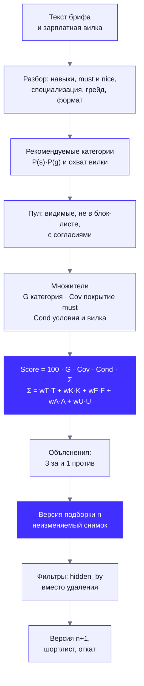
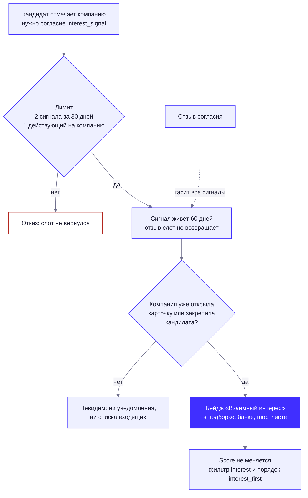

# Механика подбора и категоризации

Как «Взаимно» строит слепую объяснимую подборку: от текста потребности работодателя до версии подборки с разложением Score. Все веса и пороги — в `config/scoring.yaml`, `config/skills.yaml`, `config/taxonomy.yaml`, `config/fsp.yaml`, `config/contact.yaml`; код — `backend/app/matching` (чистые функции) и `backend/app/services/matching` (БД, права, приватность). Результаты симуляций — в [VALIDATION.md](VALIDATION.md). Не построенное помечено «в разработке».

Содержание: [1. Категория](#1-категория--специализация--грейд) · [2. Конвейер](#2-конвейер) · [3. Разбор брифа](#3-разбор-брифа) · [4. Категории и охват](#4-рекомендация-категорий-и-охват-вилки) · [5. Формула Score](#5-формула-score) · [6. Объяснения](#6-объяснения-3-за-и-1-против) · [7. Версии подборки](#7-версии-подборки-без-потери) · [8. Приватность](#8-приватность-до-раскрытия) · [9. Сигнал интереса](#9-сигнал-интереса) · [10. Кандидаты без ФСП](#10-кандидаты-без-фсп) · [11. Банк без брифа](#11-банк-кандидатов-без-брифа) · [12. Ограничения](#12-ограничения)

## 1. Категория = специализация × грейд

Категория — детерминированная функция `f(специализация, подтверждённый тестом грейд)` (`category_of` в `app/testing/session.py`): код `backend_python:middle`, название «Backend (Python) · Middle». Справочник — `config/taxonomy.yaml`.

| Специализация | Статус | Заметка |
|---|---|---|
| Backend (Python), Frontend (JS/TS) | `active` | Тест работает; кандидат получает категорию |
| Fullstack | `derived` | Присваивается, когда подтверждены обе квалификации; грейд — меньший из двух; кандидат виден в обеих категориях и в общем топе один раз |
| QA, DevOps | `active` | Тест работает (модули `qa_testing`, `devops_core`); кандидат получает категорию |
| Data/ML, Mobile, ИБ, Backend (Go), Backend (Java/Kotlin) | `survey_only` | Опрос есть, теста нет. Бриф, распознанный как такая категория, получает пометку «категория пока не тестируется. N кандидатов прошли опрос и ждут теста»; подборки по ней нет |

**Ни резюме, ни самоописание категорию не открывают.** Категорию даёт только тест. Резюме и опрос порождают серые чипы «заявлено».

Кандидат виден работодателям (`matching_features.visible`), только если одновременно: аккаунт активен; дано согласие `blind_card`; режим поиска не «не ищу»; категория подтверждена тестом; сессия не на проверке у методиста; возраст не меньше 16 лет (16–17 лет — только брифы с флагом «стажировка»); компания не в блок-листе кандидата. Отозвав согласие, перейдя в «не ищу» или заблокировав компанию, кандидат пропадает даже из уже собранных версий подборки (места остальных не пересчитываются).

## 2. Конвейер



Источники признаков кандидата (`app/services/matching/sources.py`, `features.py`): квалификация (θ̂, SE, подбаллы модулей), ФСП (VSS по дисциплинам), регулярные задачи, настройки кандидата (минимум зарплаты, форматы, город, релокация, отрасли), заявленные навыки. Строки кэша `matching_features` хранят **абсолютные** даты («дней назад» считаются при чтении по `Clock`), пересобираются по хукам (тест, профиль, согласие, ФСП, задачи) и по отпечатку источников; максимальный срок жизни — 7 дней, потому что VSS зависит от времени.

## 3. Разбор брифа

`POST /api/needs/parse` не сохраняет ничего и работает на правилах за ≤ 300 мс (`app/matching/brief_parser.py`, версия `rules-1`).

| Шаг | Как |
|---|---|
| Нормализация и вилка | «к / тыс / 000» → рубли; «на руки / до НДФЛ» ищется рядом с суммой; число без единиц считается рублями только если оно не меньше 10 000. Проверка: `from ≥ 30 000`, шаг 1000, `to ≥ from`; `to ≤ 1,6·from` — норма, 1,6–2,0× — мягкое предупреждение, больше 2,0× — блокировка |
| Навыки | Словарь `config/skills.yaml`: 349 навыков с синонимами; Aho-Corasick плюс `rapidfuzz` (≥ 90) для опечаток; у каждого чипа цитата-спан в тексте |
| must и nice | Маркеры в окне ±6 токенов («желательно», «будет плюсом» → nice; без маркера → must). Не больше 5 must; если больше — первые 4 остаются must, остальные nice |
| Специализация | `P(s) = softmax((2·cue_s + Σ вес навыков + 1,5·cos(эмбеддинг, прототип)) / 1,5)`. Эмбеддинг-член подключается через `embed_similarity` и по умолчанию равен 0 (модели в рантайме нет — «в разработке») |
| Грейд | Явные маркеры («Middle+», «Senior»), «опыт от N лет», слабый априор по середине вилки (медианы на руки: Стажёр 60, Junior 120, Middle 230, Senior 380 тыс.) |
| Формат и город | Словарь форматов (офис, гибрид, удалённо) и 50 городов; релокация |
| Уточняющий вопрос | Не больше одного, если `P(spec) < 0,5`, `P(grade) < 0,45` или не хватает вилки/навыков |

Каждое поле несёт источник: «правило», «вручную» или имя LLM-провайдера, и цитату для подсветки в тексте. Правки работодателя (`spec`, `grade`, `must`, `nice`, `formats`, `city`) применяются поверх разбора с источником «вручную» (422 `brief_invalid` при недопустимой правке, например больше 5 must).

**LLM** (по умолчанию выключена, `VZ_LLM_PROVIDER=none`) может только **добавить** навыки, пропущенные правилами, и только с цитатой, найденной в тексте (`partial_ratio ≥ 90`). В ранжировании LLM не участвует (проверяется тестом). Цифры в демо, которые зависят от разбора брифа, считаются движком, а не вручную.

## 4. Рекомендация категорий и охват вилки

`GET /api/needs/{need_id}/categories` (`app/matching/coverage.py`):

- `P(c = s×g) = P(s)·P(g)`; показываются до 3 категорий с `P ≥ 0,10` (основная — наибольшая); если в основной категории меньше 15 кандидатов, предлагается смежная (вес смежности не ниже 0,8).
- Для каждой категории: число кандидатов N, **ползунок «верх вилки → охват»**, квартили ожиданий P25–P75 (с шагом 10 тыс. руб.), доля с ФСП и доля активных за 30 дней. Подсказка вида «ваша вилка покрывает 11 из 38; при верхе 300 тыс. — 27 из 38» появляется, если вилка охватывает меньше половины.
- **Защита минимума зарплаты отдельного кандидата**: ползунок показывается при N ≥ 10, ступени гистограммы склеиваются, пока в каждой не окажется не меньше 3 человек, квартили округляются до ступени. Подбором верха вилки точный минимум одного человека не вычислить.
- Вкладка «Как мы проверим» (`GET /api/needs/{need_id}/check`): навыки брифа → модули теста; серый список «тестом не проверяется — проверьте на интервью». Подробности — [TESTING_MECHANISM.md](TESTING_MECHANISM.md), п. 12.

## 5. Формула Score

```
Score(кандидат | бриф) = 100 · G · Cov · Cond · ( wT·T + wK·K + wF·F + wA·A + wU·U )
```

Пресеты весов (`scoring.yaml → presets`): «Баланс» `T 0,40 · K 0,25 · F 0,15 · A 0,10 · U 0,10` (по умолчанию) и «Стек важнее» `T 0,30 · K 0,40 · F 0,10 · A 0,10 · U 0,10`. Ограничения проверяются при загрузке: `wT ≥ 0,30`, `wF ≤ 0,15`, сумма равна 1. Вклад ФСП поэтому не превышает 15 баллов из 100: сильный ФСП не перевешивает большой разрыв в тесте.

| Компонент | Формула | Откуда данные |
|---|---|---|
| **G** — категория | `G = adjS · adjG` (· 0,9 при `BORDERLINE_PASS`). Основная категория: `adjS = 1`. Смежные специализации: Backend↔Fullstack и Frontend↔Fullstack 0,8; Backend↔Frontend 0,3; Backend↔Data/ML, Backend↔DevOps, Backend↔Go, Backend↔Java, Go↔Java 0,5; Backend↔QA 0,3; остальные пары 0. Кандидат с бейджем Fullstack для брифов Backend, Frontend и Fullstack получает `adjS = 1`. Грейд: на ступень выше брифа ×0,85, ниже ×0,80 (дальше — степень) | Квалификация |
| **Cond** — условия как ограничение | `Cond = (1 − 0,7·(1 − SalFit)) · (1 − 0,7·(1 − FmtFit))`. Условия выполнены → 1,0 и формула прежняя; ожидание выше вилки или неподходящий формат/город уменьшают Score (минимум ×0,09 при полном несоответствии обоих), но не обнуляют: «Да, если…» остаётся возможным. Разложение c_i домножается на Cond, сумма остаётся равной Score. `SalFit` по-прежнему берётся полосами 5% (точный минимум не восстановить) | Настройки кандидата |
| **Cov** — покрытие must | 0,8, если подтверждено (`v_k ≥ 0,5`) меньше половины must; иначе 1 | K |
| **T** — тест | `θ_lcb = θ̂ − SE(t)`, где `SE(t)² = SE² + 0,02·Δмес`. `T = доверие · Pct_категории(θ_lcb)`; при N категории меньше 30 — `Φ((θ_lcb − μ_g)/σ_g)` по калибровочным `μ_g, σ_g` грейда. Доверие 1,0 (нет флагов) или 0,75 | Тест |
| **K** — стек | `K = Σ w_k·v_k / Σ w_k`, `w = 1,0` (must) или `0,4` (nice). `v_k = max( 1,0·test_k ; 0,9·q·2^(−Δд/90) ; 0,8·m(d,k)·VSS_d/100 )`. `test_k` — максимум по модулям навыка величины `P(θ_m ≥ порог грейда брифа)`, если модуль отмечен `✓` или `✓✓`. Второй член — задачи типа A. Третий — ФСП как доказательство навыка. **Заявленных навыков в `v_k` нет** | Тест, задачи, ФСП |
| **F** — ФСП | `F = max_d m(d, специализация брифа) · VSS_d / 100`; нет истории → **F = 0** (не штраф, в «против» не попадает). `VSS_d` строится из `points = C · Q · Ro · T · V` по лучшим 5 результатам с убывающей отдачей; **мероприятия не ранжируются** (уровень и статус веса не дают, DECISIONS п. 29), класс результата `C`: призёр 1,0 / участник 0,5, участий без призового места учитывается не больше 2. Релевантность дисциплины специализации (`m`) и свежесть (полураспад 24 мес.) — разрешены. ФСП на грейд не влияет | Реестр ФСП |
| **A** — свежесть | `A = max_r min(1, q_r·(1 + 0,25·[тег задачи ∈ навыки брифа])) · 2^(−Δд_r/45)` по задачам A и B за 180 дней | Регулярные задачи |
| **U** — условия | `U = 0,6·SalFit + 0,4·FmtFit`. `SalFit = 1`, если минимум кандидата ≤ верха вилки, иначе `max(0, 1 − (min/to − 1)/0,25)` с округлением превышения **вверх до полосы 5 %** (значения 1; 0,8; 0,6; 0,4; 0,2; 0), чтобы точный минимум не восстанавливался из вклада. `FmtFit` — максимум по матрице совместимости форматов; офис/гибрид в другом городе без релокации — 0; пересчёт «на руки ↔ до НДФЛ» по ставке 13 % | Настройки кандидата |

Когда в брифе нет навыков, K считается по модулям стандартного теста категории брифа (веса `blueprint`).

**Зарплата всегда с базисом.** Каждая сумма в интерфейсе подписана «на руки» или «до вычета НДФЛ»: вилка брифа (`needs.salary_net`), приглашение и вакансия (`salary_net` / `salary_type`), ожидания кандидата (`candidate_profiles.salary_type`), встречное условие «Да, если…» (в базисе приглашения). Без пометки в тексте брифа берём «на руки» и говорим об этом работодателю. Подписи — `config/contact.yaml → salary.types`; поле базиса уже есть во всех сущностях, отдельной миграции не требуется.

**Чего в Score намеренно нет:** близости текста брифа к тексту резюме или профиля, самозаявленных навыков, возраста, пола, фото, вуза, отрасли интереса. Эмбеддинги в ранжировании не участвуют.

### Контрольные примеры

Три примера зафиксированы в `tests/test_matching_scoring.py` и обязательны для прохождения (`G = Cov = 1`, пресет «Баланс»):

| Кандидат | T | K | F | A | U | Score | Вклады T + K + F + A + U |
|---|---|---|---|---|---|---|---|
| A, призёр ФСП | 0,91 | 0,80 | 0,72 | 0,6 | 1,0 | **83,2** | 36,4 + 20,0 + 10,8 + 6,0 + 10,0 |
| B, без ФСП | 0,95 | 0,85 | 0 | 0,9 | 1,0 | **78,3** | 38,0 + 21,3 + 0 + 9,0 + 10,0 |
| C, сильный ФСП, слабый тест | 0,60 | 0,60 | 0,95 | 0,2 | 0,8 | **63,3** | 24,0 + 15,0 + 14,3 + 2,0 + 8,0 |

Так выполняется условие «выше — у кого лучше результаты тестирования **и** есть достижения ФСП»: B без ФСП опережает C с сильным ФСП, а A с обоими преимуществами идёт первым.

### Детерминизм

Сортировка: `подтверждённые тестом` → `Score ↓` → `T ↓` → число совпавших заявленных навыков ↓ (только для разрыва ничьих) → `hash(need_id, candidate_id)`. Сравнение Score и T идёт с округлением до 9 знаков (защита от шума float). В каждую версию подборки пишется `scoring_config_version` — версия плюс sha256 **всех** входов формулы (`scoring.yaml`, матрицы ФСП, пороги грейдов и blueprint, граф «навык → модули»): правка любой матрицы не сможет незаметно поменять ранги.

## Навыки, наблюдаемые через проверочный набор

Потолок P@10 давали must-навыки, которых стандартный тест внутри модуля не видит: Redis, очереди (Kafka, RabbitMQ, Celery), особенности FastAPI и PostgreSQL. Резюме в Score не входит, поэтому честный путь один: сделать навык **наблюдаемым** короткой задачей из проверочного набора по вакансии ([TESTING_MECHANISM.md](TESTING_MECHANISM.md) §12).

- **Граф.** У таких навыков в `config/skills.yaml` есть «свой» модуль (`redis_core`, `mq_core`, `fastapi_core`, `pg_core`), которого нет ни в одном blueprint (`SkillCatalog.check_only_modules`). 11 семейств `families/skills/` с ключом-исполнением и тегом `observes`.
- **План набора** (`plan_check_set`): слоты модулей вне стандартного теста категории идут первыми; семейство выбирается под навык (`observes`) и ближе к грейду брифа; на задачу ставятся только навыки, которые оно наблюдает.
- **«Как мы проверим».** Навык со своим модулем, попавший в слот, получает `via = "check_set"`: «проверяется проверочным набором по вакансии (модуль «…»)». Без слота остаётся прежняя подпись («проверено стандартным тестом» или «проверьте на интервью»).
- **K.** Задача по навыку (`tags`/модуль набора) — прямое свидетельство. Решена (v ≥ 0,5) — значение входит в максимум, как у любого свидетельства (Redis и очереди из «нет данных» становятся «подтверждено задачей»; у PostgreSQL и FastAPI общий модуль теста уже давал подтверждение, поэтому успех ничего не меняет). Не решена — вытесняет вывод по соседнему модулю: чип «Задача … 0/5», состояние «проверено, не подтверждено», навык не засчитывается в Cov. Нет задачи — «не проверено»: чип как раньше. Веса Score не менялись; контрольные примеры 83,2 / 78,3 / 63,3 проходят.
- **Грейд и θ** не затрагиваются: модули набора вне blueprint, `apply_to_theta` их пропускает.

Оценка на синтетической популяции (`python -m eval.checkset_eval`): у кандидатов скрытый уровень таких навыков θ + N(0; 0,6²) (`population.Truth.skill_theta`), оракул считает навык покрытым при уровне ≥ порога грейда − 0,5; набор получают 30 человек из верха выдачи, ответ — σ(2·(уровень − порог)). Результаты — в таблице ниже.

| P@10, 40 брифов (test + dev) | оракул со скрытыми уровнями навыков | прежний оракул |
|---|---|---|
| Наш подбор без набора («до») | 0.657 [0.573; 0.732] | 0.660 [0.573; 0.737] |
| Наш подбор после набора | 0.705 [0.627; 0.778] | 0.707 [0.630; 0.780] |
| B2 (категория + точечная оценка) | 0.520 [0.415; 0.622] | 0.522 [0.415; 0.623] |
| Прирост набора, парный бутстреп | +0.048 [+0.017; +0.082] | +0.048 [+0.017; +0.083] |
| После набора минус B2 | +0.185 [+0.095; +0.282] | +0.185 [+0.092; +0.280] |

Набор получают 30 человек из верха выдачи (`CHECKSET_SHORTLIST`); ответ на задачу — σ(2·(уровень навыка − порог)); при более пологой задаче (крутизна 1,2) прирост +0,045 [+0,012; +0,083]. 95 % ДИ — парный бутстреп по брифам (2000 повторов). Это симуляция: уровни навыков и модель ответа — допущения генератора, а не измерения на людях. Вклад по отдельным навыкам не раскладывали.

## 6. Объяснения: 3 «за» и 1 «против»

Без LLM (`app/matching/explain.py`):

1. **Разложение**: `c_i = 100·G·Cov·Cond·w_i·x_i`, `Σ c_i = Score` (допуск ±0,1 после округления методом наибольших остатков; проверяется тестом). Работодатель видит полосу из 5 вкладов и множители G, Cov, Cond (с частями по зарплате и формату) в панели доказательств; они же пишутся в снимок версии подборки (`Cond`, `cond_parts`), старые версии без них читаются как Cond = 1.
2. **«За»** — до трёх компонентов, у которых `c_i − медиана_версии(c_i) > 1`, по убыванию превышения.
3. **«Против»** — **первый сработавший** флаг по приоритету (`explain.con_priority`): `salary_above` (ожидания выше вилки) → `format_mismatch` (формат/город) → `category_unconfirmed` → `must_unconfirmed` (обязательный навык не подтверждён) → `borderline` (тест сдан на границе) → `low_trust` → `stale_test` (тест старше 12 месяцев) → `weak_component` (`c_i − m < −3`, **кроме F**) → `nice_unconfirmed`.
4. **Отсутствие ФСП в «против» не попадает никогда.** Для кандидата «по опросу» вместо «ниже медианы» пишется «категория по опросу, не подтверждена».
5. Каждый пункт — шаблон со ссылкой на доказательство: попытку теста, задачу, запись ФСП, настройки, навык брифа. Непроверяемый must формулируется без ссылки на резюме: «Kafka не подтверждена — проверьте на интервью»; заявленное показывается серым чипом.
6. **«Почему #2 выше #3»** (`GET /api/needs/{need_id}/versions/{n}/neighbors/{rank}`): разница баллов, главный плюс и главный минус.
7. **Кандидату** в «почему вы» уходят те же «за», переписанные на «вы», без сравнения с другими.

Чипы навыков: зелёный «подтверждено» (с источником «Тест: модуль SQL ✓✓», «Задача … 4/5», «ФСП: алгоритмическое»), жёлтый «слабо», серый «заявлено» или «нет данных». Честность объяснений проверена на симуляции: ссылки на существующие доказательства, `Σ вкладов = Score` — 100 % ([VALIDATION.md](VALIDATION.md) §4.6).

## 7. Версии подборки без потери

| Свойство | Реализация |
|---|---|
| Неизменяемость | `POST /api/needs/{need_id}/versions` собирает версию `n` (`need_versions`): снимок брифа, категории, фильтры, пресет, веса, `scoring_config_version`, до 500 строк `items` с Score, компонентами, причинами и `hidden_by[]` |
| Фильтры не удаляют | Любой фильтр — `has_fsp`, `salary_fit`, `format`, `city`, `must_confirmed`, `skill`, `min_score`, `active`, `industry`, `grade`, `confirmed_only`, `exclude` — заполняет `hidden_by` и причину; отфильтрованные уходят в группу «Скрыто фильтрами (N)». Фильтр «есть ФСП» включает только сам работодатель |
| Правка = новая версия | Правка брифа, фильтра или пресета создаёт версию `n+1`; бейджи `новый`, `▲3 / ▼2` — разница с предыдущей (`compare_to`) |
| Шортлист отдельно | `PUT /api/needs/{need_id}/shortlist/{ref}`, до 30 на бриф; закреплённый кандидат, не прошедший фильтр, остаётся с жёлтой меткой и причиной |
| Откат | `POST /api/needs/{need_id}/rollback` переносит указатель на одну из последних 10 версий **без пересчёта**; бриф возвращается к снимку версии, шортлист не меняется |
| Страницы | Вкладки «По категориям» (до 50 на категорию) и «Общий топ» (кандидат один раз), страницы по 10 |
| Журнал показов | `impression_log` (кандидат, версия, ранг) — основа «как меня видят» и онлайн-метрик воронки |

Слабое соответствие (Score ниже 40) — предупреждение при приглашении, не блокировка.

## 8. Приватность до раскрытия

Работодатель до взаимного «да» (или отклика) работает только со слепой проекцией; границы задаёт белый список `config/contact.yaml → visibility`: поля, которых в матрице нет, не попадают никуда.

| Данные | До раскрытия (`CandidateBlind`) | После «да» и согласия (`CandidateDisclosed`) |
|---|---|---|
| Идентификатор | Псевдоним «К-4821» = `HMAC(VZ_PSEUDONYM_SECRET, компания ‖ кандидат)` и непрозрачная ссылка `ref`; своя у каждой компании, две компании не сопоставят карточки | То же плюс разрешённые поля |
| Тест | Полоса «топ-10 / 25 / 50 %» и интервал на линейке с шагом 10 баллов | Точный балл и модули |
| ФСП | Дисциплина, уровень, год, диапазон места («топ-3», «топ-10»), роль; **без** номера ЕКП, команды, протокола | Выписка с номером ЕКП, местом, командой, ссылкой на протокол |
| Зарплата | Значок «в вилке ✓ / выше вилки» (по умолчанию) или число, если кандидат так выбрал | То же |
| Место | Регион (субъект РФ) | Город |
| ФИО, фото, контакты, резюме, работодатель, вуз | Скрыты (в слепой проекции ПДн-ключи вычищаются на любой глубине) | Только поля, разрешённые кандидатом (`field_visibility`); минимум один канал связи обязателен |
| Возраст, пол, дата рождения, внутренние id | Никогда | Никогда |
| Доказательства | Внутренние id попыток теста, задач и записей ФСП наружу не уходят: непрозрачные HMAC-ссылки в рамках компании | То же |

Комментарии кандидата, уходящие компании до раскрытия, проверяются на контакты и ссылки (как стоп-слова). Контрактные тесты проверяют, что в ответах работодателю до согласия **0** полей ПДн. Компания видит кандидата, только если открыла карточку (`profile_views`) или закрепила его в шортлисте — иначе пригласить нельзя. Подробнее о защите — [SECURITY.md](SECURITY.md).

### 8.1. Почему карточка слепая до взаимного «да»

Правила хакатона разрешают показывать работодателю имя и прежних работодателей до согласия кандидата. Мы сознательно этого **не делаем** и ограничиваем показ ровно тем, что нужно для решения «приглашать или нет»:

- **Меньше предвзятости.** Имя, фото, пол, возраст, вуз и громкие бренды в резюме запускают оценку по ярлыку, а не по навыкам. Решение принимается по тому, что измерено: категория «направление × грейд», результат адаптивного теста (полоса, а не точный балл), подтверждённые достижения ФСП и выполненные задачи.
- **Основания в литературе.** Слепые прослушивания оркестров увеличили долю женщин, проходящих отбор (Goldin & Rouse, «Orchestrating Impartiality», American Economic Review, 2000; размер эффекта оспаривался, направление не отвергнуто). В полевом эксперименте с рассылкой одинаковых резюме с «белыми» и «чёрными» именами обратную связь получали заметно чаще первые (Bertrand & Mullainathan, «Are Emily and Greg More Employable than Lakisha and Jamal?», American Economic Review, 2004). Анонимизация резюме — рекомендуемая практика для таких процессов.
- **Честность для кандидата.** Раскрытие имеет цену: контакты и ПДн уходят только после его «да» и только в разрешённом им составе (152-ФЗ, минимизация).
- **Не «бедная» карточка.** Работодатель видит достаточно для оценки практической применимости: категорию и вилку, модули теста ✓/✓✓, свежесть, задачи, обобщённое ФСП, регион, формат, сферу бизнеса и **обезличенный опыт** — должность и срок («Backend, 2 г. 3 мес.») без названий компаний (`work_history`; название компании вычищается и из текста должности). Опыт и резюме — «заявлено кандидатом»: они отображаются, но **не влияют** ни на категорию, ни на Score (DECISIONS п. 1).

Названия прежних работодателей, ФИО и вуз раскрываются вместе с контактами — по разрешению кандидата после взаимного «да».

**Терминология.** Направление ИТ («Backend (Python)», «DevOps / SRE» и т. д.) в интерфейсе везде называется «Направление»; фасет интереса кандидата «финтех, ритейл, госсектор…» — «Сфера бизнеса» (в конфиге `industries`). Слово «отрасль» в интерфейсе не используется, чтобы не путать индустрию и IT-направление.

## 9. Сигнал интереса

Вторая сторона обратной механики (DECISIONS 24): кандидат может отметить компанию, которая ему интересна. **Реализовано** (`POST /api/interest`, `GET /api/interest/me`, `POST /api/interest/{id}/revoke`; кнопка «Отправить сигнал интереса (осталось 2 из 2)» в карточке вакансии).

Правило в одной схеме:



- **Лимит и срок** (`config/contact.yaml → interest`): 2 сигнала за скользящие 30 дней, каждый виден 60 дней, отзывается; отзыв слот **не возвращает** (иначе сигналы можно «качать»). Один действующий сигнал на компанию.
- **Видимость.** Работодатель не получает уведомления и списка входящих. Бейдж «Взаимный интерес» (подсказка: «Кандидат отметил интерес к вашей компании») появляется в подборке, банке, шортлисте и карточке **только у тех кандидатов, чью карточку компания уже открыла или закрепила** (DECISIONS 7); проверка пакетная в `visible_for_company`. Остальные компании сигнала не видят. От «закрепить всех, чтобы прочитать сигналы» защищает лимит шортлиста (30 на бриф).
- **Score не меняется.** Сигнал показывается отдельным блоком в панели объяснения («в Score не входит»); в банке по нему можно отфильтровать (`interest=true`) или поставить отметивших первыми (`interest_first=true`) — порядок остальных сохраняется. Тест `test_bank_badge_filter_sort_and_score_unchanged` проверяет, что Score и порядок без флагов те же.
- **Согласие.** Отдельное согласие `interest_signal` (журнал согласий); отзыв согласия гасит все сигналы.
- Для односторонне инициированного контакта у кандидата остаётся **отклик на вакансию** (`POST /api/applications`) с отдельным согласием на передачу контактов; сигнал — не отклик, без интереса работодателя он невидим.

<!-- market-sim:begin -->
### 9.1. Симуляция рынка: квоты и сигнал интереса

Чтобы выбрать числа для `config/contact.yaml` (квоты, недельный лимит, два сигнала) и честно показать границы механизма, мы сыграли рынок приглашений «компания — кандидат» на синтетических агентах (`eval/market_sim.py`, детерминированно: `numpy.random.default_rng(seed)`). Это имитация с допущениями, а не измерение живого рынка. Опора — Coles, Kushnir, Niederle, «Preference Signaling in Matching Markets» (AEJ: Micro, 2013; NBER w16185): один дефицитный сигнал интереса помогает работникам и числу совпадений, лучше всего на сбалансированных рынках; и Kushnir, «Harmful Signaling in Matching Markets» (FEEM, 2010): при очень похожих предпочтениях сигналы могут навредить.

**Модель в двух строках.** Полезность кандидата от компании = общая «престижная» часть (вертикальная) + личная (горизонтальная); доля общей части λ. Работодатель видит Score с шумом, кандидат читает не больше 5 приглашений в неделю, отвечает «Да» выше личного порога. Режимы: (а) без лимитов — 30 приглашений в неделю на вакансию; (б) квоты из `config/contact.yaml`; (в) квоты + сигнал: работодатель, открывший карточки, при выборе, кого пригласить, учитывает известную вероятность «Да» у сигналящих (в Score сигнал не входит).

Политика берётся из `config/contact.yaml`: активных приглашений на бриф ≤ 20, новых за 7 дней ≤ 60, пакет ≤ 10, новых приглашений кандидату ≤ 5 в неделю; сигналов 2 за окно ≈ 4 нед., живёт ≈ 9 нед. Прогонов на ячейку: 60 сидов (одна и та же популяция во всех режимах).

**Сбалансированный 1:1.**

| Предпочтения | Режим | Заполнено вакансий | Недель до первого «Да» | Gini приглашений | Доля топ-10% кандидатов | Впустую | Приглашений на вакансию | Выигрыш кандидатов |
|---|---|---|---|---|---|---|---|---|
| Разные вкусы (λ=0,2) | (а) без лимитов | 96,2% | 1,15 | 0,30 | 21% | 85% | 36,9 | 1,25 |
|  | (б) квоты | 95,9% | 1,44 | 0,33 | 27% | 69% | 7,7 | 0,82 |
|  | (в) квоты + сигнал | 96,2% | 1,39 | 0,32 | 28% | 65% | 7,4 | 1,04 |
| Смешанные (λ=0,5) | (а) без лимитов | 90,6% | 1,70 | 0,38 | 25% | 89% | 44,2 | 0,97 |
|  | (б) квоты | 88,6% | 2,30 | 0,45 | 34% | 80% | 10,0 | 0,64 |
|  | (в) квоты + сигнал | 89,1% | 2,26 | 0,45 | 34% | 78% | 9,8 | 0,79 |
| Похожие вкусы (λ=0,9) | (а) без лимитов | 70,2% | 3,47 | 0,39 | 24% | 94% | 68,5 | 0,51 |
|  | (б) квоты | 62,8% | 4,15 | 0,51 | 34% | 88% | 10,9 | 0,39 |
|  | (в) квоты + сигнал | 62,4% | 4,19 | 0,51 | 35% | 87% | 10,8 | 0,41 |

Парная разница «квоты + сигнал» − «квоты» (среднее ± 95% ДИ по сидам):

| Предпочтения | Δ заполнено | Δ выигрыш кандидатов | Δ недель до первого «Да» |
|---|---|---|---|
| Разные вкусы (λ=0,2) | 0,3 ± 0,2 п.п. | 0,224 ± 0,013 | -0,06 ± 0,02 |
| Смешанные (λ=0,5) | 0,5 ± 0,5 п.п. | 0,145 ± 0,009 | -0,04 ± 0,03 |
| Похожие вкусы (λ=0,9) | -0,3 ± 0,5 п.п. | 0,027 ± 0,005 | 0,04 ± 0,02 |

**Кандидатов вдвое больше.**

| Предпочтения | Режим | Заполнено вакансий | Недель до первого «Да» | Gini приглашений | Доля топ-10% кандидатов | Впустую | Приглашений на вакансию | Выигрыш кандидатов |
|---|---|---|---|---|---|---|---|---|
| Разные вкусы (λ=0,2) | (а) без лимитов | 100,0% | 1,03 | 0,39 | 26% | 78% | 32,0 | 0,63 |
|  | (б) квоты | 100,0% | 1,15 | 0,34 | 23% | 66% | 8,7 | 0,46 |
|  | (в) квоты + сигнал | 100,0% | 1,12 | 0,34 | 23% | 61% | 8,5 | 0,59 |
| Смешанные (λ=0,5) | (а) без лимитов | 99,3% | 1,30 | 0,47 | 33% | 85% | 41,2 | 0,50 |
|  | (б) квоты | 96,7% | 1,76 | 0,44 | 31% | 79% | 11,7 | 0,36 |
|  | (в) квоты + сигнал | 96,7% | 1,75 | 0,44 | 31% | 78% | 11,6 | 0,43 |
| Похожие вкусы (λ=0,9) | (а) без лимитов | 80,9% | 3,00 | 0,39 | 27% | 95% | 89,6 | 0,27 |
|  | (б) квоты | 69,7% | 3,80 | 0,60 | 43% | 90% | 15,6 | 0,21 |
|  | (в) квоты + сигнал | 69,7% | 3,80 | 0,60 | 43% | 89% | 15,6 | 0,22 |

Парная разница «квоты + сигнал» − «квоты» (среднее ± 95% ДИ по сидам):

| Предпочтения | Δ заполнено | Δ выигрыш кандидатов | Δ недель до первого «Да» |
|---|---|---|---|
| Разные вкусы (λ=0,2) | -0,0 ± 0,0 п.п. | 0,132 ± 0,007 | -0,02 ± 0,01 |
| Смешанные (λ=0,5) | 0,0 ± 0,2 п.п. | 0,073 ± 0,006 | -0,01 ± 0,01 |
| Похожие вкусы (λ=0,9) | 0,0 ± 0,4 п.п. | 0,012 ± 0,002 | -0,00 ± 0,02 |

**Сколько сигналов (сбалансированный рынок).**

| Сигналов за окно | Смешанные: заполнено | Смешанные: выигрыш канд. | Похожие: заполнено | Похожие: выигрыш канд. |
|---|---|---|---|---|
| 0 | 88,6% | 0,64 | 62,8% | 0,39 |
| 1 | 88,9% | 0,74 | 62,8% | 0,40 |
| 2 | 89,1% | 0,79 | 62,4% | 0,41 |
| 3 | 89,2% | 0,82 | 62,7% | 0,42 |
| 5 | 89,4% | 0,84 | 62,7% | 0,43 |

**Размер пакета приглашений (смешанные вкусы, сбалансированный рынок, без сигналов).**

| Пакет приглашений в неделю | Заполнено | Впустую | Gini | Недель до первого «Да» |
|---|---|---|---|---|
| 3 | 83,0% | 79% | 0,44 | 3,03 |
| 5 | 86,6% | 80% | 0,44 | 2,64 |
| 10 | 88,6% | 80% | 0,45 | 2,30 |
| 20 | 89,3% | 79% | 0,44 | 2,12 |
| 40 | 89,5% | 78% | 0,43 | 2,04 |
| без лимита (30) | 90,6% | 89% | 0,38 | 1,70 |

**Недельный лимит входящих у кандидата (смешанные вкусы).**

| Лимит в неделю | Заполнено | Отклонено при отправке | Впустую |
|---|---|---|---|
| 2 | 81,2% | 85% | 78% |
| 3 | 85,3% | 77% | 79% |
| 5 | 88,6% | 63% | 80% |
| 10 | 90,1% | 39% | 79% |
| 20 | 90,4% | 17% | 81% |

**Когда сигнал не помогает.** Наивная стратегия — сигнал на лучшую по полезности компанию без оценки шансов:

| Предпочтения | Режим | Заполнено | Выигрыш кандидатов | Недель до первого «Да» |
|---|---|---|---|---|
| Смешанные (λ=0,5) | квоты | 88,6% | 0,64 | 2,30 |
|  | квоты + сигнал (по шансам) | 89,1% | 0,79 | 2,26 |
|  | квоты + сигнал (наивно) | 88,8% | 0,72 | 2,30 |
| Похожие вкусы (λ=0,9) | квоты | 62,8% | 0,39 | 4,15 |
|  | квоты + сигнал (по шансам) | 62,4% | 0,41 | 4,19 |
|  | квоты + сигнал (наивно) | 62,8% | 0,40 | 4,18 |

**Что показала симуляция.**

- *Квоты — это обмен заполнения на нагрузку.* На сбалансированном рынке со смешанными вкусами рассылка без лимитов заполняет 90.6% вакансий, квоты — 88.6%, но на вакансию уходит 10 приглашений вместо 44 (нагрузка на кандидатов в 4,4 раза ниже), а доля приглашений впустую 80% против 89%. При очень похожих вкусах потеря заполнения заметнее (70.2% против 62.8%). Концентрацию квоты не лечат: Gini 0.45 против 0.38, доля топ-10% кандидатов 34% против 25% (при малом числе приглашений работодатели чаще выбирают лучших по Score). Выигрыш квот — защита кандидата от потока писем, а не равномерность; выигрыш кандидатов от рассылки без лимитов (0,97 против 0,64) — это цена, которую мы платим осознанно.
- *Сигнал возвращает часть потерянного для кандидата.* Против одних квот на сбалансированном рынке сигнал меняет число заполненных вакансий на: разные вкусы +0.3 ± 0.2 п.п., смешанные +0.5 ± 0.5 п.п., похожие -0.3 ± 0.5 п.п. (парное среднее ± 95% ДИ) — то есть почти не меняет. Зато выигрыш кандидатов растёт: смешанные +0.145 ± 0.009 (до 0,79 против 0,64 у одних квот), похожие +0.027 ± 0.005. Читается так: сигнал улучшает **качество** совпадений для кандидата, а не их число; это согласуется с Coles–Kushnir–Niederle (выигрыш на стороне работников, эффект для фирм неоднозначен).
- *Границы (вредный сценарий).* При очень похожих вкусах (λ=0,9) все хотят одних и тех же компаний, сигнал не помогает ни числу совпадений, ни скорости первого «Да»: выигрыш кандидатов +0.027 ± 0.005 против +0.145 ± 0.009 при смешанных. Сигналы уходят в одни и те же места — это тот случай, о котором пишет Kushnir. Заметного вреда, как в его теоретическом примере, в нашей модели не получилось (у работодателя сигнал лишь меняет порядок внутри квоты), поэтому мы заявляем только «нет пользы при общих вкусах», а не «есть вред». Наивная стратегия (сигнал на самую желанную компанию без учёта шансов) выигрыш кандидата снижает по сравнению со стратегией «по шансам» (0,72 против 0,79 при смешанных вкусах), поэтому продукт подсказывает сигнал только по вакансиям, где Score кандидата высок.
- *Допущения, которые могут не держаться на живых данных:* независимые предпочтения кроме λ, одна вакансия на компанию, фиксированные пороги «Да», нет стратегического поведения работодателей, все кандидаты используют сигналы, рынок закрыт на 8 недель. Размеры квот проверены как чувствительность, а не оптимизированы под единственный сценарий.

**Решение по настройкам.** значения `config/contact.yaml` оставлены без изменений: пакет 10, активных на бриф 20, недельный лимит кандидата 5, сигналов 2 за окно. Пакет: заполнение растёт с размером пакета и выходит на плато (3 — 83.0%, 10 — 88.6%, 40 — 89.5%), колено на 10: дальше +0.8 п.п. ценой 1.1× приглашений. Недельный лимит: 5 даёт 88.6% заполнения против 90.1% при 10, но отсекает больше рассылки (63% против 39% отклонённых при отправке); 5 — осознанный выбор в пользу кандидата (≈1.5 п.п. заполнения), работодателю это видно в квоте и его можно ослабить настройкой кандидата (3/5/10/без ограничения). Сигналы: 0 → 2 → 5 дают выигрыш кандидатов 0.64 → 0.79 → 0.84; два сигнала берут 73% пятисигнального прироста, а дефицитность (смысл сигнала по Coles и др.) сохраняется, поэтому оставлено 2.
<!-- market-sim:end -->

## 10. Кандидаты без ФСП

Требование: отсутствие истории ФСП не должно ухудшать путь кандидата.

| Состояние | Что видит работодатель | F | «Против» |
|---|---|---|---|
| ФСП ID не привязан | Серая строка «Достижения ФСП не привязаны — оценка по тесту и задачам» | 0 | Никогда |
| Привязан, результатов нет | «Участник ФСП, результатов пока нет» | 0 | Никогда |
| Есть только результаты, ждущие протокола | Ничего; у кандидата «Ожидает протокол» | 0 до подтверждения | Никогда |
| Результат скрыт кандидатом | Не участвует ни в F, ни в K, ни в выдаче (иначе — скрытая накрутка) | не учитывается | Никогда |

Тот же тест, тот же грейд, та же категория: ФСП влияет только на порядок внутри категории и на подтверждение навыков, но не на грейд. Свой путь наверх у кандидата без ФСП — регулярные задачи (компоненты K и A). Гарантии: тест «100 % профилей без ФСП получают категорию по тем же правилам»; метрика отношения экспозиции (при равном тесте).

Честный результат симуляции ([VALIDATION.md](VALIDATION.md) §4.5): условное отношение экспозиции кандидатов без ФСП в топ-50 — 0,90 (цель 0,8–1,25, выполнено), в топ-10 — 0,75 (**цель не выполнена**: при равном тесте F поднимает обладателей ФСП над такими же кандидатами без ФСП, и в верхушке из 10 мест это заметно). Вес `wF` вынесен владельцу подбора как открытый вопрос.

## 11. Банк кандидатов без брифа

`GET /api/bank` — поиск без брифа: специализация, грейд, категория, стек (переключатель «только подтверждённые»), «есть ФСП», отрасль, режим поиска. Сортировка `0,55·T + 0,25·F + 0,20·A`, затем T, затем детерминированный ключ; кандидат показывается один раз — лучшей категорией; фильтры никого не удаляют, а заполняют «Скрыто». Закрепление кандидата в шортлист брифа — `PUT /api/needs/{need_id}/shortlist/{ref}`. Версии и шортлист живут на бэкенде: переход в банк и обратно ничего не теряет.

**Кандидаты с неподтверждённым грейдом** (ответы организаторов, DECISIONS п. 29): их **показываем со статусом «грейд не подтверждён» и ранжируем ниже всех подтверждённых**, а не скрываем. Это кандидат, который прошёл опрос и заявил категорию, но тест не пройден или не подтвердил грейд, и специализации «только опрос» (Data/ML, Mobile, ИБ, Go, Java). Правила:

- **Откуда берётся заявленная категория.** Грейд, который кандидат сам выбрал для последней попытки теста; иначе специализация из опроса и подсказка грейда опроса. Резюме и самоописание категорию не задают и в Score не входят.
- **Где показываем.** Банк и подборка: хвост после всех подтверждённых (ключ сортировки `confirmed_first`, `config/scoring.yaml → tie_break`), бейдж «грейд не подтверждён» и строка объяснения «Категория заявлена, тестом не подтверждена» (первое «против»). В карточке работодателя подтверждённые и заявленные категории — отдельными списками. Фильтр «Только подтверждённые тестом» убирает хвост в «Скрыто фильтрами».
- **Что не меняется.** Те же жёсткие правила видимости: согласие на слепую карточку, режим «не ищу», возраст, блок-лист, паузы пары. Слепой DTO без ПДн. T = 0, поэтому такой кандидат не обгоняет подтверждённого по баллу и не искажает перцентили; охват и счётчики «N кандидатов» в рекомендациях категорий считаются только по подтверждённым.
- **Несколько категорий.** У кандидата может быть по одной квалификации на каждую специализацию (Backend и QA одновременно): банк находит его по каждой, в списке он один раз — лучшей строкой; «Мой путь» и карточка работодателя показывают все.

Для жюри остаётся и `POST /api/admin/import` с кандидатом `features: null` (группа «категория по опросу, не подтверждена»).

### Почему Cond, и какие подходы к ранжированию мы рассмотрели

Условия (зарплата, формат, город) работодатель воспринимает как ограничение: кандидат с ожиданием выше вилки или не готовый к формату брифа для него нерелевантен, как бы ни был силён тест. В аддитивной формуле U давал максимум 10 баллов из 100, и такие кандидаты оставались в топе-10. Мультипликатор Cond — это «gate first, rank second» в мягкой форме (двухслойная схема L1/L2): жёсткий фильтр заменён штрафом, чтобы работодатель видел несоответствие в «против», а не терял кандидата молча. Он же — упрощённое «взаимное» согласование (Reciprocal recommenders): односторонний матч штрафуется произведением, а не складывается с остальным.

Что проверили на настроечных брифах (синтетические брифы, другая популяция — `backend/eval/matching_tune.py`) и отложенной выборке (b01–b40):

| Подход | Результат | Решение |
|---|---|---|
| Подбор весов (перебор по сетке, цель P@10; вместо градиентного/парного обучения, т. к. брифов мало) | После Cond P@10 почти не зависит от весов (плато 0,59–0,61 при T 0,3–0,6, K 0–0,4, F 0–0,15) | Веса «Баланс» не меняем: нечему подгонять, риск переобучения отсутствует |
| Нижняя доверительная граница θ (EAP − k·SE) | Уже используется (k = 1, рост SE со временем); абляция «без нижней границы» в VALIDATION.md | Оставлено |
| Взаимная оценка (гармоническое/произведение) | Условия как произведение дали основной прирост | Принято как Cond |
| Фильтр, затем ранжирование | Сила штрафа 0,5–1,0 даёт одинаковый результат (плато) | Мягкий вариант 0,7 |
| Родственные навыки (ESCO-подобная таксономия) | K ухудшает P@10 не из-за синонимов, а потому что тест не различает навыки внутри модуля (см. «Ограничения») | Не вводили |

Ссылки на практики: Reciprocal Recommender Systems (взаимное согласование спроса и предложения), двухслойные ранжировщики в рекрутинге (фильтр + оценка), Rasch-ранжирование по нижней границе (консервативная оценка при неопределённости).

## 12. Ограничения

- **Что показывает симуляция** ([VALIDATION.md](VALIDATION.md) §4.1): на 20 test-брифах P@10 0,61 [0,49; 0,72] против 0,47 у базового B2 «категория + точечная оценка уровня» (разница 0,15, ДИ [-0,02; 0,30], на 20 брифах незначима); на всех 40 брифах 0,66 против 0,52, разница 0,14 [0,04; 0,24] значима. Случайный порядок в тех же категориях и поиск по самоописанию значимо хуже. Цель ≥ 0,75 пересмотрена до ≥ 0,60 (post hoc, [VALIDATION_PLAN.md](VALIDATION_PLAN.md) §1.5): потолок для подбора, который не верит резюме, около 0,76. Первоначальный прогон (0,53 против 0,62 у B2) показал две вещи: оракул не учитывал формат и город, а формула считала условия лишь 10% аддитивного бонуса. Исправлены обе (оракул v2, множитель Cond).
- Must-навыки, которые тест не проверяет (Docker, Kafka, Redis и т. п.), формула не может подтвердить: у неё есть только доказательства (тест, задачи, ФСП), самоописанию она не верит.
- Оракул и генератор популяции написаны одной командой; экспертной разметки пар нет. Это проверка согласованности механики с нашей моделью мира, а не мнения рекрутера.
- Эмбеддинги и колонки `vector` в БД — в разработке.
- Банки QA и DevOps включены (`active`), но меньше по объёму, чем Backend/Frontend; «Сигнал интереса» — в разработке (в коде нет).

## 13. Открытые данные рынка: что взяли, как, лицензия, что не входит в Score

- **Источник.** Открытые вакансии портала «Работа в России» (`opendata.trudvsem.ru/api/v1/vacancies`, публичный API без авторизации).
  Выгрузка 2026-10-08: 4 906 вакансий, из них ИТ — 1 990. hh.ru не используем: анонимный `GET api.hh.ru/vacancies` отвечает 403, а
  условия API требуют регистрации приложения. Парсинг — только для наполнения справочников и тестовых данных (разрешено организаторами),
  не механика продукта: чужие вакансии не показываются, в рантайме внешних запросов нет.
- **Лицензия и данные.** Данные портала открытые; отдельного текста лицензии на странице API мы не нашли, поэтому храним только
  производные агрегаты (`data/market/`), сырой кэш удалён, контакты и названия компаний в кэш не попадали. Резюме не используются.
- **Что получилось.** (1) Квантили зарплат p10–p90 по направлению × грейду (9 ячеек с n ≥ 8, плюс 8 по направлению), основание — gross
  (портал основание не различает; `net = gross·(1 − ндфл)`). (2) Частоты навыков и соседи по NPMI — справочно. (3) Нераспознанные
  термины → 159 новых алиасов и 4 навыка в `config/skills.yaml` (сленг «постгря», «кубер», «пайтест», «раббит», вендоры сетей и
  виртуализации, MVC/MVVM, UML/BPMN, GigaChat/RAG и др.).
- **Замер разбора брифа** (`eval/brief_parse_eval.py`, отложенная выборка из 62 брифов `eval/brief_heldout.jsonl`, написана вручную
  живым языком и сленгом): F1 навыков 0,958 → 0,975 (полнота 0,949 → 0,973), F1 must-навыков 0,837 → 0,842, специализация 0,984,
  грейд 1,000, вилка 0,952, формат 1,000 — без регрессий. Честная оговорка: ошибки базовой версии на этой выборке мы видели до расширения
  словаря, поэтому прирост нужно читать как «словарь закрыл типичные сленговые дыры», а не как независимую оценку; на 40 брифах команды
  (`eval/briefs`) и в `eval.validate --quick` метрики не изменились (P@10 test 0,415 → 0,415, nDCG@10 0,485 → 0,485).
- **Рыночная вилка в форме брифа.** `GET /api/needs/market-salary` → квантили для направления × грейда (если ячейка тонкая — по
  направлению целиком), в двух основаниях; под полем вилки в форме показываем «Рыночная вилка: p25–p75, медиана, n, источник, дата» в том
  основании, что выбрал работодатель. Подсказка, а не ограничение.
- **Сигнал доверия** `salary_far_below_market` (`app/trust/flags.py`, `config/trust.yaml`): верхняя граница вилки в пересчёте на gross
  ниже 0,8 · p25 рынка. Только пометка для очереди модерации.
- **Что не входит в Score.** Рыночные квантили, частоты навыков и соседи навыков не участвуют ни в Score, ни в категории кандидата, ни в
  ранжировании (в том числе как «частичный зачёт за родственный навык»: по §4 это ухудшало P@10, поэтому карта соседей только справочная).
- **Ограничения данных.** Выборка по всей РФ и смещена в администрирование: devops/сисадмины — 638 из 1 990, разработчиков мало
  (Python 16, Frontend 16, Go 4, Fullstack 2; для них показываем направление целиком или ничего). Уровень заметно ниже московского —
  поэтому порог сигнала консервативный. ESCO не подключали: словарь и без него закрывает типичные формулировки, а таксономия ESCO
  не покрывает рыночный сленг.

