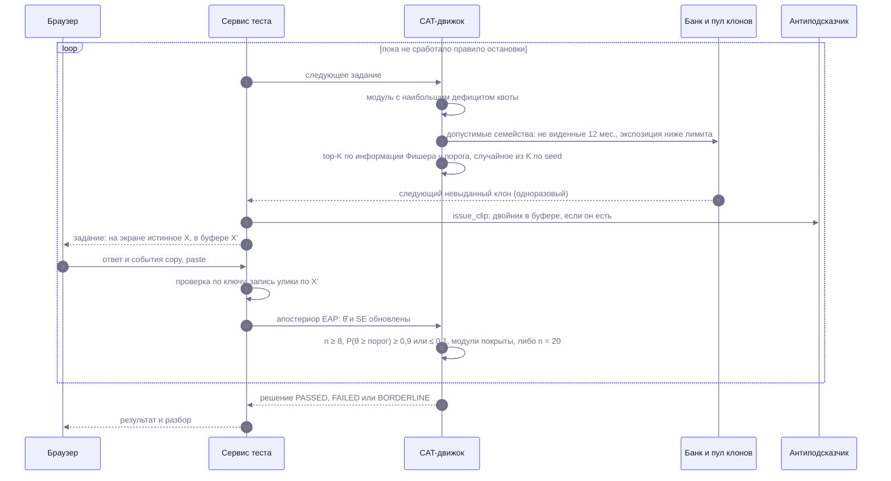
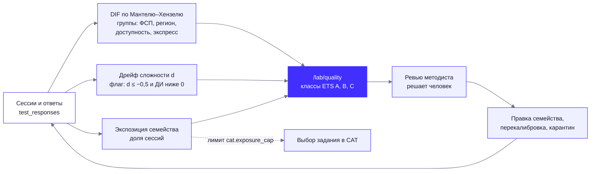

# Механика тестирования

Как «Взаимно» определяет уровень кандидата и почему этому уровню можно доверять, даже если задания утекают. Числа параметров — из `config/testing.yaml`, `config/taxonomy.yaml`, `config/anticheat.yaml`; результаты симуляций — из [VALIDATION.md](VALIDATION.md). Всё, что не построено, помечено «в разработке».

Содержание: [1. Идея](#1-идея-в-одном-абзаце) · [2. Опрос](#2-опрос-и-классификатор-специализации) · [3. Банк: семейства и клоны](#3-банк-семейства-и-одноразовые-клоны) · [4. Модель и оценка уровня](#4-модель-ответа-и-оценка-уровня) · [5. Калибровка](#5-калибровка-сложности) · [6. Адаптивный тест](#6-адаптивный-тест-cat) · [7. Смена грейда](#7-правила-попыток-и-смены-грейда) · [8. Устойчивость к утечкам](#8-устойчивость-к-распространению-заданий) · [9. Антиподсказчик](#9-антиподсказчик-двойник-в-буфере-и-подтверждение-за-5-минут) · [10. Доверие](#10-уровень-доверия) · [11. Регулярные задания](#11-регулярные-короткие-задания) · [12. Вакансия → проверочный набор](#12-вакансия--проверочный-набор) · [13. LLM пишет генератор](#13-llm-пишет-генератор-а-не-задание) · [14. Ограничения](#14-честные-ограничения)

## 1. Идея в одном абзаце

У каждой тестируемой специализации одна шкала уровня θ («линейка») с порогами грейдов. Задание в банке — не текст, а **семейство**: шаблон, генератор параметров, эталонный решатель и генератор дистракторов. Из семейства порождаются **одноразовые клоны**: у каждого свой код и числа и **свой ключ, полученный исполнением**. Тест адаптивный: следующее семейство выбирается по максимуму информации у порога заявленного грейда с соблюдением квот модулей. Слитый ответ бесполезен: он верен для чужого клона, а ввод чужого ключа сам становится уликой. Код генераторов открыт: стойкость не держится на секретности банка (принцип Керкгоффса) — секретны только seed клонов и ключи в БД.

Цепочка: опрос → выбор грейда → тест → решение → категория «специализация × грейд».

| Что тестируется | Статус |
|---|---|
| Backend (Python): `python_core`, `sql`, `http_api`, `algo`, `git_linux` | Работает |
| Frontend (JS/TS): `js_core`, `react`, `html_css`, `http_api`, `algo` | Работает |
| Fullstack | Производная категория: подтверждены обе квалификации, грейд = меньший из двух |
| QA, DevOps | `active`: тест работает (модули `qa_testing` и `devops_core`), направления включены в `taxonomy.yaml` (DECISIONS 28) |
| Data/ML, Mobile, ИБ, Backend (Go), Backend (Java/Kotlin) | `survey_only`: опрос есть, теста нет; в дорожной карте |

## 2. Опрос и классификатор специализации

Опрос — 4 шага (`/api/survey/steps/industries | actions | stack | specialization`), около 3 минут, сохранение после каждого шага. Классификатор детерминированный (`app/testing/survey.py`, веса — `config/testing.yaml → survey`, 16 действий «что делали руками за 12 месяцев» и 19 технологий):

```
s_k = Σ_a W[a,k]·freq_a + 1,2·Σ_t V[t,k]·recency_t + 0,8·[выбор = k];     p = softmax(s / 0,5)
```

Если `max p − p(выбор) ≥ 0,2`, показывается подсказка «по ответам вы ближе к …»; решает кандидат. Технологии и резюме дают только серые чипы «заявлено» и **в оценку уровня не входят**. Грейд выбирает сам кандидат (карточки с поведенческими якорями), стаж даёт необязывающую подсказку; при Senior и стаже меньше 24 месяцев — мягкое предупреждение.

## 3. Банк: семейства и одноразовые клоны

### 3.1. Контракт семейства (`app/testing/bank/base.py`)

Семейство `Family` задаёт: `id`, `title`, `specs` (общие модули принадлежат нескольким шкалам), `module`, `format`, `target_grade` и `position` (экспертная оценка уровня, см. п. 5), `c` (вероятность угадывания), `time_limit_s`, `enemies` (семейства, подсказывающие друг другу ответ — в одном тесте не встречаются), `is_anchor` и метод `generate(seed) → Instance`. Экземпляр `Instance` содержит публичную часть `Rendered` (условие, код, варианты — **без ключа и тегов дистракторов**), ключ, словарь «неверный ответ → тег заблуждения» и разбор для кандидата после теста.

Форматы (проверяются автоматически, **код кандидата не исполняется**): `predict_output` (что выведет код), `bug_line` (строка с ошибкой и исправление), `sql_result` (результат запроса по показанной таблице), `parsons` (упорядочивание), `complexity` (оценка сложности), `mcq_concept` (концептуальный выбор, не больше 30 % теста).

### 3.2. Состав банка (Backend, Frontend, QA, DevOps)

111 семейства в четырнадцати модулях: 91 семейство в десяти модулях стандартного теста и 11 семейств в четырёх модулях проверочного набора по вакансии (таблица ниже); общие модули (`http_api`, `algo`, `sql`, `git_linux`) входят в шкалы нескольких специализаций, и их сложность `b` хранится отдельно на шкале каждой. Специализации с тестом (`status: active` в `config/taxonomy.yaml`): Backend (Python), Frontend (JS/TS), QA и DevOps; банки QA и DevOps (по 11 собственных семейств `qa_testing` и `devops_core`) меньше, чем у Backend и Frontend.

| Модуль | Семейств | | Формат | Семейств |
|---|---|---|---|---|
| `python_core` | 14 | | `predict_output` | 59 |
| `js_core` | 12 | | `sql_result` | 9 |
| `sql` | 9 | | `bug_line` | 5 |
| `react` | 8 | | `mcq_concept` | 3 |
| `http_api` | 8 | | `parsons` | 2 |
| `algo` | 8 | | `complexity` | 2 |
| `git_linux` | 5 | | | |
| `html_css` | 5 | | | |
| `devops_core` | 11 | | | |
| `qa_testing` | 11 | | | |
| `redis_core`, `mq_core`, `pg_core`, `fastapi_core` | 3 + 3 + 3 + 2 | | | |

По экспертному уровню: Стажёр 10, Junior 21, Middle 21, Senior 17 (91 семейство стандартного теста; 11 семейств набора — Junior 2, Middle 6, Senior 3). Модули `redis_core`, `mq_core`, `pg_core`, `fastapi_core` не входят ни в один blueprint: CAT их не выбирает, грейд они не меняют и θ не двигают (`apply_to_theta` пропускает модули вне blueprint); их семейства выдаются только как проверочный набор или тренировочная задача. Каталоги с описанием каждого семейства лежат рядом с кодом: `backend/app/testing/bank/families/*/CATALOG.md`.

### 3.3. Откуда берутся ключи и дистракторы

Ключ получается **исполнением**, руками не задаётся (`bank/execution.py`, помощники семейств):

| Язык и формат | Как считается ключ |
|---|---|
| Python | `exec` сгенерированного кода в чистом пространстве имён; вывод перехватывается подменой `print` (потокобезопасно); `asyncio` — на цикле с виртуальным временем |
| JavaScript | `node -e` (нужен Node.js в `PATH` при генерации пула) |
| SQL | SQLite в памяти (`run_sql`), использование индекса — по `EXPLAIN QUERY PLAN` |
| Shell и git | Точные модели (chmod, конвейер coreutils, таблица дескрипторов, граф коммитов), сверенные тестами с настоящими bash и git |

Дистракторы — тоже результат исполнения: код с типичным заблуждением (мутант) запускается так же, его вывод становится неверным ответом с тегом заблуждения. Теги видит только сервер и кандидат в разборе своего экземпляра после решения. Так «ошибка ключа» исключена конструктивно: в отличие от задания, написанного моделью, ключ не может быть неверным для показанного условия.

CI-гейты семейства (`bank/gates.py`): 200 экземпляров без исключений; детерминизм генерации по seed; не менее 95 % различных ключей у текстовых ответов (для выбора — различность экземпляров); дистрактор ≠ ключу; ключ проходит `check()`; формулировка на русском; Python-код импортирует только модули из белого списка. Люди ревьюят семейство по карточке «3 клона рядом» (`GET /api/lab/bank/{family_id}/clones`).

### 3.4. Пул клонов и выдача

| Правило | Значение |
|---|---|
| Размер пула | 200 экземпляров на семейство; догенерация, когда свободных меньше 50 (`scripts/generate_pool.py`, фоновый долив после ответов) |
| Один клон — один человек | `issue_instance`: следующий невыданный экземпляр, `SELECT … FOR UPDATE SKIP LOCKED`; выданный экземпляр никогда не возвращается в пул |
| Секретные seed | seed боевого клона — `HMAC(VZ_APP_SECRET, семейство, номер)` в диапазоне `[2^50, 2^62)`. Код генераторов открыт, а код варианта (`#7F3A` — первые 4 символа `sha256(семейство:seed)`) виден на экране: при последовательных seed 0, 1, 2… кандидат нашёл бы seed по коду и получил бы ключ, запустив открытый генератор. Без секрета перебрать 2^62 значений нельзя |
| Ключи в БД | `item_instances.key_enc` — Fernet (AES-128-CBC + HMAC), ключ шифрования выводится из `VZ_APP_SECRET`. Дамп БД без секрета не раскрывает ключи пула. Пул, созданный с другим секретом, сервер не расшифрует |
| Превью для методиста | Клоны «3 рядом» берутся из отдельного диапазона seed (от 10^9), который никогда не пересекается с боевым: показ ключа методисту не раскрывает ключ ни одного кандидата |
| Что видит кандидат | Условие, таймер, код варианта. Верность ответа во время теста не сообщается; разбор с ключом — только по своему экземпляру и только после решения |

## 4. Модель ответа и оценка уровня

Один параметр сложности на семейство и шкалу (модель Раша с угадыванием; `app/testing/irt.py`):

```
P(верно | θ) = c + (1 − c) · σ( A_eff · (θ − b) )          A = 1,5;   σ_inst = 0,15
A_eff = A / √(1 + π · A² · (σ_b² + σ_inst²) / 8)
```

`A_eff` учитывает неуверенность в `b` и разброс сложности клонов внутри семейства. Оценка уровня — EAP на сетке `[−4; 4]` с шагом 0,05; **приор N(−0,25; 1,2²) одинаков для всех** (иначе завысивший заявку получил бы фору на доборе вниз). Выходы: θ̂, стандартная ошибка SE, вероятность `P(θ ≥ порог)`, вероятности по полосам грейдов («облако» уверенности), балл `S = 500 + 100·θ̂` и 80 %-интервал `S ± 128·SE`. В интерфейсе слова «θ» нет: «насколько мы уверены».

| Грейд | Порог θ | Балл S | Якорь |
|---|---|---|---|
| Ниже Стажёра | < −2,0 | < 300 | База не подтверждена |
| Стажёр | −2,0 | 300 | Решает учебные задачи по подсказкам; базовые понятия знает, без помощи разбирает не всё |
| Junior | −1,0 | 400 | Выполняет типовые задачи по готовому образцу и разбирается с типичными ошибками; ориентир по опыту — до 1,5 лет, не критерий |
| Middle | 0,0 | 500 | Самостоятельно доводит фичу от постановки до релиза, выбирает подходы и замечает риски; ориентир по опыту — 1,5–4 года, не критерий |
| Senior | +1,0 | 600 | Проектирует решения и отвечает за качество системы, находит причины сложных сбоев и учит других; ориентир по опыту — от 4 лет, не критерий |

Lead вне MVP: управленческие навыки тестом не измеряются.

**Свежесть.** Без новых тестов и задач неопределённость честно растёт: `SE(t)² = SE² + 0,02 · Δмес`. Актуальность профиля `100·exp(−Δдней/120)`; полосы: свежий (< 30 дней), актуальный (< 120), устаревает (< 240), устарел.

**Подбаллы модулей.** EAP по заданиям модуля с приором `N(θ̂; 0,6²)` (сжатие к общему уровню). Метка `✓` — при не менее 2 заданиях модуля и `P(θ_k ≥ порог Junior) ≥ 0,8`; `✓✓` — при `P(θ_k ≥ порог заявленного грейда) ≥ 0,8`; `~` — мало данных. В интерфейсе три состояния, а не числа: подбалл по 2–5 заданиям грубый, и это не скрывается. Метки `✓` и `✓✓` — единственное, что идёт в подбор как доказательство навыка из теста.

## 5. Калибровка сложности

| Этап | Что происходит | Статус |
|---|---|---|
| Экспертные приоры | Два эксперта задают семейству `target_grade` и `position ∈ [−1; 1]` (модифицированный метод Ангоффа): `b = cut(грейд) + 0,35 · position`; `σ_b = 0,5`, если оценки экспертов расходятся не более чем на 1 шаг `position`, иначе 0,8. Строки `item_family_params` по одной на семейство и шкалу (`seed_family_params`) | Работает |
| Якоря | Семейства с `is_anchor` задают шкалу: их `b` не обновляется калибровкой | Работает |
| Фаза 1: MAP-уточнение `b` | `ℓ(b) = Σ[x·ln P + (1−x)·ln(1−P)] − (b − b_prior)²/(2σ_b²)` при известных leave-one-out оценках уровня отвечавших; метод Ньютона до 25 итераций; апостериор становится новым приором; нужно не менее 30 новых ответов на семейство. Выданные грейды не пересчитываются (в сессии хранится `params_version`). Используются только ответы с согласием `calibration` | Работает; запуск `POST /api/lab/calibrate` (ночная задача — в разработке) |
| Pretest → боевой пул | Перевод `pretest → operational`: не менее 50 ответов, `SE_b ≤ 0,35`, `r_pb ≥ 0,15` по pretest-слотам, нет аномалий дистракторов | Логика готова; pretest-семейств в банке пока нет |
| Карантин | Семейство из карантина возвращается, если после 100 ответов (перекалибровка с широким приором `σ = 0,8`) `abs(Δb) < 0,3`, иначе выводится из банка | Логика готова |
| 2PL, MML, DIF | Полноценная IRT-калибровка по большим данным | Вне MVP |

На синтетике RMSE сложности после 100 ответов — 0,20 при пороге 0,30 ([VALIDATION.md](VALIDATION.md) §2.8). Это проверка процедуры, не реальных людей.

## 6. Адаптивный тест (CAT)

Движок — `app/testing/cat.py` (чистый), сервис — `app/services/testing/sessions.py`. Параметры — `config/testing.yaml → cat, extension`.

### 6.1. Выбор задания

1. **Модуль**: с наибольшим дефицитом квоты `q_k·(n+1) − n_k` (квоты — `blueprint` специализации в `taxonomy.yaml`).
2. **Допустимые семейства**: операционные, этой шкалы, не виденные кандидатом за 12 месяцев, не в паре `enemies`, с экспозицией за 30 дней ниже 0,45 (0,25 при банке от 90 семейств; лимит включается, когда за окно набралось не меньше 20 сессий; если допустимых меньше 3, лимит снимается с записью в журнал), со свободными клонами.
3. **Угадывание**: задания с `c > 0` — не больше 30 % теста в любой момент.
4. **Информация у порога, а не у θ̂**: из допустимых берутся top-K по информации Фишера в точке порога заявленного грейда (K = 5 для первых 4 заданий, далее 3), из них выбирается случайное (`random.Random(seed)` сессии).
5. **Pretest-слоты**: 2 задания на позициях 3–14 из пула `pretest` (в пределах 1,0 по `b` от порога), в оценку не входят. Пока pretest-семейств нет, слот занимает зачётное задание.
6. **Клон**: следующий невыданный экземпляр выбранного семейства.

Цикл целиком (клоны и «двойник в буфере» подробно — п. 3.4 и 9):



Причина каждого выбора пишется в `test_responses.selection_reason` (дефициты модулей, top-K с информацией, снятый лимит) — это экран «Трасса» в лаборатории (`GET /api/lab/sessions/{id}/trace`).

### 6.2. Время, стоп, решение

| Правило | Значение |
|---|---|
| Таймер задания | `time_limit_s` семейства (по умолчанию 90 с) + 5 с запаса; таймаут или `answer = null` — неверно |
| Пауза | Обрыв связи: `IN_PROGRESS ⇄ PAUSED`; пауза дольше 30 минут — `ABANDONED` (попытка засчитана, результат не публикуется) |
| Длина | Не меньше 8 и не больше 20 заданий; показанных вместе с pretest — не больше 20 |
| Стоп | `n ≥ 8`, `P(θ ≥ порог) ≥ 0,90` или `≤ 0,10`, и встречены все модули с квотой ≥ 15 %; либо `n = 20` |
| Решение | `PASSED` (P ≥ 0,9), `FAILED` (P ≤ 0,1); на максимуме длины — `BORDERLINE_PASS` (0,5 ≤ P < 0,9; грейд «на границе», в подборе G × 0,9) и `BORDERLINE_FAIL` |
| Добор | После решения 24 часа на предложение: вверх (сдал и `P(θ ≥ следующий порог) ≥ 0,30`) или вниз (не сдал); до 8 заданий; прошлые ответы засчитываются (тот же апостериор); повышает только при `P ≥ 0,90`; если ответов уже достаточно (`P ≥ 0,90`), грейд подтверждается одним нажатием без новых заданий |

Среднее число заданий в симуляции — 12,8 в основной части и 16,1 с доборами ([VALIDATION.md](VALIDATION.md) §2.2). «8–20 заданий» — честное обещание кандидату.

## 7. Правила попыток и смены грейда

Правила — `config/testing.yaml → rules`, реализация — `Qualification` в `app/testing/session.py`.

| Ситуация | Правило |
|---|---|
| Первичный тест и доборы в течение 24 часов | Сменой грейда не считаются (онбординг) |
| Не прошёл заявленный грейд | Если ответов уже хватает для грейда ниже (P ≥ 0,90) — подтверждение одним нажатием; иначе добор вниз до 8 заданий, прошлые ответы засчитываются |
| Прошёл уверенно | Предложение добора вверх (Senior сейчас); повышение только при `P ≥ 0,90` |
| Грейд не подтверждён | Статус `NOT_CONFIRMED`: в банке и подборке показывается **со статусом «грейд не подтверждён» и ниже всех подтверждённых**, а не скрывается; повтор того же грейда через 14 дней, не больше 3 попыток за 90 дней; тест на грейд ниже — сразу (см. ниже) |
| Повышение позже | Не раньше чем через 90 дней после смены грейда (`next_change_allowed_at`), на одну ступень, на непересекающихся семействах; неудача грейд не снижает, следующая попытка через 30 дней |
| Добровольное понижение | `POST /api/tests/qualification/{specialization}/downgrade`; считается сменой грейда (вне первых 24 часов — не чаще раза в 90 дней) |
| Принудительное понижение | Никогда |
| Сессия на проверке у методиста | Квалификация скрыта из витрины до 7 дней; решение «оставить» (доверие 0,75) или «аннулировать» (откат к состоянию до сессии) |
| Одна активная сессия на аккаунт | Гарантия на уровне БД (уникальный частичный индекс) |

### 7.1. Правила пересдачи и повышения

Источник — ответы организаторов на вопросы (DECISIONS п. 29). Сроки живут в `config/testing.yaml → rules` и в интерфейсе подставляются из конфига.

| Правило | Как работает | Параметр |
|---|---|---|
| Повышение — отдельным тестом | Тест на повышение — отдельная сессия на одну ступень вверх, на непересекающихся семействах; доступен не раньше чем через N дней после последней смены грейда: за один день «перепрыгнуть» уровни нельзя | `change_interval_days: 90` (срок ожидания повышения) |
| Провал не сжигает попытку на грейд ниже | Не подтвердился заявленный грейд → кандидат получает тот, который тест подтвердил (добор вниз по тем же ответам). Если подтверждения нет, тест на **более низкий** грейд доступен **сразу**, без ожидания и без лимита; он не расходует пересдачу и не продлевает ожидание | `Qualification.last_failed_grade`, `attempt_free` |
| Повтор того же грейда — по сроку | После провала и после «дали грейд ниже» тот же грейд можно пересдать через N дней; не больше M попыток за K дней | `retake_days: 14`, `max_attempts: 3`, `attempts_window_days: 90` |
| Неудачное повышение не понижает | Подтверждённый грейд остаётся; следующая попытка повышения — через N дней | `upgrade_retry_days: 30` |
| Принудительного понижения нет | Понизить грейд может только сам кандидат | — |

**Почему так.** Организаторы рекомендовали три вещи: не давать менять грейд «изо дня в день» (иначе тест превращается в перебор), не наказывать за честную заявку «на уровень выше» (иначе кандидаты занижают заявку, а подбор получает искажённые грейды) и пересдавать тот же грейд после паузы, а не сразу. Поэтому: (1) повышение — отдельный дорогой шаг с интервалом; (2) провал целевого грейда превращается в подтверждённый нижний грейд, а попытка на нижний не тратится — иначе честная заявка «Middle» стоила бы кандидату двух из трёх попыток; (3) тот же грейд пересдаётся не раньше чем через `retake_days` — за две недели приходит новый клон-набор и новый опыт, а не запомненные ответы. Лимит «3 попытки за 90 дней» защищает банк заданий от перебора и не распространяется на бесплатные попытки на ступень ниже: их число конечно (не больше трёх ступеней вниз) и каждая подтверждается на заданиях, которых кандидат не видел.

**Если грейд ниже заявленного подтвердился** (добор вниз): ожидание до повтора заявленного грейда — `retake_days`, а не `change_interval_days`: это повтор того же уровня, а не «прыжок».

**Кандидату правила показываются** на экране брифинга («Пересдача и повышение: когда можно», личная строка «пересдать Middle можно через 12 дней; грейд ниже — сразу»), на экране результата («Когда можно пересдать») и в «Моём грейде». Недоступные грейды на брифинге серые с пометкой, когда станут доступны.

**Грейд и стаж.** Грейд — уровень навыков, а не годы опыта: якоря в `config/taxonomy.yaml` описывают умения, годы указаны как «ориентир, не критерий» и нужны только для подсказки в опросе. Данные ФСП на грейд не влияют: категорию даёт только тест.

## 8. Устойчивость к распространению заданий

**Угроза:** задания и ответы выкладывают в открытый доступ, кандидаты обмениваются решениями. Принцип защиты — не прятать банк, а сделать утечку бесполезной и заметной.

| Сценарий | Что происходит | Слой защиты |
|---|---|---|
| Кандидату пересылают ответы на «его» задания | Клоны одноразовые: у соседа другие числа и другой ключ. Слитый ответ неверен | Клоны, ключ — результат исполнения |
| Кандидат вводит слитый ключ чужого клона | Хеш ответа совпадает с `key_hash` клона того же семейства, выданного другому аккаунту — жёсткий флаг, сессия на проверку | Детектор «чужой ключ» |
| Заготовленные ответы по коду варианта | Seed секретные: по коду `#7F3A` и открытому генератору ключ не восстановить | Секретные seed, Fernet |
| Сильное завышение результата списыванием | Ответ «не по заданию», аномальное время, паттерн ответов | Person-fit `l_z < −2,33`, «быстро и верно на трудном» (время < 0,25 медианы семейства, `P < 0,4`, не менее 2 раз), события (больше 3 уходов со вкладки дольше 10 с, вставка в поле ответа) |
| Массовый слив метода или семейства | Статистика дрейфа сложности растёт | CUSUM (`h = 11`) → семейство в карантин; ≥ 3 «чужих ключа» по семейству за 7 дней → карантин |
| Перебор банка | Семейство, виденное кандидатом за 12 месяцев, не повторяется; экспозиция семейства за 30 дней ограничена | Экспозиция, неповтор |
| Пересдача «до нужного результата» | Не больше 3 попыток за 90 дней, повтор через 14 дней, повышение через 90 дней на других семействах | Правила попыток |

Результаты симуляции ([VALIDATION.md](VALIDATION.md) §2.5–2.7; 300 «явных Junior» заявляют Middle, коалиция из k честных кандидатов сливает всё, что видела):

| Коалиция | 0 | 5 | 20 | 100 |
|---|---|---|---|---|
| Наш тест, осторожный списывающий (отвечает честно) | 0,10 | 0,10 | 0,10 | 0,10 |
| Наш тест, наивный (вводит слитый ключ) | 0,10 | 0,00 | 0,00 | 0,00 |
| Фиксированная форма из 16 заданий (B0) | 0,09 | 1,00 | 1,00 | 1,00 |
| CAT без клонов, 20 экземпляров (B2) | 0,10 | 0,29 | 0,77 | 1,00 |
| Наивные, пойманные «чужим ключом» | — | 1,00 | 1,00 | 1,00 |

Значения — доля ложных «Middle». Пересечение клонов у пары кандидатов — 0 по построению; два кандидата с одним семейством получили одинаковый по тексту клон в 0,10 % случаев (худшее семейство Backend).

**Что защита не закрывает (измерено, а не обещано):**

1. **Слив «метода».** Клоны защищают от слива ответов, но не от слива идеи семейства. Если кандидаты знают метод, задание им легче на Δb: при коалиции 20 и 95 % слитых семейств ложный Middle растёт с 0,10 (Δb = 0) до 0,25 (Δb = 0,25) и 0,51 (Δb = 0,5). Массовый слив ловит CUSUM; прод-порог `h = 11` подобран по нулевым потокам (без утечки) на других сидах популяции — ≤ 5 % ложных карантинов на каждом (прежний `h = 6` давал 20–33 %); цена — задержка: при 50 % знающих медиана ≈ 600 ответов и найдено около трети слитых семейств, поэтому цель ≤ 200 ответов не выполнена (VALIDATION.md, 2.7). CUSUM — сигнал методисту, а не автоматическая блокировка.
2. **«Чужой ключ» работает не у всех семейств.** Он активен, если доля коллизий ключей в семействе меньше 2 %: у Backend это 28 из 44 семейств. У заданий с выбором ответа ключи совпадают часто — их защищают только клоны и CUSUM.
3. **Помощь ИИ вне страницы теста.** Скриншот, ИИ-панель браузера, оверлей по экрану, фото телефоном, голосовой помощник не обнаруживаются ни клонами, ни «чужим ключом». От ИИ-ассистента удалённый тест без прокторинга полностью не защищён — как любой удалённый тест. Камеры, прокторинга и сканера процессов нет сознательно: это биометрия и инвазивный контроль (152-ФЗ, обычный браузер). Поэтому **грейд — решение с уровнем доверия, а не сертификат**, а слабое место закрыто живой сверкой — «Подтверждением за 5 минут» (п. 9.3).

## 9. Антиподсказчик: «двойник в буфере» и «подтверждение за 5 минут»

Библиотека `app/testing/anticheat` (чистый Python: без БД, HTTP и LLM; пороги и тексты — `config/anticheat.yaml`). **Статус: реализовано сквозным образом: библиотека, сервис `app/services/anticheat`, три хука в `app/services/testing/anticheat_hooks.py` (подмена при выдаче задания, запись улик при ответе), клиентский обработчик буфера во фронтенде и лаборатория.** API принимает события `copy`, `cut`, `dragstart`, `self_paste`, `copy_bypass` (`POST /api/tests/sessions/{id}/events`) и отдать данные подмены (`ItemOut.clip`).

### 9.1. Механизм

Для каждого клона X строится двойник X′: **тот же текст с ровно одним изменённым литералом данных**, а ключ X′ вычисляется тем же исполнителем, что и основной (`run_python`, `run_js`, `run_sql`). На экране и в дереве доступности всегда истинный X. Когда кандидат копирует условие, в буфер обмена попадает X′. Модель, которой вставили X′, честно решает другую задачу и возвращает ответ, которого по экрану получить нельзя. Никаких скрытых инструкций модели нет.

Какие мутации разрешены: только те, что не воспроизводят типичную человеческую ошибку: элемент списка, множитель, значение в строке SQL-таблицы вдали от порога `WHERE` (классы `data_literal` и `table_value`; форматы `predict_output` и `sql_result` на Python, JavaScript и SQL). Запрещены границы `range`, `<` ↔ `<=`, направление `ORDER BY`, константа-порог — они совпали бы с ошибкой «на единицу» у честного человека.

Гейты генератора (`twins.py`, `gates.py`): ключ X′ ≠ ключу X; не равен ни одному дистрактору; не равен ключу типичной ошибки (`K_err`: исполнение до 40 мутантов Python, 10 JavaScript, 40 SQL); не совпадает с ключом другого клона пула; ровно один изменённый токен, длина ±1, относительное изменение значения 12–80 %; не путаемые на мелком шрифте пары глифов (17/38/56, l/1, O/0 и др.); изменённый токен не в строке, которую переведёт переводчик страницы. Если безопасного двойника нет, клон выдаётся без него.

**Покрытие каталога** (`python -m app.testing.anticheat.report`, 50 сидов на семейство; 111 семейства): формат `predict_output` или `sql_result` у 87 семейств; по форме двойник возможен у **39** (ответ вводится текстом, язык исполняется офлайн), у остальных 48 двойник невозможен: у 32 язык не исполняется (JSX, HTML, CSS, shell и др.), у 14 ответ выбирается из вариантов (ключ двойника совпал бы с вариантом-дистрактором), у 2 в задании нет кода или данных. Из 39 пригодных валидный двойник на не менее чем 90 % сидов даёт 35 семейств (89,7 % при пороге 85 %; ниже порога `py.mro.super`, `react.batched_updates`, `react.controlled_input`, `react.stale_closure`), 89,1 % экземпляров пригодных семейств получают двойник. То есть двойник защищает около трети каталога (35 из 111 семейств), остальное защищают клоны, детекторы и живая сверка.

### 9.2. Улики и что видит каждая сторона

Функция `aggregate_session` сводит ответы на задания с двойником в состояние и **предлагаемый** уровень квалификации (решает методист):

| Состояние | Условие | Предлагаемый уровень |
|---|---|---|
| Наблюдений нет | Нет точных попаданий в ключ X′ | «Подтверждена» |
| Предупреждение | Первое точное попадание (до предупреждения; тост показывается при первом копировании) | Не выше «С оговоркой» |
| Материал для методиста | Повтор после предупреждения | «С оговоркой» (в режиме доступности — потолок из конфига) |
| Кандидат на «Требует подтверждения» | Не меньше 2 попаданий, не меньше 1 после предупреждения, не меньше 2 разных классов мутации, вероятность такого числа совпадений у честного кандидата `≤ 10⁻³`, режим доступности не включён | «Требует подтверждения» |

Правила учёта: ответ двойника для оценки уровня всегда неверный (это неверный ответ на X); не больше одного попадания на подкласс мутации (защита от коррелированных заблуждений); вставка в собственное поле (`self_paste`) и устаревшая копия (другой `render_id`) в улику не идут. Дополнительные наблюдения (ответ получается при типичной ошибке на X′; в ответе есть значение, которого нет на экране) — только контекст.

Пока вероятность честно попасть на ключ двойника ε не измерена на людях (консервативно принята 0,02), `evidence.calibrated: false`: предлагаемый уровень не применяется, вес улики в доверии 0, а вся сводка — контекст для методиста. Кандидат после закрытия сессии видит только номер задания и фразу «ответ не соответствует показанному условию» с кнопками «Оспорить» и «Пройти подтверждение»; работодатель улик не видит никогда; методист получает **акт сверки** (`build_act`): показанная версия и копия рядом с подсвеченным литералом, оба ключа, ответ кандидата, время копирования и ответа, вероятность такого совпадения у честного кандидата и чек-лист альтернативных объяснений (вставка в собственное поле, устойчивое заблуждение, путаница глифов, устаревшая копия, режим доступности). Вердикт — фактами, без слов «ИИ» и «списал».

При вставке в собственное поле ответа токен X′ заменяется обратно на X, событие `self_paste` исключает такой ответ из улики: честный кандидат, копирующий литерал в свой черновик, не страдает.

**Сколько заданий с двойником.** Двойник выдаётся на каждом задании сессии, для которого он посчитан (`evidence.twin_rate_per_session: 20` — максимальная длина теста). Предрасчёт идёт сразу после генерации пула (`make gen-pool`, сервис `pool` в compose: `generate_pool.py`, затем `python -m app.services.anticheat.precompute`), достройка в момент выдачи выключена, чтобы кандидат не ждал. Раньше двойник получали только первые 4 задания: пилот с ИИ-испытуемыми (VALIDATION.md, раздел 10) показал, что дальше копирование в ИИ безопасно и 3 прогона «списывающих» из 4 получили ложный Middle. Честному кандидату двойник ничего не стоит — он отвечает по экрану, а порог улик `P(≥ k | H0)` сам учитывает, сколько заданий с двойником было в сессии.

### 9.3. «Подтверждение за 5 минут» — ответ на скриншот

Двойник ловит только копирование текста. **Скриншот, ИИ-панель браузера и оверлей двойник проходят бесплатно** (во внутреннем пилоте на трёх моделях одного вендора и 14 заданиях канал «текст из буфера» дал 0 верных ответов для экрана, канал «скриншот» — все верные; выборка мала, переносить на другие модели нельзя). Поэтому вторая половина защиты — живая сверка по трассе (`build_kit`): после взаимного «да» работодатель получает комплект из 3 вопросов по заданиям самого кандидата (предпочтительно трудным, решённым верно и быстро, и заданиям со «следом двойника»), в каждом изменён один параметр, ожидаемый ответ вычислен исполнением; рубрика 0–2 и подсказка «что слушать»; до 2 шаблонных вопросов по must-навыкам, которых тест не покрывает (с пометкой «не откалибровано»). Итог «соответствует / выше / ниже» даёт бейдж «Подтверждено вживую». Улик и флагов в комплекте нет. Шаблонные вопросы может перефразировать шлюз LLM, но не оценивать ответы.

Для жюри предусмотрена песочница «Попробуй списать» (`build_sandbox`, `score_sandbox`): 4 задания на Python, JavaScript и SQL; после ответа показывается, что именно заметила система и по какому каналу.

## 10. Уровень доверия

| Флаги сессии | Доверие | Последствие |
|---|---|---|
| Нет | 1,0 | — |
| 1–2 мягких | 0,75 | В подборе компонент T умножается на доверие; в объяснении — «пониженное доверие к результату теста» |
| ≥ 3 мягких или «чужой ключ» | Проверка методистом, до 7 дней | Квалификация скрыта из витрины; решение «оставить» (0,75) или «аннулировать» |

Работодатель флагов не видит: он видит только слова в «против» («тест сдан на границе», «пониженное доверие») и бейдж подтверждения вживую. Кандидат видит свои флаги без источника и может оспорить один раз (`POST /api/tests/flags/{flag_id}/dispute`); оспоренный флаг первым попадает в очередь методиста (`GET /api/lab/flags`).

## 11. Регулярные короткие задания

| | Тип A «задача из каталога» | Тип B «предложи подход» |
|---|---|---|
| Что выбирает работодатель | Откалиброванное семейство из каталога (`GET /api/tasks/catalog`) | Свой текст и рубрика из 4 критериев по 0–2 |
| Что получает кандидат | Свой одноразовый клон, автопроверка, серверный таймер | Общий текст; решение уходит работодателю без имени |
| Влияние | Уровень: апостериор с приором `N(θ̂; SE(t)²)` (только по операционным семействам), подтверждение навыка через модуль, свежесть. **Грейд напрямую не меняется**; при `P(θ ≥ следующий порог) ≥ 0,7` — «вам доступен тест на повышение» | Только свежесть (текст общий, мог утечь) |
| Лимиты | Работодатель: ≤ 5 активных задач, ≤ 15 минут, аудитория «специализация × грейд ±1», отметка «это не рабочая задача компании». Кандидат: не больше 1 предложения в 7 дней, не больше 3 активных, отказ не штрафуется, после 3 пропусков подряд — пауза 30 дней | то же |
| Если компаний нет | «Тренировочная задача от платформы» из того же каталога | — |

Так выполняется «регулярные задания влияют на актуальность профиля»: актуальность и свежесть `A` в подборе считаются от последнего теста или задачи.

## 12. Вакансия → проверочный набор

Стандартный тест категории **под вакансию не меняется**: иначе грейды стали бы несравнимы. Вакансия даёт две вещи.

1. **«Как мы проверим»** (`GET /api/needs/{need_id}/check`): навыки брифа отображаются на модули теста по графу «навык → модули» (`config/skills.yaml`: 349 навыков, из них 167 привязаны к модулям, 182 «тестом не проверяются»); показываются покрытие, серый список «тестом не проверяется — проверьте на интервью» и веса модулей в компоненте K.
2. **Проверочный набор** (`POST /api/tasks/check-sets`, результаты — `GET /api/tasks/check-sets/{need_id}`): must-навыки → модули → 3–5 откалиброванных семейств типа A суммарно не дольше 15 минут (`plan_check_set`). Каждому кандидату из шортлиста выдаются свои одноразовые клоны как регулярная задача со сроком 3 дня. Результат идёт в подтверждение модуля (K) и свежесть (A); стандартный тест и грейд не затрагиваются. Кандидатам вне шортлиста и тем, кто не принимает обращений компании, набор не уходит. Если must-навыки тестом не проверяются — 409.

**Навыки внутри модуля.** Стандартный тест меряет модуль целиком (Python, SQL, HTTP …) и не видит Redis, очередей сообщений, особенностей FastAPI и PostgreSQL; резюме в Score не входит. Эти навыки наблюдаются короткими семействами `families/skills/` (поле `Family.observes` = навыки, которые семейство наблюдает; `plan_check_set` берёт семейство под навык и ближе к грейду брифа и ставит на задачу только эти теги). Ключ — исполнение, как у остальных семейств: настоящий FastAPI через `TestClient`, sqlite для SQL-семантики, совпадающей с PostgreSQL (upsert, RETURNING, порядок NULL переписывается по правилам PostgreSQL), эмуляторы Redis и брокеров по документированным правилам. Дистракторы — тот же решатель с заблуждением; «двойник в буфере» строится решателем по показанному тексту. Семейства Docker, Kubernetes, nginx, cron, CI получили `observes` без смены модуля.

Модуль теста, собранный под конкретную вакансию, — вне MVP.

## 13. LLM пишет генератор, а не задание

В оцениваемом контуре LLM запрещена архитектурно: выдача и ключи заданий, сложность `b`, грейд, Score, ранжирование, объяснения и вердикты «Антиподсказчика» работают без LLM. Причина в данных, а не в принципе: модель, генерирующая задание «под каждого», не гарантирует сопоставимость сложности и ошибается в ключах (в симуляции каждые 5 % битых ключей снижают долю верных решений — [VALIDATION.md](VALIDATION.md) §2.5; доля битых ключей у реальных YandexGPT/GigaChat не измерена). Решение о человеке принимает человек (ст. 16 152-ФЗ).

| Где LLM допустима | Как | Статус |
|---|---|---|
| Разбор брифа | Только **добавляет** навыки, пропущенные правилами; каждое поле с цитатой, найденной в тексте (`partial_ratio ≥ 90`), источник «YandexGPT» / «GigaChat» | Работает, выключена по умолчанию |
| Разбор резюме | То же: ПДн маскируются до вызова, поле без цитаты отбрасывается | Работает |
| «Фабрика семейств» | Офлайн: LLM пишет **черновик семейства** (шаблон, генератор параметров, эталонный решатель). Ключи считает исполнение, черновик проходит CI-гейты и ревью человека, затем pretest с весом 0 и калибровка по ответам людей | В разработке |
| Черновик задачи типа B из вакансии, перефразирование вопросов «Подтверждения за 5 минут» | Работодатель правит и подтверждает; оценка — человека | В разработке |

Шлюз `app/llm/gateway.py`: цепочка YandexGPT → GigaChat → «без LLM» (детерминированный fallback: результат правил не меняется), общий бюджет 20 с, кэш по `sha256` замаскированного текста. Режимы `VZ_LLM_MODE`: `none`, `live`, `record` (провайдеры плюс запись ответов в JSON-кассету), `replay` (только кассета, без сети и ключей — демо воспроизводимо; в кассете нет текста запроса и ПДн). Контур Score защищён тестом: модули ранжирования и объяснений не импортируют `app.llm`; в `app/testing` и `app/services/testing` таких импортов нет.

## 14. Честные ограничения

- Сложность семейств пока **экспертная** (приоры), а не измеренная на людях; калибровка по ответам запускается вручную. Pretest-слоты в банке пока пусты.
- Валидация ([VALIDATION.md](VALIDATION.md)) — симуляция на синтетической популяции с латентной истиной: она проверяет процедуру, не реальные сложности. Раздела «люди» (пилот, экспертная разметка) в прогоне нет. Два порога из шести основных на момент прогона не выполнены (точный грейд 0,748 при цели 0,75; корреляция оценок при пересдаче 0,86 при цели 0,88).
- Точное совпадение грейда при пересдаче не может быть близким к 1 при 4–5 уровнях и около 15 заданиях; стабильность для пользователя обеспечивает гистерезис (повышение только при `P ≥ 0,90`, смена не чаще раза в 90 дней).
- Не закрыты: слив метода (частично, п. 8), помощь ИИ вне страницы (п. 8 и 9.3), заданий с выбором ответа детектор «чужой ключ» не защищает.
- Поведение `copy` на мобильных браузерах не проверено; если подмена не сработала, это пропуск, а не ложное срабатывание.
- Банки QA и DevOps меньше по объёму, чем Backend/Frontend: доверительные интервалы уровня у них шире.
- В демо-режиме есть «режим жюри» (подсказка с верным ответом): такие сессии помечаются `demo_assisted` и исключаются из метрик, калибровки и медиан времени ответа.

## 15. Дизайнеры (UI/UX): по опросу, тест в дорожной карте

**Статус:** специализация `uiux_design` есть в справочнике (`config/taxonomy.yaml`, `status: survey_only`): дизайнер проходит опрос, попадает в лист ожидания, работодатель видит число «ждут теста», но категория «специализация × грейд» **не присваивается**: теста нет, а резюме и портфолио на категорию не влияют (принцип платформы). Приоритет проекта — технические роли; ответы организаторов допускают дизайнеров в каталоге, если есть идея объективной проверки. Ниже — идея, которая укладывается в тот же движок (семейства, одноразовые клоны, IRT/CAT) и **не опирается на субъективную оценку вкуса**.

### 15.1. Принцип: проверяем то, у чего есть ключ

Эстетику и креативность тестом не измерить, и мы этого не пытаемся: они остаются за портфолио и интервью (в карточке навыки дизайна помечены «тестом не проверяется — посмотрите портфолио»). Объективно проверяются профессиональные суждения, у которых есть вычислимый или согласованный экспертами ответ:

| Модуль (план) | Что проверяет | Формат задания | Как считается ключ |
|---|---|---|---|
| `ux_heuristics` | Эвристическая оценка по Нильсену | Экран-макет (SVG) с **внедрёнными дефектами**: нет статуса загрузки, нет отмены, непонятная иконка, ошибка без подсказки. Кандидат отмечает области и выбирает нарушенную эвристику | Генератор сам внедряет дефекты и знает их координаты и классы. Балл: доля найденных дефектов минус штраф за ложные отметки (F-мера по попаданию в область и классу) |
| `a11y_calc` | Доступность | «Подберите цвет текста с контрастом не ниже 4,5:1 на этом фоне»; «какие из кнопок меньше 44×44 px»; «в каком порядке пойдёт фокус» | Контраст по формуле WCAG (относительная яркость, отношение `(L1+0,05)/(L2+0,05)`), размеры из геометрии макета. Ответов может быть много — проверяется **вычислением**, а не сверкой со списком |
| `layout_grid` | Сетка, отступы, адаптивность | Набор блоков и ограничения: сетка 8 px, колонки 12, брейкпоинты. Расставьте блоки или найдите нарушающие сетку | Детерминированная проверка геометрии: кратность отступов, выравнивание по колонкам, отсутствие наложений |
| `ui_theory` | Закон Фиттса и Хика, иерархия, типографская шкала | Расчётные и ранжирующие задачи: «какой из вариантов меню быстрее по Фиттсу», «упорядочьте элементы по визуальному приоритету», «постройте шкалу с модулем 1,25» | Формулы; для иерархии — согласованный экспертами эталон с несколькими допустимыми порядками |
| `ux_research` | Чтение результатов исследований | Таблица результатов юзабилити-теста (успех, время, SUS): «какую гипотезу данные поддерживают», «что делать дальше» | Расчёт метрик (SUS, доля успеха с доверительным интервалом) и выбор вывода по заранее заданным правилам |

Черновая раскладка стандартного теста категории: `ux_heuristics` 0,30, `a11y_calc` 0,25, `layout_grid` 0,25, `ui_theory` 0,10, `ux_research` 0,10 — в `taxonomy.yaml` как `blueprint`, когда семейства появятся.

### 15.2. Как это ложится на движок

- **Семейство и клоны.** Макет задаётся параметрами (палитра, размеры, список внедряемых дефектов, seed); клон отличается параметрами, а не текстом, как у существующих семейств (контракт — `app/testing/bank/base.py`). Скриншот одного клона не помогает со вторым: другой дефект в другом месте.
- **Ключ — исполнение.** Правильный ответ считает код генератора (дефекты известны по построению, контраст и размеры вычисляются), а не человек и не LLM. LLM допускается только офлайн как автор черновика семейства, с тем же ревью и калибровкой, что у остальных (п. 13).
- **Рендер без внешних ресурсов.** Макеты рисуются в SVG на стороне платформы; шрифты и иконки самохостятся (локализация данных, SECURITY.md п. 1).
- **Оценка уровня.** Те же IRT-параметры и CAT; грейд — уровень навыков, а не стаж. Задания тегируются навыками, «заявлено» от «проверено» отличается как у остальных специализаций.
- **Антиподсказчик.** Двойник в буфере и подтверждение за 5 минут (п. 9) применимы без изменений: вопросы на выбор и расчёты клонируются.

### 15.3. Что не решено (честно)

- Нужна **калибровка на людях** и экспертная разметка допустимых ответов в задачах на иерархию и эвристики: без неё это гипотеза, не измерение.
- Валидность: умение находить дефекты в макете коррелирует с профессионализмом, но не равно умению проектировать; поэтому категория дизайнера всегда будет сопровождаться пометкой «портфолио смотрите отдельно».
- Оценка трудозатрат: инфраструктура (SVG-рендер, ввод отметок на макете) — основной объём; генераторы семейств — по образцу существующих. До этого `uiux_design` остаётся «по опросу, тест в дорожной карте».


## 16. Качество заданий: DIF, дрейф сложности, экспозиция

Три монитора психометрического качества. Формулы — `app/testing/monitoring.py` (чистые функции), пороги — `config/testing.yaml` → `quality`, демонстрация на синтетике — `uv run python -m eval.fairness` (результат — раздел 8 [VALIDATION.md](VALIDATION.md)), экран — «Лаборатория → Качество» (`GET /api/lab/quality`).

Контур мониторинга:



### 16.1. DIF по Мантелю–Хензелю

Вопрос: при одинаковом уровне задание одинаково трудно для всех групп? Для семейства и пары групп (опорная / фокальная) ответы раскладываются по стратам уровня (θ̂ сессии, шаг 0,5 логита; в адаптивном тесте суммарного балла нет), в каждой страте — таблица 2×2 (A, B — опорная верно/неверно; C, D — фокальная). Оценка общего отношения шансов α_MH = Σ(A·D/N) / Σ(B·C/N); шкала ETS: **MH D-DIF = −2,35·ln α_MH**, Δ < 0 — тяжелее для фокальной группы. Дисперсия ln α — Робинс–Бреслоу–Гринланд; значимость — χ² MH с поправкой на непрерывность (порог 3,84).

Классы ETS: **A** — |Δ| < 1 или различие незначимо; **C** — |Δ| ≥ 1,5 и значимо больше 1 (односторонний тест, (|Δ| − 1)/SE > 1,645); **B** — остальное. A — задание годится, B — посмотреть, C — на ревью методисту. Для пар с менее чем 30 ответами в группе класс не присваивается («мало данных»).

Группы — только те, по которым есть законный смысл сравнивать и которые у нас есть: история ФСП (есть/нет), регион (Москва и Санкт-Петербург / остальные), режим доступности, экспресс-версия. Пол и возраст платформа не собирает. Это персональные признаки, поэтому DIF по живым кандидатам в лаборатории **не считается**: экран показывает прогон на синтетике (группы заданы нами, часть заданий намеренно смещена) как доказательство, что метод находит смещение, а не как вывод о людях.

### 16.2. Монитор дрейфа сложности

Для семейства с калиброванной сложностью b по ответам после калибровки решается уравнение Σ P(θⱼ; b + d) = Σ yⱼ (θⱼ — апостериорный уровень отвечавшего без этого ответа, как в калибровке, п. 5). d — эмпирическая сложность минус калиброванная; 95% ДИ — по информации Фишера. Флаг **«дрейф»** — d ≤ −0,5 (стало легче: признак слива) и весь ДИ ниже 0; рост сложности даёт лишь «наблюдать» (при массовом сливе он возникает у остальных заданий как артефакт: знающие завышают свой уровень). Не меньше 40 ответов. Оценка консервативна: шум θⱼ сжимает d к нулю (на синтетике при сдвиге −1,5 у 80% кандидатов измеряется около −0,7). Монитор дополняет CUSUM (п. 8): CUSUM быстро замечает поток, монитор даёт величину сдвига с доверительным интервалом. Ночная задача `calibration` пишет число семейств с флагом в журнал аудита (`scheduler.calibration`, поле `drift_flags`).

### 16.3. Экспозиция и контроль Симпсона–Хеттера

Экспозиция семейства — доля решённых сессий шкалы, где оно показано. Одноразовые клоны делают экспозицию конкретного экземпляра ≈ 0, но семейство (идея задачи) видит каждый; поэтому ограничение — на уровне семейства (`cat.exposure_cap` по 30-дневной экспозиции уже есть в движке).

Контроль Симпсона–Хеттера (`quality.sympson_hetter`, **выключен по умолчанию**): выбранное по информации задание предъявляется с вероятностью K_i, иначе берётся следующее; отклонённое в этой сессии больше не возвращается. K_i подбирают итерациями симуляции: K_i ← min(1, r_max / P(S_i)), где P(S_i) — доля сессий, в которых задание было выбрано до фильтра K. При `enabled: false` выбор не меняется, генератор случайности не расходуется и в трассе нет следов контроля (тест `tests/test_quality_monitoring.py::test_sh_default_off_is_identical`). Результат на синтетике (разд. 8.3 VALIDATION.md) честный: за 8 итераций контроль сходится не полностью, поэтому в продукте он выключен.

Формулу итерации в явном виде мы сверили только по описанию процедуры (assess.com); первоисточник — Sympson & Hetter (1985) — недоступен в открытом доступе, поэтому формула приведена по литературному обзору и подтверждена поведением симуляции (K_i снижает экспозицию, тест на наличие эффекта).

### 16.4. Источники

- Holland P. W., Thayer D. T. (1988). Differential item performance and the Mantel–Haenszel procedure. В: Wainer H., Braun H. (ред.), *Test Validity*. Erlbaum. — α_MH и шкала дельта.
- Mantel N., Haenszel W. (1959). Statistical aspects of the analysis of data from retrospective studies of disease. *JNCI*, 22. — χ² MH.
- Robins J., Breslow N., Greenland S. (1986). Estimators of the Mantel–Haenszel variance consistent in both sparse data and large-strata limiting models. *Biometrics*, 42. — дисперсия ln α_MH.
- Zwick R., Donoghue J. R., Grima A. (1993). Assessment of differential item functioning for performance tasks. *J. Educ. Meas.*, 30. — классы A/B/C в адаптивных тестах; Paek I., Holland P. W. (2015). A note on statistical hypothesis testing based on log-transformation of the MH common odds ratio for DIF classification. *Psychometrika*, 80. — проверка значимости для класса C.
- Sympson J. B., Hetter R. D. (1985). Controlling item-exposure rates in computerized adaptive testing. *Proceedings of the 27th Annual Meeting of the Military Testing Association*; обзор метода — assess.com/sympson-hetter-item-exposure-control.
