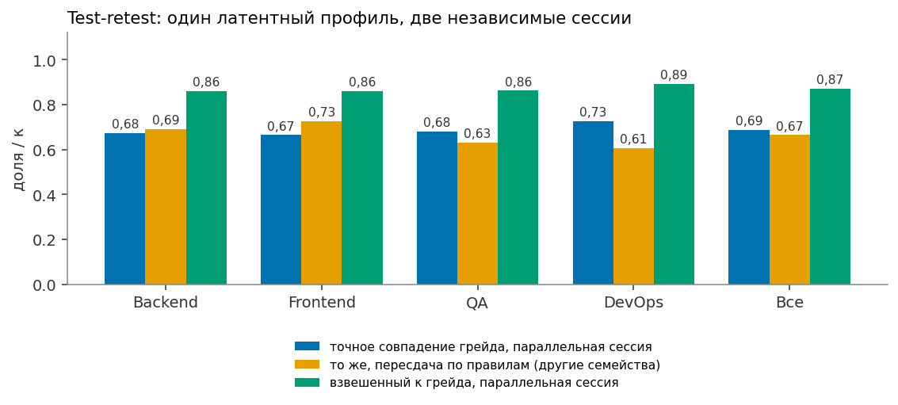
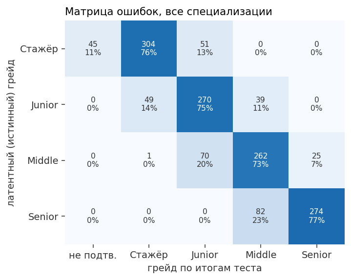
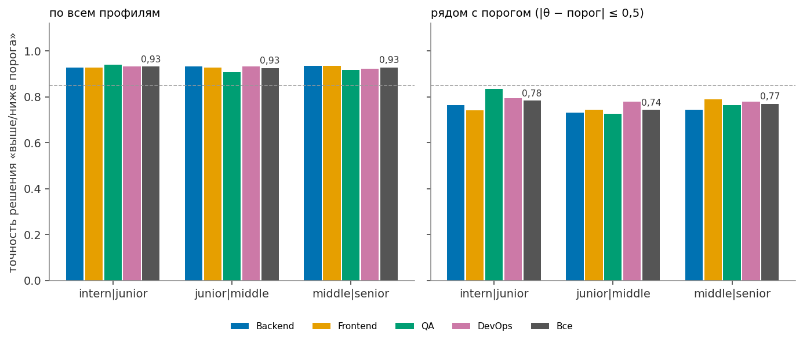

# Валидация «Взаимно»: результаты

> Файл сгенерирован командой `cd backend && uv run python -m eval.validate` — режим полный, сид `20261005`, коммит `8b083fe305`, 394 с на 4 процессах. Руками не редактируется. Протокол — [VALIDATION_PLAN.md](VALIDATION_PLAN.md): метрики и пороги в нём записаны до прогона, уточнения процедуры после прогонов вынесены в отдельные разделы 4–5 (пороги не менялись). Все числа в машиночитаемом виде — [`../backend/eval/out/validation.json`](../backend/eval/out/validation.json) (его же показывает «Лаборатория» после `--save-db`).

Всё ниже — **симуляция**: она проверяет процедуру на синтетической популяции с известной истиной и работает на тех же движках, что и прод (`app/testing`, банк из 111 семейств с экспертными оценками сложности, `app/matching`, `app/fsp`). Раздела «люди» (пилот, экспертная разметка пар) в этом прогоне нет — см. «Честные ограничения».

## Итоги

| Раздел | Метрика | Значение | Цель | Статус |
|---|---|---|---|---|
| Тестирование | Верное решение у заявленного порога | 0,86 | ≥ 0,85 | ✓ выполнено |
| Тестирование | Точный грейд | 0,748 | ≥ 0,75 | ✗ не выполнено |
| Тестирование | Грейд с точностью ±1 | 1,00 | ≥ 0,99 | ✓ выполнено |
| Тестирование | Средняя длина основной части, заданий | 12,8 | ≤ 15,0 | ✓ выполнено |
| Тестирование | Средняя длина с доборами, заданий | 16,1 | ≤ 17,0 | ✓ выполнено |
| Тестирование | p95 длины с доборами, заданий | 20,0 | ≤ 20,0 | ✓ выполнено |
| Тестирование | Показано в основной части вместе с pretest (максимум; pretest-семейств в банке пока нет) | 20 | ≤ 20 | ✓ выполнено |
| Тестирование | Пересдача: совпадение решения | 0,81 | ≥ 0,78 | ✓ выполнено |
| Тестирование | Пересдача: κ решения | 0,551 | ≥ 0,55 | ✓ выполнено |
| Тестирование | Пересдача: QWK грейда | 0,86 | ≥ 0,85 | ✓ выполнено |
| Тестирование | Пересдача: корреляция оценок уровня | 0,86 | ≥ 0,88 | ✗ не выполнено |
| Тестирование | Ложное повышение грейда (гистерезис) | 0,03 | ≤ 0,07 | ✓ выполнено |
| Тестирование | Общих экземпляров у пар кандидатов (каждый экземпляр выдаётся одному — по построению) | 0 | 0 | ✓ выполнено |
| Тестирование | Двум кандидатам с одним семейством выпал одинаковый по тексту экземпляр (Backend, худшее семейство) | 0,10% | показываем | справочно |
| Тестирование | RMSE сложности после 100 ответов | 0,20 | ≤ 0,30 | ✓ выполнено |
| Тестирование | Теги ✓ модулей: точность против истинного уровня (ориентир концепции ≥ 0,90) | 0,97 | показываем | справочно |
| Тестирование | Теги ✓ модулей: полнота (ориентир концепции ≥ 0,75) | 0,76 | показываем | справочно |
| Утечки | Ложный Middle у явных Junior, коалиция 20 (худшая стратегия списывания) | 0,10 | ≤ 0,15 | ✓ выполнено |
| Утечки | Наивные списывающие пойманы «чужим ключом» (коалиция 20) | 1,00 | ≥ 0,90 | ✓ выполнено |
| Утечки | B0 фиксированная форма: ложный Middle при коалиции 20 | 1,00 | показываем | справочно |
| Дрейф | CUSUM, 50% знают метод: медиана задержки (прод-порог h), ответов | 603 | ≤ 200 | ✗ не выполнено |
| Дрейф | CUSUM: ложные карантины без утечки (прод-порог h) | 0,01 | ≤ 0,05 | ✓ выполнено |
| Категоризация | macro-F1 подсказки специализации (V-CAT) | 0,93 | ≥ 0,90 | ✓ выполнено |
| Категоризация | Профили без ФСП получают категорию по тем же правилам | да | да | ✓ выполнено |
| Подбор | P@10 по оракулу, test-брифы, сквозной режим | 0,61 | ≥ 0,60 | ✓ выполнено |
| Подбор | P@10 значимо выше B2 (парный бутстреп) | нет | да | ✗ не выполнено |
| Подбор | P@10 значимо выше B2 на всех 40 брифах (постфактум-срез) | да | да | ✓ выполнено |
| Разбор брифа | Специализация top-1 | 0,90 | ≥ 0,90 | ✓ выполнено |
| Разбор брифа | Грейд точно | 0,95 | ≥ 0,75 | ✓ выполнено |
| Разбор брифа | Грейд ±1 | 1,00 | ≥ 0,95 | ✓ выполнено |
| Разбор брифа | F1 навыков | 0,98 | ≥ 0,85 | ✓ выполнено |
| Разбор брифа | must/nice определены верно | 0,81 | ≥ 0,80 | ✓ выполнено |
| Разбор брифа | Верная категория в топ-3 | 0,95 | ≥ 0,95 | ✓ выполнено |
| Устойчивость | Стабильность топ-10 при пересдаче (overlap@10) | 0,28 | ≥ 0,70 | ✗ не выполнено |
| Устойчивость | P@10 после пересдачи (постфактум): качество десятки не зависит от шума теста | 0,67 | ≥ 0,60 | ✓ выполнено |
| Устойчивость | Стабильность топ-10 / потолок ранжирования по одному измерению уровня при той же надёжности (постфактум) | 3,3 | ≥ 1,0 | ✓ выполнено |
| Устойчивость | Жаккар топ-10 после «добавлен nice-навык» | 0,95 | ≥ 0,60 | ✓ выполнено |
| Устойчивость | Падение P@10 при сдвиге веса на ±0,05 (максимум) | 0,01 | ≤ 0,05 | ✓ выполнено |
| Устойчивость | Накрутка навыков: сдвиг ранга вверх, наш подбор | 0,0 | ≤ 2,0 | ✓ выполнено |
| Устойчивость | Накрутка навыков: сдвиг ранга вверх, BM25 (ожидание ≥ 10) | 518,4 | ≥ 10,0 | ✓ выполнено |
| Экспозиция | Кандидаты без ФСП: условное отношение экспозиции, топ-10 | 0,91 | 0,80–1,25 | ✓ выполнено |
| Экспозиция | Кандидаты без ФСП: условное отношение экспозиции, топ-50 | 0,94 | 0,80–1,25 | ✓ выполнено |
| Объяснения | Σ вкладов = Score | 1,00 | ≥ 1,00 | ✓ выполнено |
| Объяснения | Доводы ссылаются на существующие доказательства | 1,00 | ≥ 1,00 | ✓ выполнено |
| Объяснения | Отсутствие ФСП никогда не «против» | 1,00 | ≥ 1,00 | ✓ выполнено |
| Объяснения | Без доказательства довода №1 Score падает не меньше превышения над медианой | 1,00 | ≥ 1,00 | ✓ выполнено |
| Производительность | p95 сборки версии подборки, мс | 133 | ≤ 300 | ✓ выполнено |

Выполнено 38 из 43 пороговых пунктов. Не выполнены: «Точный грейд», «Пересдача: корреляция оценок уровня», «CUSUM, 50% знают метод: медиана задержки (прод-порог h), ответов», «P@10 значимо выше B2 (парный бутстреп)», «Стабильность топ-10 при пересдаче (overlap@10)».

## 1. Данные

**Популяция с латентной истиной** (`eval/population.py`). Каждый кандидат порождается своим генератором с сидом, поэтому популяция из n кандидатов — префикс популяции из 2n.

| Показатель | Значение |
|---|---|
| Кандидатов | 2 000 |
| Истинная специализация | Backend (Python) 50%, Frontend (JS/TS) 39%, Fullstack 10% |
| Истинный грейд | Ниже Стажёра 5%, Стажёр 16%, Junior 30%, Middle 31%, Senior 19% |
| Заявленная специализация не совпадает с истинной | 9,5% |
| Есть история ФСП | 35,4% |
| Корреляция VSS (лучшая дисциплина) с истинным уровнем | 0,48 (Спирмен 0,51, n = 708) |
| Есть регулярные задачи | 49,4% |
| Категория подтверждена тестом | 93,2% |
| Навыков в истинном стеке / приписано в самоописании (в среднем) | 14,5 / 4,3 |

**Брифы** (`eval/briefs/*.json`): 100 русскоязычных брифов, разбиение 20 dev / 20 test (b01–b40) и 60 test2 (b41–b100, предрегистрированная отложенная выборка, VALIDATION_PLAN §8) зафиксировано в файлах. Стили: переписка со сленгом и опечатками — 26, формальная вакансия — 24, длинное описание с разделами — 15, смесь с английским — 14, короткий запрос — 21. **Тексты и эталонная разметка (специализация, грейд, must/nice, формат, город, вилка) написаны командой с помощью ИИ-ассистента**; посторонних авторов в наборе нет, а история правок эталона до первого коммита не зафиксирована. Все итоговые цифры подбора — по test-брифам; веса на брифах не подбирались.

## 2. Тестирование

Метрики точности и пересдачи — по кандидатам, чья заявленная специализация совпадает с истинной (n = 1 810). Решение «верное», если «сдал» ⇔ истинный уровень не ниже порога заявленного грейда. «Не подтверждён» считается как «Ниже Стажёра».

### 2.1. Точность

| Система | Верное решение у порога | Точный грейд | ±1 | κ | QWK |
|---|---|---|---|---|---|
| Наш CAT (основная часть + доборы) | 0,86 | 0,75 | 1,00 | 0,67 | 0,90 |
| B4: грейд по стажу (подсказка опроса) | — | 0,54 | 0,97 | 0,38 | 0,75 |

Точность решения по тому, как кандидат заявил грейд: верно — 0,84 (n = 1243); на ступень выше — 0,85 (n = 420); на ступень ниже — 1,00 (n = 147).

Матрица «истинный грейд → итоговый грейд» (строки — истина):

| Истина \ итог | Ниже Стажёра / не подтверждён | Стажёр | Junior | Middle | Senior |
|---|---|---|---|---|---|
| Ниже Стажёра / не подтверждён | 62 | 31 | 0 | 0 | 0 |
| Стажёр | 34 | 204 | 30 | 0 | 0 |
| Junior | 0 | 86 | 401 | 54 | 0 |
| Middle | 0 | 1 | 105 | 421 | 35 |
| Senior | 0 | 0 | 1 | 80 | 265 |

Точность по специализациям теста (кандидаты с верной заявкой):

| Специализация | n | Верное решение | Точный грейд | ±1 | Подтверждено | Заданий в тесте: среднее / p95 |
|---|---|---|---|---|---|---|
| backend_python | 1003 | 0,86 | 0,73 | 1,00 | 94% | 15,8 / 20 |
| frontend_js | 807 | 0,86 | 0,76 | 1,00 | 95% | 16,5 / 20 |

Кандидаты, ошибившиеся со специализацией (проходят чужой тест, n = 190): категорию получают 79%, на уровне своего истинного грейда или выше — 23%. Подсказка опроса (раздел 3) нужна, чтобы таких было меньше.

### 2.2. Длина теста

| Метрика | Значение | Цель |
|---|---|---|
| Основная часть, оцениваемых заданий: среднее / p95 | 12,8 / 20 | ≤ 15 |
| С доборами, оцениваемых: среднее / p95 | 16,1 / 20 | ≤ 17 / ≤ 20 |
| Основная часть, показано вместе с pretest: среднее / p95 / максимум | 12,8 / 20 / 20 | ≤ 20 (DECISIONS п.17) |
| Pretest-заданий на сессию | 0,00 | — |
| Доля основных частей, дошедших до максимума | 30% | — |

Решения основной части: не сдал, на границе — 203, сдал на границе — 327, не сдал — 367, сдал — 913.

### 2.3. Пересдача и гистерезис

Вторая сессия того же человека; все семейства первой сессии исключены (n = 1 810).

| Метрика | Значение | Цель |
|---|---|---|
| Совпадение решения | 0,81 | ≥ 0,78 |
| κ решения | 0,55 | ≥ 0,55 |
| Точное совпадение грейда / ±1 | 0,68 / 0,99 | показываем |
| QWK грейда | 0,86 | ≥ 0,85 |
| Корреляция оценок уровня | 0,86 | ≥ 0,88 |
| Ложное повышение при тесте на грейд выше (гистерезис) | 0,03 (n = 400) | ≤ 0,07 |

### 2.4. Ошибка экспертов в сложности и крутизне (S2)

Истинная сложность = экспертная + N(0; σ²) — ошибка одна на семейство; истинная крутизна A ≠ 1,5 модели. n = 400 кандидатов на условие.

| Условие | Верное решение у порога | Точный грейд |
|---|---|---|
| σ = 0, A = 1,5 (модель верна) | 0,87 | 0,77 |
| σ = 0,3 | 0,86 | 0,76 |
| σ = 0,5 | 0,85 | 0,73 |
| истинная крутизна A = 1 | 0,81 | 0,69 |
| истинная крутизна A = 2 | 0,88 | 0,76 |

### 2.5. Бейзлайны тестирования

Подвыборка n = 400. B0 и B1 — формы из 16 заданий («сдал», если вероятность уровня не ниже порога ≥ 0,5). B3 «LLM под каждого»: каждое задание сгенерировано заново, его сложность = задуманная + N(0; σ²) на экземпляр, часть ключей неверна. **Доля битых ключей — допущение, а не замер**: реального прогона заданий через YandexGPT/GigaChat в этом прогоне нет; поэтому показана чувствительность к этой доле.

| Система | Верное решение | Точный грейд | Длина | Совпадение решения при пересдаче |
|---|---|---|---|---|
| Наш CAT (клоны) | 0,85 | 0,73 | 12,7 | 0,79 |
| B0 фиксированная форма (16) | 0,85 | 0,69 | 16 | — |
| B1 LOFT (16) | 0,85 | 0,68 | 16 | 0,81 |
| B3 «LLM под каждого» (σ = 0,5, битых ключей 10%) | 0,78 | 0,66 | 13,5 | 0,71 |
| B3, битых ключей 0% | 0,86 | 0,76 | 13,3 | — |
| B3, битых ключей 5% | 0,82 | 0,67 | 13,3 | — |
| B3, битых ключей 20% | 0,63 | 0,44 | 13,6 | — |
| B3 «идеальный LLM» (σ = 0,3, 0% битых) | 0,87 | 0,76 | 13,2 | 0,78 |

### 2.6. Утечки (S4)

300 «явных Junior» (истинный уровень равномерно в [−0,8; −0,3]) заявляют Middle (Backend). Коалиция из k честных кандидатов сливает всё, что видела. Наш тест: экземпляры одноразовые; «наивный» списывающий вводит слитый ключ чужого экземпляра того же семейства, «осторожный» видит, что код другой, и отвечает честно. B0/B1/B2: копирует, только если достался тот же экземпляр (консервативно в пользу бейзлайнов). B3: экземпляры уникальны, слив бесполезен — его доля ложных Middle равна честной ошибке.


| Коалиция | 0 | 5 | 20 | 100 |
|---|---|---|---|---|
| Слито семейств банка Backend | 0% | 77% | 95% | 100% |
| Наш тест, наивный списывающий | 0,10 | 0,00 | 0,00 | 0,00 |
| Наш тест, осторожный | 0,10 | 0,10 | 0,10 | 0,10 |
| B0 фиксированная форма | 0,09 | 1,00 | 1,00 | 1,00 |
| B1 LOFT | 0,12 | 1,00 | 1,00 | 1,00 |
| B2 CAT без клонов (20 экземпляров) | 0,10 | 0,29 | 0,77 | 1,00 |
| B3 «LLM под каждого» | 0,06 | 0,06 | 0,06 | 0,06 |
| Наивные пойманы «чужим ключом» | — | 1,00 | 1,00 | 1,00 |

В «Итогах» для нашего теста берётся худшая из двух стратегий списывающего: наивный ввод чужого ключа почти всегда проваливается, поэтому рациональный списывающий отвечает честно, и его доля ложных Middle равна честной ошибке теста у порога.

**Утечка метода** (коалиция 20, слито 95% семейств): тем, кто знает идею семейства, оно легче на Δb. Клоны защищают от слива ответов, но не от слива идеи — это видно в таблице.

| Δb | Ложный Middle |
|---|---|
| 0,00 | 0,10 |
| 0,25 | 0,25 |
| 0,50 | 0,51 |

Детектор «чужой ключ» активен для 28 из 44 семейств Backend (доля коллизий ключей < 2%, измерено на 200 экземплярах каждого семейства реального банка; медиана коллизий 0,00). У семейств с выбором ответа ключи совпадают часто, поэтому для них детектор не работает — их защищают только клоны и CUSUM.

### 2.7. Дрейф: CUSUM (S5)

Поток ответов по каждому из 44 семейств Backend: сначала объём 3 000 честных сессий, затем столько же, где доля проходящих знает метод 12 семейств (Δb = 0,5). Повторов: 20. Прод-порог h = 11.


| Сценарий | h | Найдено слитых семейств | Медиана задержки, ответов | Ложные карантины |
|---|---|---|---|---|
| без утечки | 4 | — | — | 0,633 |
| без утечки | 5 | — | — | 0,380 |
| без утечки | 6 | — | — | 0,204 |
| без утечки | 7 | — | — | 0,120 |
| без утечки | 8 | — | — | 0,060 |
| без утечки | 9 | — | — | 0,032 |
| без утечки | 10 | — | — | 0,018 |
| без утечки | 11 | — | — | 0,011 |
| без утечки | 12 | — | — | 0,004 |
| 20% знают метод | 4 | 0,33 | 281 | 0,548 |
| 20% знают метод | 5 | 0,33 | 426 | 0,306 |
| 20% знают метод | 6 | 0,20 | 441 | 0,172 |
| 20% знают метод | 7 | 0,16 | 436 | 0,091 |
| 20% знают метод | 8 | 0,12 | 513 | 0,057 |
| 20% знают метод | 9 | 0,10 | 520 | 0,035 |
| 20% знают метод | 10 | 0,07 | 557 | 0,016 |
| 20% знают метод | 11 | 0,07 | 615 | 0,008 |
| 20% знают метод | 12 | 0,03 | 648 | 0,006 |
| 50% знают метод | 4 | 0,52 | 157 | 0,552 |
| 50% знают метод | 5 | 0,70 | 226 | 0,312 |
| 50% знают метод | 6 | 0,67 | 306 | 0,184 |
| 50% знают метод | 7 | 0,66 | 370 | 0,101 |
| 50% знают метод | 8 | 0,57 | 421 | 0,049 |
| 50% знают метод | 9 | 0,50 | 461 | 0,028 |
| 50% знают метод | 10 | 0,44 | 556 | 0,014 |
| 50% знают метод | 11 | 0,35 | 603 | 0,008 |
| 50% знают метод | 12 | 0,30 | 703 | 0,004 |

**Подбор прод-порога на других популяциях.** Порог h выбирается по нулевым потокам (без утечки) на отдельных сидах, а не на основном; основной сид лишь проверяет выбор. Ложные карантины по h:

| Популяция | 4 | 5 | 6 | 7 | 8 | 9 | 10 | 11 | 12 |
|---|---|---|---|---|---|---|---|---|---|
| сид 301 (подбор) | 0,690 | 0,449 | 0,293 | 0,177 | 0,108 | 0,070 | 0,050 | 0,027 | 0,017 |
| сид 302 (подбор) | 0,701 | 0,481 | 0,314 | 0,189 | 0,103 | 0,064 | 0,039 | 0,023 | 0,017 |
| сид 303 (подбор) | 0,693 | 0,473 | 0,330 | 0,201 | 0,124 | 0,081 | 0,053 | 0,026 | 0,018 |
| основной сид (проверка) | 0,633 | 0,380 | 0,204 | 0,120 | 0,060 | 0,032 | 0,018 | 0,011 | 0,004 |

Наименьший h с ложными ≤ 5% на каждом из сидов подбора — 11; прод-порог h = 11 даёт на основном сиде 1% ложных карантинов (цель ≤ 5%). При 50% знающих такой порог находит 35% слитых семейств с медианой задержки 603 ответа — цель ≤ 200 ответов **не достигнута**: задержка ≈ h / (информация на ответ), а при Δb = 0,5 и половине знающих эффект на один ответ мал (порядка 0,02–0,03 нат); уложиться в 200 ответов можно только ценой ложных карантинов 12–31% (h = 5–7 в таблице) или при вдвое большем трафике на семейство. Выбран контроль ложных карантинов: без утечки CUSUM — сигнал методисту, а не автоматическая блокировка. Порог плана ≤ 200 не меняем.

### 2.8. Калибровка сложности

Истинная сложность неякорных семейств = экспертная + N(0; 0,5²); MAP-уточнение `calibration.calibrate_family` по n ответам. Семейств: 25, повторов: 5.


| Ответов на семейство | 0 | 30 | 100 | 300 |
|---|---|---|---|---|
| RMSE | 0,48 | 0,29 | 0,20 | 0,13 |

### 2.9. Дискриминативность

r_pb — точечно-бисериальная корреляция ответа с оценкой уровня **без этого задания**; pretest-семейств в банке пока нет, поэтому считаем по боевым заданиям. ΔP — доля верных у Middle минус у Junior (по оценке уровня).

| Специализация | Семейств | Медиана r_pb | Доля r_pb ≥ 0,20 | Флаг r_pb < 0,10 | Медиана ΔP | Доля ΔP ≥ 0,20 |
|---|---|---|---|---|---|---|
| backend_python | 44 | 0,44 | 0,98 | py.closures.late_binding | 0,20 | 0,46 |
| frontend_js | 40 | 0,46 | 0,97 | нет | 0,22 | 0,60 |

AUC оценки уровня для соседних грейдов: intern / junior — 0,91, junior / middle — 0,88, middle / senior — 0,90. Надёжность 1 − mean(SE²)/var: 0,83.

Пересечение экземпляров у пар кандидатов: 0 из 67 974 выданных (тест и пересдача). Это свойство выдачи, а не измерение: симулятор, как и пул в проде, отдаёт каждый экземпляр одному человеку. Измеримый вопрос — увидят ли двое одно и то же задание под разными id: по 200 экземплярам каждого из 44 семейств Backend вероятность, что двум кандидатам с одним семейством выпадет одинаковый по тексту экземпляр, в среднем 0,00%, в худшем семействе (py.complexity.containers) — 0,10%; совпадения есть у 2 семейств. У таких близнецов и ключ общий; модель утечек в 2.6 это учитывает: слитый ключ верен с этой вероятностью (плюс угадывание).

**Теги модулей.** ✓ утверждает «уровень модуля не ниже порога Junior», ✓✓ — «не ниже порога итогового грейда»; истина — уровень модуля генератора. По 8 570 модулям: точность ✓ 0,97, полнота 0,76 (полнота считается по всем модулям теста, у 10% из них заданий меньше двух — «~»); точность ✓✓ 0,91 (n = 4222). В плане этой метрики не было, поэтому ориентир концепции (≥ 0,90 / ≥ 0,75) показан справочно.

### 2.10. Кандидаты без истории ФСП

Опрос и тест не принимают на вход ничего из ФСП, поэтому категория присваивается по тем же правилам. Доля подтверждённых тестом: с ФСП — 92,9% (n = 708), без ФСП — 93,4% (n = 1292); разница — только от уровня, который в генераторе коррелирует с ФСП.

### 2.11. Test-retest и разделяющая способность по специализациям

Отдельный эксперимент на тех же движках (`eval/spec_validation.py`): по 400 латентных профилей на каждую из четырёх специализаций, поровну по грейдам Стажёр / Junior / Middle / Senior, заявка 60% верно / 30% на ступень выше / 10% ниже. Один и тот же профиль проходит три сессии: **A** — основная; **B** — независимая параллельная (другой сид → другие клоны и другая траектория CAT, семейства могут повториться); **C** — пересдача по реальным правилам (spec-testing §7.1: семейства сессии A исключены, то есть другая экспозиция заданий). Истина — латентный уровень профиля; в расчёт точности не входят кандидаты, заявившие грейд ниже истинного: тест на заявленный грейд не может выдать больше, повышение — отдельный тест, это правило продукта, а не ошибка теста.







**Test-retest** (A↔B — параллельные формы; A↔C — по правилам пересдачи).

| Специализация | n | A↔B точно | ±1 | QWK | r(уровень) | решение сдал/не сдал совпало | κ решения | A↔C точно | A↔C QWK | A↔C r(уровень) | общих семейств в C |
|---|---|---|---|---|---|---|---|---|---|---|---|
| Backend (Python) | 400 | 68% | 99% | 0,86 | 0,87 | 80% | 0,52 | 69% | 0,86 | 0,85 | 0,0 |
| Frontend (JS/TS) | 400 | 66% | 100% | 0,86 | 0,87 | 79% | 0,46 | 72% | 0,88 | 0,87 | 0,0 |
| QA | 400 | 68% | 100% | 0,86 | 0,86 | 79% | 0,53 | 63% | 0,81 | 0,79 | 0,0 |
| DevOps | 400 | 73% | 100% | 0,89 | 0,89 | 80% | 0,50 | 61% | 0,80 | 0,78 | 0,0 |
| Все вместе | 1600 | 69% | 100% | 0,87 | 0,87 | 80% | 0,51 | 66% | 0,84 | 0,82 | 0,0 |

Доля профилей, у которых решение «перевернулось» через порог между сессиями A и B (весь профиль; в скобках — только рядом с порогом, |уровень − порог| ≤ 0,5, где ошибки ожидаемы):

| Специализация | Стажёр/Junior | Junior/Middle | Middle/Senior | любой порог | рядом с порогом: грейд разошёлся | SEM по паре сессий |
|---|---|---|---|---|---|---|
| Backend (Python) | 9% | 11% | 10% | 32% | 37% (n = 299) | 0,42 |
| Frontend (JS/TS) | 10% | 10% | 10% | 34% | 33% (n = 287) | 0,42 |
| QA | 8% | 8% | 11% | 32% | 28% (n = 285) | 0,42 |
| DevOps | 8% | 8% | 8% | 27% | 30% (n = 298) | 0,39 |
| Все вместе | 9% | 9% | 10% | 31% | 32% (n = 1169) | 0,41 |

**Разделяющая способность: итог теста против истинного грейда.**

| Специализация | n | Точный грейд | ±1 | QWK | Надёжность | SEM (апост.) | SEM у порогов | Заданий | p95 |
|---|---|---|---|---|---|---|---|---|---|
| Backend (Python) | 371 | 76% | 100% | 0,91 | 0,84 | 0,45 | 0,43 | 16,0 | 20 |
| Frontend (JS/TS) | 369 | 75% | 100% | 0,90 | 0,83 | 0,47 | 0,45 | 16,5 | 20 |
| QA | 360 | 73% | 100% | 0,89 | 0,82 | 0,47 | 0,46 | 17,0 | 20 |
| DevOps | 372 | 77% | 100% | 0,91 | 0,82 | 0,50 | 0,48 | 14,2 | 15 |
| Все вместе | 1472 | 75% | 100% | 0,90 | 0,83 | 0,47 | 0,46 | 15,9 | 20 |

Матрица ошибок, все специализации (строки — истинный грейд, столбцы — итог теста):

| Истина \ итог | не подтв. | Стажёр | Junior | Middle | Senior |
|---|---|---|---|---|---|
| Стажёр | 45 | 302 | 53 | 0 | 0 |
| Junior | 0 | 49 | 270 | 39 | 0 |
| Middle | 0 | 1 | 70 | 262 | 25 |
| Senior | 0 | 0 | 0 | 82 | 274 |

Точность решения «выше порога / ниже» у каждого порога (всего / рядом с порогом) и AUC оценки уровня между соседними грейдами (ровно «ниже/выше» порога):

| Специализация | Стажёр/Junior | Junior/Middle | Middle/Senior |
|---|---|---|---|
| Backend (Python) | 93% / 76% / 0,96 | 93% / 73% / 0,96 | 94% / 74% / 0,96 |
| Frontend (JS/TS) | 92% / 71% / 0,95 | 93% / 74% / 0,96 | 94% / 79% / 0,96 |
| QA | 94% / 84% / 0,96 | 91% / 73% / 0,95 | 92% / 76% / 0,96 |
| DevOps | 93% / 79% / 0,97 | 93% / 78% / 0,98 | 92% / 78% / 0,96 |
| Все вместе | 93% / 77% / 0,96 | 93% / 74% / 0,96 | 93% / 77% / 0,96 |

Информация Фишера, набранная заданиями сессии у порога, и SEM = 1/√I (среднее по профилям):

| Специализация | Стажёр/Junior: I / SEM | Junior/Middle: I / SEM | Middle/Senior: I / SEM |
|---|---|---|---|
| Backend (Python) | 4,7 / 0,46 | 4,9 / 0,45 | 3,5 / 0,53 |
| Frontend (JS/TS) | 4,7 / 0,46 | 4,9 / 0,45 | 3,3 / 0,55 |
| QA | 5,1 / 0,44 | 4,7 / 0,46 | 3,2 / 0,56 |
| DevOps | 3,9 / 0,51 | 4,3 / 0,48 | 3,5 / 0,53 |
| Все вместе | 4,6 / 0,47 | 4,7 / 0,46 | 3,4 / 0,54 |

**Дискриминация заданий** (зачётные задания сессий A; r_pb — ответ против оценки уровня без этого ответа; A_eff — крутизна IRT-кривой из банка; ΔP — прирост доли верных между соседними грейдами):

| Специализация | Семейств (n ≥ 25 ответов) | Медиана r_pb | 10-й перцентиль | Доля r_pb ≥ 0,20 | Медиана A_eff | Медиана ΔP | Флаг r_pb < 0,10 |
|---|---|---|---|---|---|---|---|
| Backend (Python) | 43 | 0,41 | 0,24 | 95% | 1,35 | 0,21 | нет |
| Frontend (JS/TS) | 39 | 0,46 | 0,27 | 95% | 1,35 | 0,22 | нет |
| QA | 25 | 0,47 | 0,35 | 100% | 1,35 | 0,19 | нет |
| DevOps | 19 | 0,52 | 0,38 | 100% | 1,35 | 0,21 | нет |

**Эквивалентность клонов.** Живых клонов у нас нет, поэтому разброс сложности клона σ_inst (в конфиге 0,15) — допущение. Проверяем чувствительность: как меняются точность и ретест, если клоны на самом деле разнятся меньше или больше (по каждой специализации, доля точного грейда против истины / доля совпадения при ретесте):

| Специализация | σ_inst = 0,00 | σ_inst = 0,15 | σ_inst = 0,30 |
|---|---|---|---|
| Backend (Python) | 81% / 70% | 81% / 68% | 79% / 69% |
| Frontend (JS/TS) | 79% / 72% | 78% / 71% | 83% / 74% |
| QA | 69% / 64% | 82% / 78% | 75% / 69% |
| DevOps | 75% / 68% | 75% / 71% | 73% / 63% |

**Устойчивость к утечке ответов.** Коалиция честных участников выкладывает всё, что видела; слабый кандидат (Стажёр/Junior, заявка на ступень выше) вводит слитый ключ чужого клона. Сравнение парное: та же сессия честно и со слитыми ключами. «Осторожный» списывающий, видя другой код, отвечает честно — его прирост равен нулю по построению, поэтому в таблице наивный.

| Специализация | n | Коалиция | Банк слит | Прирост оценки уровня [95% ДИ] | Ложный «сдал» честно | со слитыми ключами | Пойман «чужим ключом» | Детектор активен для семейств |
|---|---|---|---|---|---|---|---|---|
| Backend (Python) | 100 | 20 | 80% | -1,76 [-1,91; -1,65] | 15% | 0% | 100% | 39 из 55 |
| Frontend (JS/TS) | 100 | 20 | 98% | -1,72 [-1,85; -1,60] | 12% | 0% | 100% | 25 из 41 |
| QA | 100 | 20 | 100% | -1,83 [-1,95; -1,71] | 21% | 0% | 100% | 13 из 27 |
| DevOps | 100 | 20 | 100% | -1,70 [-1,83; -1,58] | 26% | 0% | 100% | 15 из 19 |

**«Двойник в буфере»: покрытие банка.** Доля экземпляров, для которых строится двойник (подменённый литерал, ключ двойника ≠ ключа), — детерминированно, без людей и без LLM:

| Специализация | Семейств | С двойником | Экземпляров с двойником | Ключ двойника ≠ ключа | Почему нет двойника (экземпляров) |
|---|---|---|---|---|---|
| Backend (Python) | 55 | 33 | 60% | 100% | format_unsupported: 48, answer_mode_not_text: 48, language_not_executable: 30, no_candidates: 6, all_candidates_rejected: 1 |
| Frontend (JS/TS) | 41 | 20 | 48% | 100% | format_unsupported: 48, answer_mode_not_text: 48, language_not_executable: 30, executor_failed: 1 |
| QA | 27 | 13 | 48% | 100% | format_unsupported: 30, answer_mode_not_text: 30, language_not_executable: 24 |
| DevOps | 19 | 12 | 63% | 100% | language_not_executable: 24, answer_mode_not_text: 12, format_unsupported: 6 |

**Пилот анти-ассиста** (сводка без персональных данных). Пилот 1: 3 модели одного вендора × 2 условия × 2 обычных задания = 12 ответов, верных 12 — правильный ответ ИИ по одному ответу не отличить от сильного человека. Пилот 2: построено 14 заданий с двойником (predict_output — 10, sql_result — 4); ключ двойника ≠ ключа и все гейты пройдены у 14 из 14. **Прогон моделей на этих ловушках не выполнен, поэтому recall двойника не измерен.** Измерен только факт построения двойников (14/14, ключ двойника ≠ ключу) и покрытие банка (ниже, twin). Доля пойманных копипастеров среди живых людей и моделей не измерена; обход скриншотом двойник не ловит.

**Выводы по 2.11 (считаются по числам выше).**

- Разделяющая способность: точный грейд против истины — 75%, ±1 — 100%, QWK 0,90. Лучше всего DevOps (77%), слабее всего QA (73%). Грубые ошибки (через ступень) редки; ошибаются соседние грейды — у порога.
- Test-retest: точное совпадение грейда между независимыми сессиями 69%, между сессией и пересдачей по правилам 66%; слабее всего Frontend (JS/TS) (66%). Решение «выше/ниже порога» повторяется в 80% случаев. При пересдаче по правилам слабее всего DevOps (61%): в малых банках (QA, DevOps) после исключения семейств первой сессии остаётся меньше подходящих по сложности заданий. κ решения около 0,5 — умеренная. Точное совпадение при 4–5 уровнях и ~16 заданиях не может быть близким к 100%; расхождения сосредоточены у порогов.
- Утечка: у наивного списывающего слитые ключи не дают прироста (верхняя граница 95% ДИ прироста оценки уровня по специализациям: -1,58 ≤ 0). Это модельный результат при допущении σ_inst и уникальных клонов; утечку **идеи** семейства он не покрывает (см. 2.6, CUSUM).
- Двойник строится не везде: доля экземпляров с двойником ниже 50% у Frontend (JS/TS), QA — остальные семейства закрыты только клонами и временем ответа.
- Семейств с r_pb < 0,10 нет.
- Всё это симуляция: модель ответа — Раш с экспертными сложностями, а не живые люди; точность против истины отражает процедуру, а не реальную валидность заданий. Живой ретест на людях не проводился.

## 3. Категоризация по специализации (V-CAT)

300 синтетических профилей опроса (10 специализаций × 30) и 30 трудных случаев. Ответы порождает своя матрица в `eval/vcat.py` (шум 10%, «амбициозные» отметки соседней специализации у 15% профилей, выбор кандидата совпадает с истиной в 80%); классифицирует прод-функция `app.testing.survey.classify`.

| Метрика | Подсказка классификатора | Только выбор кандидата |
|---|---|---|
| macro-F1 | 0,93 | 0,80 |
| Точность | 0,93 | 0,79 |

Подсказка показывается 16% профилей, верна в 92% случаев; из тех, кто выбрал не свою специализацию, верную подсказку получают 70%.

| Специализация | Точность | Полнота | F1 |
|---|---|---|---|
| Backend (Go) | 1,00 | 0,87 | 0,93 |
| Backend (Java/Kotlin) | 1,00 | 1,00 | 1,00 |
| Backend (Python) | 0,88 | 1,00 | 0,94 |
| Data Science / ML | 1,00 | 1,00 | 1,00 |
| DevOps / SRE | 0,86 | 1,00 | 0,92 |
| Frontend (JS/TS) | 0,73 | 1,00 | 0,85 |
| Fullstack | 1,00 | 0,67 | 0,80 |
| Информационная безопасность | 1,00 | 0,90 | 0,95 |
| Mobile | 1,00 | 0,90 | 0,95 |
| QA / тестирование | 1,00 | 1,00 | 1,00 |

Трудные случаи:

| Тип | n | Верная подсказка (top-1) | Подсказка показана |
|---|---|---|---|
| Fullstack | 10 | 0,60 | 0,00 |
| смена профессии | 10 | 1,00 | 0,00 |
| противоречивый опрос | 10 | 0,80 | 0,90 |

**Веса подсказки подбирались не на основном сиде.** Прежние веса «технологии / бонус за выбор» (0,3 / 0,5) заменены на (1,2 / 0,8) по сетке на четырёх других популяциях профилей (сиды 11, 12, 13, 14); проверка — на четырёх отложенных (сиды 21, 22, 23, 24), которых в подборе не было, и на основном сиде (таблица выше — уже с новыми весами).

| Выборка, веса | Профилей | macro-F1 | Подсказка показана | Подсказка верна | Верная подсказка при ошибочном выборе | Трудные случаи: top-1 |
|---|---|---|---|---|---|---|
| подбор, прежние веса | 1200 | 0,87 | 11% | 0,79 | 0,46 | 0,75 |
| подбор, текущие веса | 1200 | 0,93 | 14% | 0,90 | 0,68 | 0,81 |
| отложенные, прежние веса | 1200 | 0,87 | 13% | 0,84 | 0,47 | 0,76 |
| отложенные, текущие веса | 1200 | 0,92 | 17% | 0,94 | 0,71 | 0,82 |

Оговорка: генератор профилей писала та же команда, поэтому проверка на отложенных сидах показывает отсутствие подгонки под 300 профилей, а не перенос на живых людей — это нужно перепроверить на реальных опросах. Подсказка ничего не решает: специализацию выбирает кандидат, категорию подтверждает тест.

Сетка «вес технологий × бонус за выбор» на чётных профилях основного сида (проверка на нечётных): текущие (1,2 / 0,8) — macro-F1 на проверочной половине 0,94; лучшие на чётных 1,2 / 0,8 — 0,94.

## 4. Подбор

**Оракул релевантности** по скрытой истине (VALIDATION_PLAN §1.5): rel = 0 при несмежной специализации; иначе 3, −1 за соседний грейд (≥ 2 ступени → 0), −1 если покрыты не все must, −2 если покрыто меньше половины, −1 если минимум кандидата выше 1,1 · верх вилки. Релевантен ⇔ rel ≥ 2. Навык «покрыт», если он есть в истинном стеке и (не тестируется или истинный уровень его модуля не ниже порога грейда брифа − 0,5). Формат работы оракул не учитывает.

Популяция — 2 000 кандидатов, из них с подтверждённой категорией 1 865. Сквозной режим: разбор брифа → один уточняющий вопрос, если парсер его задал (отвечает работодатель — вариант из эталона) → обязательная вилка (если парсер её не нашёл, работодатель вводит её в форме) → рекомендованные категории → версия подборки с пресетом «Баланс».

### 4.1. Главная таблица (20 test-брифов, среднее и 95% бутстреп-ДИ по брифам)


| Система | P@10 | P@5 | nDCG@10 | Recall@50 | MRR |
|---|---|---|---|---|---|
| Наш (сквозной: разбор брифа + 1 уточнение) | 0,61 [0,49; 0,73] | 0,56 [0,43; 0,68] | 0,49 [0,42; 0,56] | 0,23 [0,17; 0,29] | 0,64 [0,49; 0,79] |
| Наш (эталонный бриф) | 0,64 [0,51; 0,76] | 0,58 [0,45; 0,71] | 0,51 [0,43; 0,58] | 0,24 [0,18; 0,30] | 0,67 [0,51; 0,82] |
| Наш (только парсер, без уточнения) | 0,61 [0,48; 0,73] | 0,56 [0,43; 0,68] | 0,49 [0,42; 0,56] | 0,23 [0,17; 0,29] | 0,64 [0,49; 0,79] |
| B2 категория + точечная оценка уровня | 0,49 [0,34; 0,64] | 0,50 [0,34; 0,67] | 0,38 [0,31; 0,48] | 0,14 [0,11; 0,16] | 0,73 [0,57; 0,89] |
| B0 случайный порядок в тех же категориях | 0,25 [0,17; 0,33] | 0,28 [0,20; 0,37] | 0,25 [0,18; 0,33] | 0,10 [0,08; 0,13] | 0,51 [0,36; 0,66] |
| B1 BM25 по самоописанию (как поиск по резюме) | 0,13 [0,07; 0,19] | 0,12 [0,06; 0,19] | 0,14 [0,10; 0,19] | 0,07 [0,05; 0,09] | 0,24 [0,14; 0,37] |
| B3 TF-IDF «бриф ↔ самоописание» (заменитель эмбеддингов) | 0,17 [0,10; 0,23] | 0,15 [0,09; 0,21] | 0,16 [0,12; 0,20] | 0,06 [0,05; 0,08] | 0,32 [0,21; 0,45] |

Потолок P@10 (если поставить всех релевантных наверх): 1,00. Recall@50 ограничен сверху величиной 50 / (число релевантных в популяции), а релевантных у брифа — сотни, поэтому он мал у всех систем.

Разница P@10 с B2 «категория + точечная оценка уровня» (парный бутстреп по брифам):

| Система | Разница | 95% ДИ | Значимо |
|---|---|---|---|
| Наш (сквозной: разбор брифа + 1 уточнение) | 0,12 | [-0,04; 0,28] | нет |
| Наш (эталонный бриф) | 0,14 | [-0,01; 0,31] | нет |
| Наш (только парсер, без уточнения) | 0,12 | [-0,03; 0,28] | нет |
| B0 случайный порядок в тех же категориях | -0,24 | [-0,34; -0,13] | да |
| B1 BM25 по самоописанию (как поиск по резюме) | -0,36 | [-0,53; -0,21] | да |
| B3 TF-IDF «бриф ↔ самоописание» (заменитель эмбеддингов) | -0,33 | [-0,49; -0,17] | да |

**Все 40 брифов (test + dev; ни те ни другие не использовались при настройке формулы).** P@10 нашего сквозного режима 0,66 [0,57; 0,74], B2 0,54 [0,43; 0,64]; разница с B2 0,12 [0,03; 0,22] — значима. Против случайного порядка в тех же категориях: 0,35 [0,26; 0,44]. Добавленный pooled-срез отмечен как постфактум: заявленная метрика остаётся на 20 test-брифах.

### 4.1а. Предрегистрированная отложенная выборка test2 (60 брифов b41–b100)

План и правило решения записаны до написания брифов (VALIDATION_PLAN §8, 9 октября 2026, 09:06 MSK); брифы заморожены в 09:09 MSK, до первого запуска разбора и Score на них; оценка выполнена один раз. Заморозка при этом прогоне: хэш манифеста совпадает с записанным в плане (`fa766490b26e3c4e…`, файлов 60, расхождений 0).

| Система | P@10 test2 | nDCG@10 test2 | P@10 test + test2 (80) | nDCG@10 test + test2 (80) |
|---|---|---|---|---|
| Наш (сквозной: разбор брифа + 1 уточнение) | 0,54 [0,47; 0,61] | 0,55 [0,50; 0,61] | 0,56 [0,49; 0,62] | 0,54 [0,49; 0,58] |
| Наш (эталонный бриф) | 0,53 [0,45; 0,61] | 0,55 [0,50; 0,61] | 0,56 [0,49; 0,62] | 0,54 [0,50; 0,58] |
| Наш (только парсер, без уточнения) | 0,53 [0,46; 0,61] | 0,54 [0,49; 0,60] | 0,55 [0,49; 0,62] | 0,53 [0,49; 0,58] |
| B2 категория + точечная оценка уровня | 0,36 [0,28; 0,43] | 0,38 [0,33; 0,43] | 0,39 [0,33; 0,46] | 0,38 [0,34; 0,43] |
| B0 случайный порядок в тех же категориях | 0,18 [0,14; 0,23] | 0,22 [0,19; 0,26] | 0,20 [0,16; 0,24] | 0,23 [0,20; 0,27] |
| B1 BM25 по самоописанию (как поиск по резюме) | 0,14 [0,10; 0,18] | 0,15 [0,12; 0,18] | 0,14 [0,11; 0,17] | 0,15 [0,12; 0,17] |
| B3 TF-IDF «бриф ↔ самоописание» (заменитель эмбеддингов) | 0,13 [0,10; 0,17] | 0,14 [0,11; 0,17] | 0,14 [0,11; 0,17] | 0,15 [0,12; 0,17] |

Парный бутстреп по брифам (наш сквозной режим минус сравниваемая система), 2 000 повторов:

| Выборка | Разность | Значение | 95% ДИ | Значимо |
|---|---|---|---|---|
| test2 | P@10 − B2 | 0,18 | [0,12; 0,24] | да |
| test2 | P@10 − B0 (случайный) | 0,35 | [0,29; 0,42] | да |
| test2 | nDCG@10 − B2 | 0,17 | [0,12; 0,22] | да |
| test2 | nDCG@10 − B0 | 0,33 | [0,28; 0,38] | да |
| test + test2 | P@10 − B2 | 0,17 | [0,11; 0,23] | да |
| test + test2 | P@10 − B0 (случайный) | 0,36 | [0,30; 0,41] | да |
| test + test2 | nDCG@10 − B2 | 0,16 | [0,11; 0,20] | да |
| test + test2 | nDCG@10 − B0 | 0,31 | [0,26; 0,35] | да |

Справочно: парный t-критерий P@10 наш − B2 на test2: t = 5,92, p < 0,001 (решает бутстреп, §8.3).

**Решение по предрегистрированному правилу (нижняя граница ДИ разности P@10 с B2 > 0):** подтверждено — разность 0,18 [0,12; 0,24]. Абсолютный P@10 на test2 0,54 [0,47; 0,61]: **ниже порога 0,60 (§2.3), порог на этой выборке не выполнен** — пишем как есть. Ни Score, ни конфиг, ни оракул после просмотра результата не менялись.

Описательно, по специализациям (малые выборки, выводов не делаем):

| Специализация | Брифов | P@10 наш | P@10 B2 | Разность P@10 |
|---|---|---|---|---|
| backend_python | 24 | 0,64 [0,57; 0,72] | 0,43 [0,32; 0,55] | 0,21 |
| frontend_js | 24 | 0,55 [0,41; 0,68] | 0,33 [0,20; 0,46] | 0,23 |
| fullstack | 12 | 0,31 [0,17; 0,44] | 0,28 [0,16; 0,39] | 0,03 |

Разбор брифа на test2 (справочно): специализация top-1 0,97, грейд точно 0,97.

**По оракулу наш подбор не обгоняет B2 — так и пишем.** Оракул видит только грейд, стек и деньги; B2 сортирует основную категорию ровно по тому, что оракул вознаграждает сильнее всего (уровень), а наша формула добавляет то, чего оракул не видит: формат работы, свежесть задач и ФСП. Где формула выигрывает — ниже: устойчивость к накрутке навыков и к пересдаче (4.4), проверяемые объяснения (4.6); где проигрывает — разобрано в диагностике выше и в 4.5.

**Откуда нерелевантные места в топ-10** (описательная диагностика после прогона, порогов у неё нет):

| Причина по оракулу | Наш подбор | B2 |
|---|---|---|
| грейд совпал, покрыто меньше половины must | 41 | 32 |
| грейд на ступень выше брифа, покрыты не все must или минимум выше вилки | 26 | 32 |
| грейд на ступень ниже брифа, покрыты не все must или минимум выше вилки | 8 | 4 |
| грейд совпал, покрыты не все must и минимум выше вилки | 1 | 28 |
| другая специализация | 1 | 0 |
| грейд и must подходят, но формат/город или зарплата не подходят | 0 | 4 |
| грейд дальше чем на ступень | 0 | 2 |
| пустые места (в категориях меньше 10 кандидатов) | 0 | 0 |
| всего нерелевантных мест из 200 | 77 | 102 |

Два главных источника: (1) must-навыки, которые тест не проверяет (Docker, Kafka, Redis и т. п.): оракул знает истинный стек, а формула по построению видит только доказательства — тест, задачи, ФСП — и не верит самоописанию; (2) кандидаты на ступень выше брифа: в категорию попадают сильные люди, заявившие грейд ниже своего и не повысившие его, а внутри категории Score растёт вместе с результатом теста. Оракул считает «переросших» релевантными, только если покрыты все must. Это расхождение формулы и оракула, а не ошибка движка; вопрос передан владельцу подбора (штрафовать ли «переросших» внутри категории, как показывать непроверяемые must).

### 4.2. Абляции

Снятый компонент отдаёт вес тесту (ограничения на веса соблюдены). «Без нижней границы» — ранжирование по точечной оценке уровня (SE = 0, без старения).

| Вариант | P@10 | nDCG@10 | Разница P@10 с полной формулой | 95% ДИ |
|---|---|---|---|---|
| без нижней границы (точечная оценка, SE = 0) | 0,60 [0,47; 0,71] | 0,49 [0,41; 0,58] | -0,01 | [-0,04; 0,01] |
| без K (стек) | 0,60 [0,48; 0,71] | 0,48 [0,41; 0,55] | -0,01 | [-0,04; 0,01] |
| без F (ФСП) | 0,65 [0,52; 0,76] | 0,51 [0,44; 0,58] | 0,03 | [-0,01; 0,07] |
| без A (свежесть) | 0,60 [0,47; 0,72] | 0,47 [0,39; 0,55] | -0,01 | [-0,05; 0,01] |
| без U (условия) | 0,60 [0,49; 0,71] | 0,49 [0,41; 0,56] | -0,01 | [-0,03; 0,01] |

### 4.3. Разбор брифа

| Метрика | test | dev (справочно) | Цель |
|---|---|---|---|
| Специализация top-1 | 0,90 | 1,00 | ≥ 0,90 |
| Грейд точно / ±1 | 0,95 / 1,00 | 1,00 / 1,00 | ≥ 0,75 / ≥ 0,95 |
| Навыки: точность / полнота / F1 | 0,99 / 0,98 / 0,98 | 0,99 / 0,99 / 0,99 | F1 ≥ 0,85 |
| must: F1 | 0,83 | 0,86 | — |
| must/nice определены верно (среди найденных) | 0,81 | 0,84 | ≥ 0,80 |
| Верная категория в топ-3 | 0,95 | 1,00 | ≥ 0,95 |
| Вилка: точно от и до / на руки или до НДФЛ | 1,00 / 1,00 | 1,00 / 1,00 | — |
| Формат точно / город | 0,95 / 1,00 | 1,00 / 1,00 | — |
| Задан уточняющий вопрос | 0,00 | 0,00 | — |

Ошибки парсера на test-брифах:

| Бриф | Стиль | Специализация | Грейд (парсер / эталон) | Пропущены навыки | Лишние | Ошибка must/nice |
|---|---|---|---|---|---|---|
| b05 | chat | верно | junior / junior | — | layout | css, responsive |
| b07 | formal | ошибка (backend_python) | middle / middle | — | — | drf |
| b15 | long | верно | senior / senior | highload | — | asyncio, caching, docker, fastapi, kafka, postgresql, redis |
| b17 | chat | верно | junior / junior | — | — | mongodb, postgresql |
| b21 | chat | верно | senior / senior | python | — | — |
| b23 | formal | верно | senior / senior | — | — | webpack |
| b25 | long | ошибка (backend_python) | senior / senior | db_design | — | celery, react, typescript |
| b29 | chat | верно | junior / junior | — | — | jquery, layout |
| b31 | mixed_en | верно | middle / middle | — | — | typescript |
| b33 | formal | верно | junior / intern | — | — | — |
| b35 | long | верно | junior / junior | — | — | css, figma, flexbox, javascript, layout |

### 4.4. Устойчивость

**Накрутка навыков.** В каждом test-брифе 50 самым слабым кандидатам выдачи добавили в самоописание 5 навыков брифа (1000 случаев). Наш подбор: средний сдвиг вверх 0,0 позиции (максимум 0), ни один не попал в топ-10: заявленные навыки в Score не входят и служат только последним ключом сортировки при равном Score (DECISIONS п.1). BM25 по самоописанию: сдвиг вверх 518,4 позиции, в топ-10 попали 12,4%.

**Стабильность при пересдаче** (тест пересимулирован на непересекающихся семействах, overlap@10, 20 брифов): наш подбор 0,28, тот же подбор по точечной оценке 0,28, B2 «категория + точечная оценка» 0,06. Исходная цель ≥ 0,70.

Исходный порог не достигнут и, как показывает разбор ниже, **поставлен некорректно** (постфактум-пересмотр, VALIDATION_PLAN §7; сам порог в таблице «Итоги» оставлен и показан как не выполненный). Причина в измерении, а не в формуле: в категории размах истинного уровня — одна полоса грейда, а SE теста из ~15 заданий сопоставим с ней, поэтому надёжность оценки уровня внутри категории — всего 0,25 (по популяции в целом 0,86, но это почти целиком различия между грейдами). Две сессии одного человека честно ранжируют категорию по-разному, и у любого ранжирования, опирающегося на одну оценку теста, состав десятки из сотен кандидатов меняется (Goldstein & Spiegelhalter, 1996, о рейтингах с ошибкой измерения).

Что измеряем вместо «десятка осталась той же»:

| Показатель | Значение |
|---|---|
| overlap@10 нашего подбора | 0,28 |
| потолок overlap@10 для ранжирования по одному измерению уровня при надёжности внутри категории 0,25 (симуляция) | 0,09 |
| наш overlap@10 / потолок | 3,3 |
| индекс Кунчевой@10 (overlap с поправкой на случайность: 0 — как у случайной десятки, 1 — совпадение) | 0,26 |
| RBO (p = 0,9, глубина 50; вес позиции убывает, Webber и др., 2010) | 0,25 |
| P@10 по оракулу: первая сессия → после пересдачи | 0,61 → 0,67 |
| доля прежней десятки, которая остаётся в топ-50 после пересдачи | 63% |
| доля прежней десятки, ушедшей из категории (грейд при пересдаче изменился) | 11% |

Вывод: состав десятки при пересдаче меняется сильнее, чем хотелось бы, но в 3,3 раза устойчивее потолка «сортировки по оценке теста» (за счёт стабильных K, A, F и U), а **качество** десятки при пересдаче не падает (P@10 по оракулу после пересдачи не ниже, чем в первой сессии), то есть заменяются одинаково пригодные кандидаты. Попытка стабилизировать порядок «полосами» Score (кандидаты внутри полосы ранжируются по hash, «равные по уровню») заметно не стабилизировала (прирост не больше 0,03 — в пределах шума при 20 брифах): ширина 2 — overlap@10 0,29, P@10 0,62; ширина 5 — overlap@10 0,27, P@10 0,62; ширина 8 — overlap@10 0,30, P@10 0,62 (без полос: 0,28 и 0,61); в продукт не внесено. Что делаем в продукте: версия подборки неизменна и меняется только по действию работодателя, грейд защищён гистерезисом.

**Добавлен nice-навык:** Жаккар топ-10 до и после — 0,95 в среднем, минимум 0,67.

**Веса ±0,05** (компенсация пропорционально остальным; если вес упирается в ограничение wF ≤ 0,15 или wT ≥ 0,30, он остаётся на месте). P@10 при весах «Баланс» — 0,61.

| Компонент | Сдвиг | P@10 | Падение P@10 |
|---|---|---|---|
| T | +0,05 | 0,61 | 0,01 |
| T | −0,05 | 0,61 | 0,01 |
| K | +0,05 | 0,63 | -0,01 |
| K | −0,05 | 0,61 | 0,00 |
| F | +0,05 | пропущен | — |
| F | −0,05 | 0,63 | -0,01 |
| A | +0,05 | 0,61 | 0,01 |
| A | −0,05 | 0,61 | 0,00 |
| U | +0,05 | 0,62 | -0,01 |
| U | −0,05 | 0,61 | 0,00 |

### 4.5. Экспозиция кандидатов без ФСП (DECISIONS п.11)

Условное отношение: наблюдаемое число релевантных кандидатов без ФСП в топ-k к ожидаемому, если бы они попадали в топ-k так же часто, как все релевантные **того же дециля компонента T** (при равном тесте). 1,0 — паритет; цель 0,8–1,25. Децили считаются по всем кандидатам рекомендованных категорий брифа, а не только по 500 строкам версии. Безусловное отношение (доля без ФСП в топе к их доле среди релевантных) — справочно.

| k | Условное | Безусловное | Наблюдаемо / ожидаемо |
|---|---|---|---|
| 10 | 0,91 | 0,91 | 73 / 80,2 |
| 50 | 0,94 | 0,92 | 333 / 355,7 |

Доля кандидатов без ФСП среди релевантных — 65%.

### 4.6. Честность объяснений

Проверено 1000 карточек (топ-50 каждого test-брифа).

| Проверка | Доля |
|---|---|
| Σ вкладов = Score (± 0,1 после округления) | 100,0% |
| Каждый довод «за» и «против» ссылается на существующее доказательство (попытка теста, модуль, задача, запись ФСП, настройки, навык брифа) | 100,0% |
| Отсутствие ФСП никогда не попадает в «против» | 100,0% |
| «За» даны только компонентам выше медианы версии более чем на 1 балл | 100,0% |
| Без доказательства довода №1 Score падает не меньше его превышения над медианой (994 проверок) | 100,0% |

Контрфакт по компоненту довода №1: A — 7 из 7; F — 17 из 17; K — 92 из 92; T — 878 из 878. Контрфакт: T — теста нет; F — нет ФСП; K и A — убраны именно те модули, задачи и записи ФСП, на которые ссылается довод. Довод «Стек» ссылается на все источники подтверждённых навыков, «Свежесть» — на все задачи окна (v_k и A берут максимум, поэтому одного лучшего источника мало: при исходной версии, где называлось по одному источнику, этот пункт был 0,96 — 34 из 91 по K и 7 из 7 по A не проходили из-за запасных источников). U — настройки, а не доказательство, не проверяется.

### 4.7. Производительность

Сборка версии подборки (Score + объяснения + ранги) на пуле из 1 865 подтверждённых кандидатов: медиана 58 мс, p95 133 мс, максимум 378 мс (100 брифов). Цель p95 ≤ 300 мс. Замер — на машине разработчика параллельно с другими разделами прогона.

### 4.8. По брифам (test)

| Бриф | Стиль | Категория эталона | Релевантных | Категории подборки | Вопрос | P@10 наш | P@10 B2 | P@10 B1 |
|---|---|---|---|---|---|---|---|---|
| b01 | formal | backend_python · middle | 160 | backend_python · middle | — | 0,8 | 0,2 | 0,3 |
| b03 | short | frontend_js · middle | 326 | frontend_js · middle | — | 0,9 | 0,9 | 0,1 |
| b05 | chat | frontend_js · junior | 78 | frontend_js · junior | — | 0,8 | 0,5 | 0,2 |
| b07 | formal | fullstack · middle | 30 | backend_python · middle | — | 0,6 | 0,1 | 0,0 |
| b09 | chat | backend_python · junior | 77 | backend_python · junior; backend_python · middle; backend_python · senior | — | 0,8 | 0,3 | 0,1 |
| b11 | mixed_en | frontend_js · middle | 35 | frontend_js · middle | — | 0,4 | 0,0 | 0,1 |
| b13 | short | backend_python · middle | 244 | backend_python · middle | — | 0,9 | 0,5 | 0,0 |
| b15 | long | backend_python · senior | 162 | backend_python · senior; backend_python · middle | — | 0,4 | 0,9 | 0,1 |
| b17 | chat | fullstack · junior | 41 | fullstack · junior; backend_python · junior | — | 0,0 | 0,0 | 0,0 |
| b19 | mixed_en | backend_python · middle | 275 | backend_python · middle; backend_python · senior | — | 0,6 | 0,7 | 0,5 |
| b21 | chat | backend_python · senior | 142 | backend_python · senior | — | 0,6 | 0,9 | 0,0 |
| b23 | formal | frontend_js · senior | 82 | frontend_js · senior; frontend_js · middle | — | 1,0 | 0,3 | 0,0 |
| b25 | long | fullstack · senior | 93 | backend_python · senior; fullstack · senior; backend_python · middle | — | 0,3 | 0,5 | 0,3 |
| b27 | short | backend_python · junior | 184 | backend_python · junior | — | 0,4 | 0,5 | 0,3 |
| b29 | chat | frontend_js · junior | 97 | frontend_js · junior; frontend_js · intern | — | 0,7 | 0,8 | 0,0 |
| b31 | mixed_en | fullstack · middle | 64 | fullstack · middle; frontend_js · middle; backend_python · middle | — | 0,0 | 0,1 | 0,2 |
| b33 | formal | backend_python · intern | 132 | backend_python · junior; backend_python · intern | — | 0,9 | 0,1 | 0,1 |
| b35 | long | frontend_js · junior | 249 | frontend_js · junior | — | 0,8 | 1,0 | 0,0 |
| b37 | chat | frontend_js · middle | 177 | frontend_js · middle; frontend_js · senior | — | 0,7 | 0,5 | 0,2 |
| b39 | short | backend_python · senior | 163 | backend_python · senior | — | 0,7 | 1,0 | 0,1 |

### 4.9. dev-брифы (справочно)

| Система | P@10 | nDCG@10 |
|---|---|---|
| Наш (сквозной: разбор брифа + 1 уточнение) | 0,70 [0,59; 0,81] | 0,56 [0,47; 0,65] |
| Наш (эталонный бриф) | 0,71 [0,60; 0,82] | 0,56 [0,47; 0,66] |
| Наш (только парсер, без уточнения) | 0,70 [0,59; 0,81] | 0,56 [0,47; 0,66] |
| B2 категория + точечная оценка уровня | 0,58 [0,42; 0,73] | 0,48 [0,37; 0,59] |
| B0 случайный порядок в тех же категориях | 0,37 [0,23; 0,51] | 0,29 [0,19; 0,40] |
| B1 BM25 по самоописанию (как поиск по резюме) | 0,23 [0,15; 0,33] | 0,19 [0,13; 0,26] |
| B3 TF-IDF «бриф ↔ самоописание» (заменитель эмбеддингов) | 0,20 [0,13; 0,28] | 0,19 [0,13; 0,25] |

## 5. Набор пар для проверки жюри

`backend/eval/pairs_test.jsonl` — 1 706 строк: для каждого из 20 test-брифов пул из объединения топ-20 систем (наш сквозной, B0, B1, B2, B3) и 10 случайных кандидатов. Одна строка — одна пара «бриф × кандидат» в JSON. Схема — `backend/eval/pairs_test.schema.json` (JSON Schema 2020-12). Кандидаты вне пула при оценке считаются нерелевантными (обычный пулинг); для P@10 и P@5 глубины 20 хватает.

Поля строки:

- `brief_id`, `brief.text`, `brief.form` (вилка из обязательной формы, если её нет в тексте), `brief.gold` — эталон: специализация, грейд, must, nice, форматы, город, вилка;
- `candidate_id`, `candidate.features` — слепые признаки в форме `app.matching.scoring.CandidateFeatures` (категория, оценка уровня и SE, подбаллы модулей с тегами, задачи, VSS по дисциплинам ФСП, заявленные навыки, минимум зарплаты, форматы, город); `null`, если категория тестом не подтверждена; `candidate.self_description` — самоописание (в Score не входит, нужно только для B1/B3);
- `rel` — релевантность 0–3 по оракулу (релевантен ⇔ rel ≥ 2); `ranks_top20` — место в топ-20 каждой системы пула.

Как пользоваться: ранжируйте кандидатов каждого брифа своей системой (или нашей — порядок в `ranks_top20`) и посчитайте P@k по полю `rel`. Импорт этого файла и своих пар — `POST /api/admin/import`, метрики — `POST /api/admin/eval/pairs`, ранжирование — `POST /api/admin/eval/rank` (раздел 7). Скрытой истины (истинный уровень, истинный стек) в файле нет — только итоговая метка оракула.

**Как набор собран.** Популяция с латентной истиной (`eval/population.py`) → 40 брифов (`eval/briefs`, эталон разметки написан командой) → для каждого test-брифа пул из топ-20 пяти систем и 10 случайных кандидатов → `rel` 0–3 даёт оракул по скрытой истине (специализация, грейд, доля must/nice в истинном стеке, формат/город — не учитывается); релевантен rel ≥ 2. **Размер** — см. выше; минимального размера организаторы не требуют. **Ограничение:** разметка машинная, не рекрутерская (см. раздел 6).

## 6. Честные ограничения

- Синтетика проверяет процедуру, а не реальные сложности заданий. Ответы порождает модель Раша с разбросом клонов; нецикличных DINA-персон и живого пилота в этом прогоне нет, раздела «люди» нет.
- Экспертной разметки пар нет: релевантность — оракул по истине генератора. Оракул и генератор писала одна команда, поэтому P@k проверяет согласованность механики с нашей же моделью мира, а не с мнением рекрутера.
- Брифы и эталон к ним написаны командой с ИИ-ассистентом; 10 брифов от посторонних авторов, заявленные в концепции, не собраны. Разбиение dev/test есть, но авторы одни и те же.
- Генератор V-CAT и веса классификатора опроса составлены одной командой — проверка частично круговая.
- B3 «LLM под каждого» — симуляция с допущениями (разброс сложности σ = 0,5, доля битых ключей задана, а не измерена). B3 подбора — TF-IDF, а не эмбеддинги: модель эмбеддингов в прогоне не используется.
- Знание «методов» частично обходит защиту: клоны закрывают слив ответов, но не слив идеи семейства; это измерено в 2.6 и ловится CUSUM лишь при массовом сливе.
- От ИИ-ассистента удалённый тест не защищён, как любой удалённый тест; грейд — решение с уровнем доверия, а не сертификат.
- Точное совпадение грейда при пересдаче не может быть близким к 1 при 4–5 уровнях и ~15 заданиях; стабильность для пользователя обеспечивает гистерезис.
- В банке нет pretest-семейств: r_pb считается по боевым заданиям с оценкой уровня без этого задания.
- Fullstack как производная категория в популяции не порождается (каждый кандидат проходит один тест), поэтому Fullstack-брифы ищут в смежных категориях Backend и Frontend.
- Test-retest и разделяющая способность (2.11) измерены на симулированных профилях: ответы порождает модель Раша с экспертными сложностями и допущенным разбросом клонов, поэтому цифры — верхняя оценка для живых людей, где к шуму добавятся усталость, подсказки и неидеальные ключи. Ретеста на людях не проводилось.
- Покрытие двойниками неполное (2.11): для части форматов (выбор ответа, не исполняемые языки) двойник не строится; recall двойника на моделях и людях не измерен.
- Формат работы и город оракул не учитывает, а наша формула учитывает (компонент U): часть «ошибок» по оракулу — это кандидаты, которых формула честно опустила из-за формата.

Пороговые пункты, которые не выполнены в этом прогоне, перечислены в «Итогах»; пороги плана после прогона не менялись. По итогам предыдущего прогона менялись параметры продукта, а не пороги — на других сидах, чтобы не подгонять под основной: `cusum_h` (6 → 11, раздел 2.7), веса подсказки опроса (раздел 3) и полнота доказательств довода в объяснениях (4.6). Что не выполнено и почему:

- **Точный грейд.** Разница с целью 0,75 в пределах выборочной ошибки (n = 1 810, SE ≈ 0,010): на пяти других сидах (101–105) среднее 0,758 при том же коде, на основном сиде 0,748. Ужесточение правила остановки (P ≥ 0,92 / n_min = 10) даёт +0,0…0,3 п.п. ценой +0,6…1,7 задания основной части (+0,8…1,6 с доборами) — бюджет длины (≤ 17 с доборами) нарушается, поэтому не внесено (`eval/stop_rule_sweep.py`, VALIDATION_PLAN §7).
- **Корреляция оценок уровня при пересдаче.** CAT выбирает задания для решения «выше/ниже порога», а не для оценки уровень у всех: SE у кандидатов, далёких от порога, остаётся большим. На пяти других сидах среднее 0,857; самые длинные варианты правила остановки дают 0,861–0,867 при 17,0–17,7 заданиях. Цель 0,88 несовместима с бюджетом длины ≤ 17.
- **Задержка CUSUM при 50% знающих.** Порог h подобран по ложным карантинам (≤ 5% на отдельных сидах), а задержка ≈ h / (информация на ответ) физически ограничена: при Δb = 0,5 и половине знающих эффект на один ответ мал. Уложиться в 200 ответов можно ценой 12–31% ложных карантинов (h = 5–7). CUSUM остаётся сигналом методисту, а не автоматической блокировкой.
- **P@10 значимо выше B2 на 20 test-брифах.** Разница и её ДИ — в 4.1: при 20 брифах интервал чуть захватывает 0, на всех 40 брифах разница значима. Оракул награждает ровно то, по чему сортирует B2 (уровень), а формат, свежесть и ФСП оракул не видит; подгонять веса под оракул ради значимости не будем. Мощности не хватало, поэтому разность проверена на 60 новых брифах по предрегистрированному протоколу (VALIDATION_PLAN §8): результат — в 4.1а, пункт 20 test-брифов остаётся невыполненным.
- **Стабильность топ-10 при пересдаче (overlap@10 ≥ 0,70).** Цель поставлена некорректно: при надёжности оценки уровня внутри категории порядка 0,25–0,3 даже идеальное ранжирование по одному измерению даёт overlap@10 около 0,1 (раздел 4.4). Постфактум-метрики — P@10 после пересдачи и отношение к потолку — выполнены; исходная цель оставлена невыполненной.

## 7. Набор жюри: как проверить вручную на своих профилях

Организаторы проверяют воспроизводимость и разделяющую способность на своём закрытом наборе синтетических профилей. Есть два пути.

**A. Test-retest и разделяющая способность (тест) — `eval/jury_check.py`.** Принимает JSONL или CSV с профилями и прогоняет их через боевой CAT-движок (три сессии на профиль: основная, параллельная, пересдача по правилам).

```
cd backend
uv run python -m eval.jury_check eval/jury_profiles_example.jsonl --seed 1 --out eval/out/jury_check.json
```

Формат строки (CSV — те же имена столбцов, заголовок обязателен):

| Поле | Значение | Обязательно |
|---|---|---|
| `id` | уникальная строка | да |
| `spec` | `backend_python` · `frontend_js` · `qa` · `devops` | да |
| `true_grade` | ваш эталон: `intern` · `junior` · `middle` · `senior` | да |
| `theta` | латентный уровень на шкале движка (пороги: Стажёр/Junior −1, Junior/Middle 0, Middle/Senior +1); нет — берётся из полосы грейда по сиду | нет |
| `claimed_grade` | грейд, на который профиль проходит тест; нет — равен `true_grade` | нет |

Пример: `backend/eval/jury_profiles_example.jsonl` (16 профилей). Вывод — таблица в консоль и JSON (`eval/out/jury_check.json`): согласие грейдов, κ, r(уровень), доли переворотов, матрица ошибок против `true_grade`, точность и AUC у каждого порога, информация и SEM у порогов, дискриминация заданий и грейды по каждому профилю. Фиксированный `--seed` даёт тот же результат. Неверная строка → код 2 и сообщение с номером строки и полем.

**B. Подбор: свои пары «бриф × кандидат» — админ-API.** Формат строк — `backend/eval/pairs_test.jsonl` (схема `pairs_test.schema.json`, раздел 5): бриф, слепые признаки кандидата (или `features: null` — без теста), `rel` 0–3.

1. `POST /api/admin/import` — загрузить пары жюри (данные в банк платформы не попадают); `GET /api/admin/import` — список загрузок.
2. `POST /api/admin/eval/pairs` — P@5, P@10, nDCG@10 с 95% бутстреп-ДИ по брифам (тот же код, что в `make validate`); без `pairs` берётся последний импорт.
3. `POST /api/admin/eval/rank` — ранжирование пула по брифу нашей формулой Score с объяснениями (CSV — `?format=csv`).

Требуется роль администратора; ключи доступа — в `docs/API.md`.

<!-- quality:begin -->
## 8. Качество заданий: DIF, дрейф, экспозиция

Монитор справедливости и стабильности заданий (`app/testing/monitoring.py`, прогон — `uv run python -m eval.fairness`, seed 20261005). **Это проверка метода на синтетике:** группы задаём мы, в одну группу кладём заведомо смещённые задания, и отчёт обязан их найти. Выводов о реальных людях здесь нет; пол и возраст платформа не собирает, поэтому группы — ФСП (есть/нет), регион (Москва и Санкт-Петербург / остальные), режим доступности, экспресс-версия.

### 8.1. DIF: Мантель–Хензель, классы ETS

Сессий в анализе: 4000. Критерий сопоставления — уровень̂ сессии в стратах по 0,5 логита; MH D-DIF = −2,35·ln α_MH; A — |Δ| < 1 или различие незначимо, C — |Δ| ≥ 1,5 и значимо больше 1, иначе B. Δ < 0 — задание тяжелее для фокальной группы.

**Внедрённые смещённые задания** (сдвиг сложности для фокальной группы в логитах):

| Группа | Семейство | Сдвиг | Доля верных: опорная / фокальная | MH D-DIF (±SE) | Класс |
|---|---|---|---|---|---|
| регионы | `py.format.spec` | 0,30 | 0,65 / 0,54 | -1,33 ± 0,35 | **B** |
| регионы | `py.defaults.mutable` | 0,60 | 0,47 / 0,35 | -1,59 ± 0,36 | **C** |
| регионы | `http.idempotency.retry_cart` | 1,00 | 0,51 / 0,28 | -3,56 ± 0,38 | **C** |
| без истории ФСП | `sql.group.having` | 0,60 | 0,63 / 0,47 | -2,34 ± 0,37 | **C** |

**Настоящие семейства банка** (без внедрения), все пары «семейство × группа» с достаточным числом ответов (не меньше 30 в каждой группе):

| Группа (фокальная) | Проверено пар | A | B | C |
|---|---|---|---|---|
| без истории ФСП | 81 | 77 | 4 | 0 |
| регионы | 79 | 77 | 2 | 0 |
| режим доступности | 74 | 74 | 0 | 0 |
| экспресс-версия | 82 | 82 | 0 | 0 |
| **Всего** | **316** | **310** | **6** | **0** |

Доля класса A среди проверенных: **98%**. При ~316 проверках отдельные B ожидаемы (5% ложных срабатываний на уровне значимости), поэтому в лаборатории B — повод посмотреть, C — повод вывести семейство на ревью.

Различие в уровне между группами при этом не принимается за DIF (impact): средний истинный уровень у кандидатов без ФСП -0,03 против -0,04 с ФСП — MH сравнивает людей одного уровня.

### 8.2. Монитор дрейфа сложности

По ответам после калибровки оценивается сдвиг сложности Δb (метод моментов при апостериорном уровне отвечавшего без этого ответа, 95% ДИ по информации Фишера). Флаг «дрейф» — Δb ≤ −0,50 (стало легче) и весь ДИ ниже 0 (не меньше 40 ответов). Эксперимент: 12 самых частых семейств «утекли» — 80% кандидатов знают ответы (сложность для них ниже на 1,50); 1912 сессий.

- Найдено утёкших семейств: **12 из 12** (полнота 100%); средний Δb по утёкшим -0,71 при «наивном» ожидании -1,20 (оценка сжата: знающие завышают собственный уровень, и это съедает часть сдвига).
- Ложные флаги среди остальных семейств в прогоне с утечкой: 0 (специфичность 100%).
- Контроль (без утечки): флагов **1** из 44 семейств.

Это дополняет CUSUM (раздел 2.7): CUSUM быстро реагирует на поток, монитор даёт величину сдвига с доверительным интервалом для решения методиста. Ночная задача калибровки пишет число флагов в журнал аудита (`scheduler.calibration`).

### 8.3. Экспозиция семейств и Симпсон–Хеттер

Специализация backend_python: 44 семейств, целевой максимум r_max = 0,60. Экспозиция — доля сессий, в которых семейство показано (одноразовые клоны делают экспозицию конкретного экземпляра ≈ 0, поэтому контроль нужен на уровне семейства). Контроль Симпсона–Хеттера в движке выключен по умолчанию (`quality.sympson_hetter.enabled`); таблица — симуляция с K_i, подобранными за 8 итераций на одной половине кандидатов и проверенными на другой.

| Показатель | Без контроля | Симпсон–Хеттер |
|---|---|---|
| Сессий | 455 | 455 |
| Максимум экспозиции | 0,68 | 0,67 |
| Семейств выше r_max | 5 | 2 |
| Доля почти неиспользуемых (<1%) | 0,00 | 0,00 |
| Средняя экспозиция | 0,37 | 0,37 |
| Средняя погрешность (SE) итогового уровня | 0,447 | 0,452 |
| Среднее число заданий | 16,27 | 16,16 |
| Верных решений о пороге | 0,818 | 0,804 |

Семейств с K_i < 1: 4. Нижняя граница экспозиции — средняя длина теста / размер банка = 0,37: r_max ниже этого числа недостижим, поэтому его выбирают выше. Формула итерации: K_i ← min(1, r_max / P(S_i)), P(S_i) — доля сессий, где задание было выбрано до фильтра K (Sympson & Hetter 1985).

**Честно про результат.** За несколько итераций на ~450 сессиях контроль сходится не полностью: K_i считаются по P(S_i), а P(S_i) растёт, когда соседние задания «отклоняют» (их место занимают остальные); классическая процедура требует десятков итераций на тысячах сессий. Максимум задают семейства самого большого модуля: квота модуля обязывает показывать их почти каждому. Поэтому контроль в продукте выключен, а `eval.fairness` — способ посчитать K_i под реальный банк перед включением.
<!-- quality:end -->

<!-- agent-pilot:begin -->
## 10. Пилот с ИИ-испытуемыми

### 10.1. Что и зачем (предрегистрация)

Модель IRT-симуляции (раздел 2) проверяет движок на синтетических людях, которых мы же и описали. Пилот добавляет сквозное свидетельство: **Claude-агенты играют кандидатов с заданным профилем знаний и проходят настоящий адаптивный тест через настоящий HTTP API** (регистрация, опрос, выбор грейда, одноразовые клоны заданий, решение, экран результата), каждый — дважды, на двух аккаунтах (повторный тест подтверждённого грейда правилами пересдачи не предусмотрен, поэтому вторая попытка идёт со свежего аккаунта и с другими клонами). 12 честных персон (4 специализации × Junior/Middle/Senior) и 2 «списывающих», которые копируют задание и решают его копию из буфера (проверка двойника-ловушки).

Протокол, профили знаний и анализ описаны в `backend/eval/agent_pilot/PROTOCOL.md` и **зафиксированы до первого прогона**. Сессии пилота помечены `demo_assisted`: в калибровку, норму семейств, экспозицию и метрики не входят.

**Честная рамка.** ИИ-испытуемые не заменяют людей. Языковой модели трудно «не знать»: она склонна отвечать лучше, чем отвечал бы живой Junior, поэтому **ожидаем завышение у младших персон** (и почти нулевое занижение у старших). Пилот не калибрует шкалу и не доказывает валидность на людях — он показывает, что весь путь работает, повтор воспроизводим, а ловушка срабатывает; что получилось, то и публикуем.

**Предрегистрированные метрики** (ориентиры заданы до прогона и не используются как условие «прошёл / не прошёл»):

| Метрика | Что считаем | Ориентир |
|---|---|---|
| Согласие повторов | полоса грейда по баллу (0 — ниже Стажёра … 4 — Senior), точное совпадение | ≥ 60% |
| Согласие ±1 | различие не более чем на одну полосу | ≥ 90% |
| Каппа Коэна | взвешенная (линейные веса) и обычная по полосам | взвешенная ≥ 0.60 |
| Балл | средний модуль разности баллов повторов, корреляция Пирсона | без порога |
| Уровень против задуманного | матрица «задуман × получен», смещение (получен − задуман) по уровням | без порога; ожидаем + у Junior |
| Длина и время | число заданий по уровням, медиана секунд на задание, таймауты | без порога (у агентов время не человеческое) |
| Ложные тревоги | честные прогоны с уликой-«следом двойника» или флагом | 0 |
| Ловля списывающих | доля прогонов «списывающих» с уликой `twin_trace`, флагом или проверкой методиста | ≥ 50% |

### 10.2. Результаты

Прогонов: **32**, персон: **14**; пар повторов у честных персон с результатом: **12**.

**Повтор теста (test-retest), честные персоны**

| Метрика | Значение | Ориентир |
|---|---|---|
| Точное совпадение полосы | 0,83 | ≥ 0,60 |
| Различие не больше ±1 | 1,00 | ≥ 0,90 |
| Каппа Коэна (обычная) | 0,68 | — |
| Каппа Коэна (взвешенная) | 0,83 | ≥ 0,60 |
| Совпадение решения «подтверждён / нет» | 0,92 | — |
| Средний модуль разности баллов | 20,1 | — |
| Корреляция баллов | 0,97 | — |

| Персона | Специализация | Задуман | Полоса 1 / 2 | Балл 1 / 2 | Решение 1 / 2 |
|---|---|---|---|---|---|
| P01 | backend_python | Junior | Junior / Junior | 472 / 417 | да / да |
| P02 | backend_python | Middle | Senior / Senior | 665 / 698 | да / да |
| P03 | backend_python | Senior | Senior / Senior | 687 / 687 | да / да |
| P04 | frontend_js | Junior | Junior / Стажёр | 472 / 376 | да / нет |
| P05 | frontend_js | Middle | Senior / Middle | 601 / 595 | да / да |
| P06 | frontend_js | Senior | Senior / Senior | 686 / 687 | да / да |
| P07 | qa | Junior | Junior / Junior | 473 / 483 | да / да |
| P08 | qa | Middle | Senior / Senior | 669 / 694 | да / да |
| P09 | qa | Senior | Senior / Senior | 686 / 686 | да / да |
| P10 | devops | Junior | Junior / Junior | 467 / 464 | да / да |
| P11 | devops | Middle | Senior / Senior | 607 / 616 | да / да |
| P12 | devops | Senior | Senior / Senior | 700 / 697 | да / да |

**Полученный уровень против задуманного** (полоса по баллу, все попытки честных персон)

| Задуман \ получен | ниже Стажёра | Стажёр | Junior | Middle | Senior | смещение | совпало | подтверждён |
|---|---|---|---|---|---|---|---|---|
| Junior | 0 | 1 | 7 | 0 | 0 | -0,12 | 0,88 | 0,88 (n=8) |
| Middle | 0 | 0 | 0 | 1 | 7 | 0,88 | 0,12 | 1,00 (n=8) |
| Senior | 0 | 0 | 0 | 0 | 8 | 0,00 | 1,00 | 1,00 (n=8) |

**Длина теста и время**

| Уровень | Прогонов | Заданий (среднее, мин–макс) | Доля верных ответов |
|---|---|---|---|
| Junior | 8 | 13,1 (8–20) | 0,56 |
| Middle | 8 | 8,0 (8–8) | 0,94 |
| Senior | 8 | 9,0 (8–12) | 1,00 |

Ответов: 241, таймаутов: 0, пропусков: 6, медиана времени ответа агента: 4,3 с (у агента это не человеческое время, поэтому метрика справочная).

**Ложные тревоги антиподсказчика:** 1 из 24 честных прогонов (ориентир: 0).

**«Списывающие» персоны**

| Персона | Заявлено / задуман | Заданий | Скопировано (с двойником) | Улики | Флаги | Статус | Решение | Поймана |
|---|---|---|---|---|---|---|---|---|
| C01 (поп. 1) | middle / junior | 14 | 14 (4) | twin_trace: 4 | — | FINAL | подтверждён | да |
| C01 (поп. 2) | middle / junior | 13 | 13 (4) | twin_trace: 4 | — | FINAL | подтверждён | да |
| C02 (поп. 1) | middle / junior | 17 | 12 (3) | correct: 1, twin_trace: 3 | — | FINAL | подтверждён | да |
| C02 (поп. 2) | middle / junior | 8 | 6 (4) | twin_trace: 4 | — | EXTENSION_OFFERED | не подтверждён | да |

Доля пойманных прогонов: **1,00** (ориентир ≥ 0,50). «Поймана» значит, что улика записана в акт сверки для методиста; на решение теста улика не влияет (вес 0 до калибровки ε). **Завышенную категорию (подтверждён заявленный Middle при задуманном Junior) получили 3 из 4 прогонов** — двойник доставался только первым четырём заданиям сессии, а дальше копирование в ИИ проходило без последствий.

### 10.3. Как читать

Результаты — на малой выборке (12 честных персон, 2 списывающих) и на агентах, а не на людях: доверительные интервалы не строились, выводов о валидности на людях делать нельзя. Если ориентир не достигнут, это записано как есть. Пилот повторяется командами из `PROTOCOL.md`; сырые прогоны лежат в `backend/var/pilot_runs/` (в git не входят).

### 10.4. Повтор «списывающих» после исправления (пост-хок)

Не входит в предрегистрированные доли выше. По итогам 10.2 изменена выдача двойников: двойник ставится на каждое задание, для которого он посчитан (`evidence.twin_rate_per_session: 20` вместо 4), а предрасчёт двойников встроен в конвейер пула. Те же персоны и инструкции, свежие аккаунты и клоны; честных персон это изменение не касается (они отвечают по экрану) и они не перепрогонялись. В пилоте двойники достраиваются в момент выдачи (запас 20 с, PROTOCOL.md §2), на стенде — предрасчётом в конвейере пула и выдачей клона с готовым двойником.

| Персона | Заявлено / задуман | Заданий | Скопировано (с двойником) | Улики | Флаги | Статус | Решение | Поймана |
|---|---|---|---|---|---|---|---|---|
| C01 (поп. 3) | middle / junior | 8 | 8 (6) | twin_trace: 6 | — | EXTENSION_OFFERED | не подтверждён | да |
| C01 (поп. 4) | middle / junior | 8 | 8 (7) | twin_trace: 7 | — | EXTENSION_OFFERED | не подтверждён | да |
| C02 (поп. 3) | middle / junior | 8 | 6 (4) | twin_trace: 4 | — | EXTENSION_OFFERED | не подтверждён | да |
| C02 (поп. 4) | middle / junior | 8 | 6 (5) | twin_trace: 5 | — | EXTENSION_OFFERED | не подтверждён | да |

Завышенную категорию получили **0 из 4** прогонов (до исправления — 3 из 4).
<!-- agent-pilot:end -->

## Как воспроизвести

```
cd backend
uv run python -m eval.validate            # полный прогон: этот файл, eval/out/validation.json, графики, набор пар
uv run python -m eval.validate --quick    # дымовой прогон на меньших выборках (eval/out/validation_quick.json)
uv run python -m eval.spec_validation --quick   # только test-retest и разделяющая способность (eval/out/spec_validation.json)
uv run python -m eval.jury_check eval/jury_profiles_example.jsonl   # проверка на своих профилях (раздел 7)
uv run python -m eval.validate --save-db  # дополнительно записать ValidationRun в базу
uv run python -m eval.validate --save-db --from-json eval/out/validation.json  # залить готовый результат без прогона
```

Время по разделам, с: population 14,7, matching 75,8, leak 37,7, hysteresis 4,4, cusum 9,1, calibration 0,3, vcat 0,5, cusum_calib:301 66,4, cusum_calib:302 66,4, cusum_calib:303 66,7, s2:sigma:0.0 5,0, s2:sigma:0.3 5,4, s2:sigma:0.5 6,0, s2:a:1.0 5,8, s2:a:2.0 4,9, baselines:0 12,2, baselines:1 6,6, baselines:2 5,7, baselines:3 6,1, baselines:4 10,2, spec_validation 274,3.
